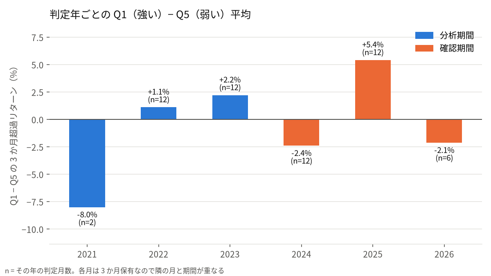
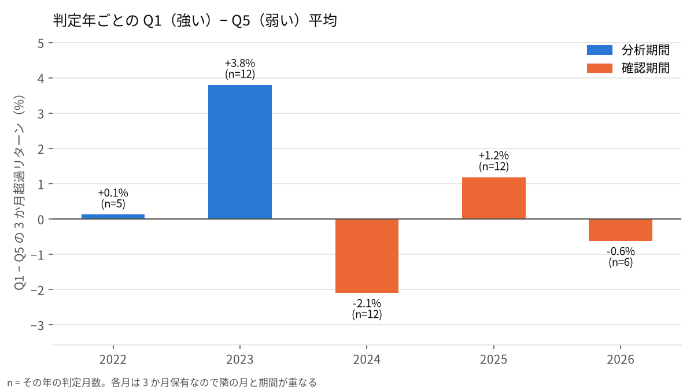

# 対 TOPIX モメンタム

過去の対 TOPIX 超過リターンで 5 分位に分けると、その後 3 か月の超過リターンに差が出るか。

**結論（2026-10-02）: 予測力は確認できない。** 3 か月モメンタムは Q1−Q5 が +0.85%（Newey-West t 0.73）。12-1 モメンタムは分析期間で +2.72%（t 1.71）だったが、確認期間で −0.48% に反転した。

## データ

- 本番コピーの `stock.db`。日足 2021-08-25〜2026-10-01（1,247 営業日）
- TOPIX は `topix` テーブル（欠けなし）。1306 での代用はしていない
- 上場廃止銘柄を含む（現マスタに無いコード 567 件、廃止日まで株価あり）。短信があり REIT でないものを普通株として採用。保有中の廃止は最終終値で現金化扱い
- 価格は `close × adj_factor` から自前で遡及調整。DB の `adj_close` は 2026-08-28 効力の分割 5 件が未反映だった。自前調整で残る飛びは 1447（2026-09-11、J-Quants の係数）の 1 件だけ

## 定義

- 判定日: 毎月末の最終営業日
- 形成期間: 判定日の N か月前 → M か月前の超過リターン（3 か月モメンタムは N=3, M=0、12-1 は N=12, M=1）
- 保有期間: 判定日の終値 → 3 か月後の月末終値の超過リターン
- 判定日までの 20 営業日平均売買代金 ≥ 1 億円（約 1,550 銘柄）
- 判定日ごとに形成期間で 5 分位。Q1 = 強い、Q5 = 弱い。等ウェイト
- 保有が 3 か月重なるので t 値は Newey-West（lag 2）を主に見る
- 分析期間: 判定日 2023-12 まで / 確認期間: 2024-01 以降

## 結果: 3 か月モメンタム

| 分位 | 全期間 2021-11〜2026-06 | 分析期間 | 確認期間 |
|---|---|---|---|
| Q1（強い） | −1.28% | −1.73% | −0.88% |
| Q2 | −0.04% | −0.51% | +0.37% |
| Q3 | −0.56% | −0.54% | −0.58% |
| Q4 | −0.84% | −0.73% | −0.94% |
| Q5（弱い） | −2.13% | −2.65% | −1.67% |

| Q1 − Q5 | 全期間 | 分析期間 | 確認期間 |
|---|---|---|---|
| 判定月数 | 56 | 26 | 30 |
| 平均 | +0.85% | +0.92% | +0.78% |
| t（Newey-West） | +0.73 | +1.01 | +0.39 |
| プラスの月 | 52% | 58% | 47% |

売買代金の下限を 3,000 万円 / 3 億円にしても Q1−Q5 は +1.2% 前後、t 0.9〜1.2 で変わらない。



## 結果: 12-1 モメンタム

| Q1 − Q5 | 全期間 2022-08〜2026-06 | 分析期間 | 確認期間 |
|---|---|---|---|
| 判定月数 | 47 | 17 | 30 |
| 平均 | +0.68% | +2.72% | −0.48% |
| t（Newey-West） | +0.55 | +1.71 | −0.30 |
| プラスの月 | 47% | 59% | 40% |



## 読み方の注意

- 全分位が TOPIX に負けているのは、等ウェイト（中小型寄り）と時価総額加重の差。期間中は大型株優位だった
- Q1 − Q5 のプラスは Q5 の負けによるもの。Q1 を買って TOPIX を売る形では負ける
- Q1 銘柄の次の 3 か月: 上位 20% に残る 23%、下位 20% に転落 29%。向きより値動きの大きさが続く
- 約 5 年分なので検出力が低い。今のばらつきだと t 2 に届くのは、5 年で差 2.3%、10 年で 1.6% 以上
- 未対応: ベータ調整、規模の中立化、売買コスト

## 実行

```
.venv/bin/python -m pip install -r analyzer/requirements.txt
.venv/bin/python analyzer/momentum/backtest.py --db stock.db --out /tmp/momentum
.venv/bin/python analyzer/momentum/backtest.py --db stock.db --form-months 12 --skip-months 1 --out /tmp/momentum_12_1
```

`--min-turnover`（円、既定 1e8）と `--split`（確認期間の開始、既定 2024-01-01）も変えられる。出力は `report.md`、`spread_by_year.png`、`monthly_quintiles.csv`、`panel.csv`。
