# ジョブ設計

**このファイルと `docs/jobs/gen/` は自動生成。手で直さない。** 作り直しは `python -m tools.jobs.render`。

- 起動時刻は `deploy/crontab`、引数は各ジョブの `add_argument`、読み書きする表は `docs/dataflow/entries.json`（`python -m pytest tests --dataflow=write` が作る）から拾う
- 読み書きする表はテストが通った道だけなので下限。読み方は [DATA_FLOW.md](DATA_FLOW.md)
- ジョブは `jobs/` のうち `__main__` を持つファイル。機能は `jobs/<機能>/` のフォルダ
- 時刻は Asia/Tokyo。所要時間は載せない（cron からは分からない）

## 機能ごとのページ

ジョブごとの引数・読み書きする表と、ジョブ間の依存図。

| 機能 | cron のジョブ | cron に無いジョブ |
|---|---|---|
| [株価・決算](jobs/gen/market.md) | `briefing_offsite`, `homepage_briefing`, `intraday_1m`, `pts_snapshot`, `run_batch`, `tanshin_covers`, `tdnet_briefing_r2` | `briefing_extract`, `check_demo`, `homepages` |
| [月次](jobs/gen/monthly.md) | `ir_monthly_html_ingest`, `ir_monthly_html_r2`, `ir_monthly_json_ingest`, `ir_monthly_r2`, `ir_monthly_xls_ingest`, `tdnet_monthly_pdf_ingest`, `tdnet_monthly_pdf_sidecar`, `tdnet_monthly_r2` | `monthly_names` |
| [XBRL・決算書類](jobs/gen/xbrl.md) | `tdnet_xbrl_r2`, `xbrl_normalize`, `xbrl_parse`, `xbrl_statements` | `xbrl_presentation` |
| [EDINET・大量保有](jobs/gen/edinet.md) | `edinet_archive`, `edinet_buybacks`, `edinet_codes`, `edinet_documents`, `edinet_large_holdings`, `edinet_tender_offers`, `edinet_xbrl` | `edinet_shareholders` |
| [サプライ](jobs/gen/supply.md) | `material_stats` |  |
| [共通・運用](jobs/gen/common.md) | `fx_rates`, `backup_data`, `backup_db`, `vps_packages_r2` | `golden_db`, `migrate`, `migrate_r2_share`, `rebuild_daily_prices` |

## 1 日の時刻表

ひし形は 1 回の起動。帯はその間に毎時くり返し起動する（何分かは名前に出す）。帯の長さは所要時間ではない。「続き n/m」は crontab の 1 行に並べて順に走らせるジョブの n 番目。

```mermaid
gantt
  title 1 日の起動時刻（Asia/Tokyo）
  dateFormat HH:mm
  axisFormat %H:%M
  todayMarker off
  section 株価・決算
  pts_snapshot 火〜土曜 :milestone, 00:00, 0m
  briefing_offsite :milestone, 01:40, 0m
  tanshin_covers 毎時 00 分 続き 5/7 :12:00, 23:00
  tdnet_briefing_r2 毎時 00 分 続き 6/7 :12:00, 23:00
  homepage_briefing 毎時 00 分 続き 7/7 :12:00, 23:00
  pts_snapshot 平日 :milestone, 15:30, 0m
  pts_snapshot 平日 毎時 00・30 分 :16:00, 23:30
  run_batch :milestone, 19:30, 0m
  intraday_1m 平日 :milestone, 20:30, 0m
  tdnet_briefing_r2 :milestone, 22:10, 0m
  homepage_briefing 日曜 :milestone, 22:25, 0m
  tanshin_covers :milestone, 23:35, 0m
  section 月次
  ir_monthly_r2 :milestone, 10:00, 0m
  ir_monthly_html_r2 :milestone, 10:20, 0m
  ir_monthly_html_ingest :milestone, 10:30, 0m
  ir_monthly_json_ingest :milestone, 10:30, 0m
  ir_monthly_xls_ingest :milestone, 10:40, 0m
  ir_monthly_r2 :milestone, 16:00, 0m
  ir_monthly_html_r2 :milestone, 16:20, 0m
  ir_monthly_html_ingest :milestone, 16:30, 0m
  ir_monthly_json_ingest :milestone, 16:30, 0m
  ir_monthly_xls_ingest :milestone, 16:40, 0m
  tdnet_monthly_r2 :milestone, 18:00, 0m
  tdnet_monthly_pdf_sidecar :milestone, 18:20, 0m
  tdnet_monthly_pdf_ingest :milestone, 18:30, 0m
  tdnet_monthly_r2 :milestone, 21:00, 0m
  tdnet_monthly_pdf_sidecar :milestone, 21:20, 0m
  tdnet_monthly_pdf_ingest :milestone, 21:30, 0m
  section XBRL・決算書類
  tdnet_xbrl_r2 毎時 00 分 続き 1/7 :12:00, 23:00
  xbrl_parse 毎時 00 分 続き 2/7 :12:00, 23:00
  xbrl_normalize 毎時 00 分 続き 3/7 :12:00, 23:00
  xbrl_statements 毎時 00 分 続き 4/7 :12:00, 23:00
  section EDINET・大量保有
  edinet_archive 毎時 15 分 :00:15, 06:15
  edinet_codes :milestone, 07:30, 0m
  edinet_documents 毎時 40 分 :08:40, 23:40
  edinet_xbrl 毎時 50 分 :08:50, 23:50
  edinet_large_holdings 毎時 05 分 :09:05, 23:05
  edinet_tender_offers 毎時 20 分 :09:20, 23:20
  edinet_buybacks 毎時 25 分 :09:25, 23:25
  section サプライ
  material_stats 月曜 :milestone, 07:10, 0m
  material_stats :milestone, 07:15, 0m
  material_stats :milestone, 07:45, 0m
  section 共通・運用
  backup_data :milestone, 03:30, 0m
  backup_db :milestone, 05:00, 0m
  vps_packages_r2 :milestone, 06:40, 0m
  fx_rates :milestone, 08:00, 0m
```

## cron のジョブ

| ジョブ | 機能 | 起動 | 引数 | 書く | 読むだけ |
|---|---|---|---|---|---|
| `market/briefing_offsite` | 株価・決算 | 毎日 01:40 |  | `briefing_documents` |  |
| `market/homepage_briefing` | 株価・決算 | 日曜 22:25 | `--years 5 --ledger /var/log/app/homepage_briefing_ledger.json` | `briefing_documents` | `tanshin_covers` |
| `market/homepage_briefing` | 株価・決算 | 毎日 12〜23 時の毎時 00 分 | `--years 5 --pending 7 --ledger /var/log/app/homepage_briefing_ledger.json` | `briefing_documents` | `tanshin_covers` |
| `market/intraday_1m` | 株価・決算 | 平日 20:30 |  |  |  |
| `market/pts_snapshot` | 株価・決算 | 火〜土曜 00:00 平日 15:30 平日 16〜23 時の毎時 00・30 分 |  | `pts_snapshots` |  |
| `market/run_batch` | 株価・決算 | 毎日 19:30 |  | `daily_prices`, `earnings_date_fetches`, `earnings_date_pubs`, `earnings_events`, `indicators`, `statements`, `stocks`, `topix` |  |
| `market/tanshin_covers` | 株価・決算 | 毎日 12〜23 時の毎時 00 分 | `--days 1` | `tanshin_covers` | `stocks`, `tdnet_pdf_documents`, `xbrl_documents`, `xbrl_filings` |
| `market/tanshin_covers` | 株価・決算 | 毎日 23:35 | `--days 3` | `tanshin_covers` | `stocks`, `tdnet_pdf_documents`, `xbrl_documents`, `xbrl_filings` |
| `market/tdnet_briefing_r2` | 株価・決算 | 毎日 12〜23 時の毎時 00 分 | `1` | `briefing_documents` |  |
| `market/tdnet_briefing_r2` | 株価・決算 | 毎日 22:10 | `7` | `briefing_documents` |  |
| `monthly/ir_monthly_html_ingest` | 月次 | 毎日 10:30 毎日 16:30 | `--ledger /var/log/app/html_ingest_ledger.json` | `monthly_element_sources`, `monthly_elements`, `monthly_issuers`, `monthly_tables`, `monthly_values` | `statements`, `stocks` |
| `monthly/ir_monthly_html_r2` | 月次 | 毎日 10:20 毎日 16:20 |  |  | `stocks` |
| `monthly/ir_monthly_json_ingest` | 月次 | 毎日 10:30 毎日 16:30 |  | `monthly_element_sources`, `monthly_elements`, `monthly_issuers`, `monthly_tables`, `monthly_values` | `statements`, `stocks` |
| `monthly/ir_monthly_r2` | 月次 | 毎日 10:00 毎日 16:00 |  |  | `stocks` |
| `monthly/ir_monthly_xls_ingest` | 月次 | 毎日 10:40 毎日 16:40 | `--all --post` | `monthly_element_sources`, `monthly_elements`, `monthly_issuers`, `monthly_tables`, `monthly_values` | `statements`, `stocks` |
| `monthly/tdnet_monthly_pdf_ingest` | 月次 | 毎日 18:30 毎日 21:30 | `--ledger /var/log/app/pdf_ingest_ledger.json` | `monthly_element_sources`, `monthly_elements`, `monthly_issuers`, `monthly_tables`, `monthly_values` | `statements`, `stocks` |
| `monthly/tdnet_monthly_pdf_sidecar` | 月次 | 毎日 18:20 毎日 21:20 |  |  | `monthly_elements`, `monthly_tables`, `monthly_values` |
| `monthly/tdnet_monthly_r2` | 月次 | 毎日 18:00 毎日 21:00 | `7` |  | `stocks` |
| `xbrl/tdnet_xbrl_r2` | XBRL・決算書類 | 毎日 12〜23 時の毎時 00 分 | `2` |  | `stocks` |
| `xbrl/xbrl_normalize` | XBRL・決算書類 | 毎日 12〜23 時の毎時 00 分 |  | `xbrl_element_mappings`, `xbrl_financials`, `xbrl_job_runs`, `xbrl_major_shareholders`, `xbrl_segments`, `xbrl_shareholder_filings`, `xbrl_shareholding_by_category`, `xbrl_std_items` | `edinet_documents`, `xbrl_contexts`, `xbrl_elements`, `xbrl_facts`, `xbrl_filings` |
| `xbrl/xbrl_parse` | XBRL・決算書類 | 毎日 12〜23 時の毎時 00 分 |  | `xbrl_contexts`, `xbrl_documents`, `xbrl_element_mappings`, `xbrl_elements`, `xbrl_facts`, `xbrl_filings`, `xbrl_financials`, `xbrl_job_runs`, `xbrl_major_shareholders`, `xbrl_pdf_matches`, `xbrl_presentation_roles`, `xbrl_segments`, `xbrl_shareholder_filings`, `xbrl_shareholding_by_category`, `xbrl_std_items` | `statements`, `stocks`, `tdnet_pdf_documents` |
| `xbrl/xbrl_statements` | XBRL・決算書類 | 毎日 12〜23 時の毎時 00 分 |  | `statements` | `xbrl_filings`, `xbrl_financials`, `xbrl_std_items` |
| `edinet/edinet_archive` | EDINET・大量保有 | 毎日 0〜6 時の毎時 15 分 | `--limit 1000` | `edinet_archives` | `edinet_buybacks`, `edinet_documents`, `edinet_tender_offer_docs`, `large_holding_reports`, `xbrl_filings` |
| `edinet/edinet_buybacks` | EDINET・大量保有 | 毎日 9〜23 時の毎時 25 分 | `--limit 500` | `edinet_archives`, `edinet_buyback_resolutions`, `edinet_buybacks` | `edinet_documents`, `edinet_filers`, `stocks` |
| `edinet/edinet_codes` | EDINET・大量保有 | 毎日 07:30 |  | `edinet_documents`, `edinet_filers`, `stocks` |  |
| `edinet/edinet_documents` | EDINET・大量保有 | 毎日 8〜23 時の毎時 40 分 |  | `edinet_documents`, `edinet_list_days` | `edinet_filers`, `stocks` |
| `edinet/edinet_large_holdings` | EDINET・大量保有 | 毎日 9〜23 時の毎時 05 分 | `--limit 1000` | `edinet_archives`, `large_holding_reports`, `large_holdings` | `edinet_documents`, `edinet_filers`, `stocks` |
| `edinet/edinet_tender_offers` | EDINET・大量保有 | 毎日 9〜23 時の毎時 20 分 | `--limit 100` | `edinet_archives`, `edinet_tender_offer_docs`, `edinet_tender_offers` | `edinet_documents`, `edinet_filers`, `stocks` |
| `edinet/edinet_xbrl` | EDINET・大量保有 | 毎日 8〜23 時の毎時 50 分 | `--limit 300` | `edinet_archives`, `xbrl_contexts`, `xbrl_elements`, `xbrl_facts`, `xbrl_filings`, `xbrl_financials`, `xbrl_job_runs`, `xbrl_major_shareholders`, `xbrl_pdf_matches`, `xbrl_presentation_roles`, `xbrl_segments`, `xbrl_shareholder_filings`, `xbrl_shareholding_by_category` | `edinet_documents`, `stocks`, `xbrl_element_mappings`, `xbrl_std_items` |
| `supply/material_stats` | サプライ | 月曜 07:10 | `--source estat` | `material_monthly`, `material_trade_country` |  |
| `supply/material_stats` | サプライ | 毎日 07:15 | `--source meti --only seidou --ledger /var/log/app/material_stats_ledger.json` | `material_monthly`, `material_trade_country` |  |
| `supply/material_stats` | サプライ | 毎日 07:45 | `--source meti --only sekiyu --ledger /var/log/app/material_stats_ledger.json` | `material_monthly`, `material_trade_country` |  |
| `fx_rates` | 共通・運用 | 毎日 08:00 |  | `fx_rates` |  |
| `ops/backup_data` | 共通・運用 | 毎日 03:30 |  |  |  |
| `ops/backup_db` | 共通・運用 | 毎日 05:00 |  |  |  |
| `ops/vps_packages_r2` | 共通・運用 | 毎日 06:40 |  |  |  |

## cron に無いジョブ

手で流すか、GitHub Actions から流す。

| ジョブ | 機能 | Actions | 書く | 読むだけ |
|---|---|---|---|---|
| `market/briefing_extract` | 株価・決算 |  | `briefing_extracts`, `briefing_facts`, `briefing_pages` | `briefing_documents` |
| `market/check_demo` | 株価・決算 |  |  | `statements`, `stocks` |
| `market/homepages` | 株価・決算 |  | `homepages` | `statements`, `tdnet_pdf_documents`, `xbrl_elements`, `xbrl_facts`, `xbrl_filings` |
| `monthly/monthly_names` | 月次 | `monthly-names.yml` | `monthly_element_sources`, `monthly_elements`, `monthly_values` |  |
| `xbrl/xbrl_presentation` | XBRL・決算書類 |  | `edinet_archives`, `xbrl_filings`, `xbrl_presentation_roles` | `edinet_documents` |
| `edinet/edinet_shareholders` | EDINET・大量保有 |  | `xbrl_major_shareholders`, `xbrl_shareholder_filings`, `xbrl_shareholding_by_category` | `edinet_documents`, `xbrl_contexts`, `xbrl_elements`, `xbrl_facts`, `xbrl_filings` |
| `golden_db` | 共通・運用 |  | `daily_prices`, `earnings_date_fetches`, `earnings_date_pubs`, `earnings_events`, `fx_rates`, `indicators`, `material_monthly`, `material_trade_country`, `monthly_element_sources`, `monthly_elements`, `monthly_issuers`, `monthly_tables`, `monthly_values`, `statements`, `stocks`, `topix` |  |
| `migrate` | 共通・運用 |  | `monthly_element_sources`, `monthly_elements`, `monthly_issuers`, `monthly_tables`, `monthly_values`, `xbrl_elements`, `xbrl_financials` | `stocks` |
| `ops/migrate_r2_share` | 共通・運用 |  |  |  |
| `ops/rebuild_daily_prices` | 共通・運用 |  | `daily_prices` |  |
