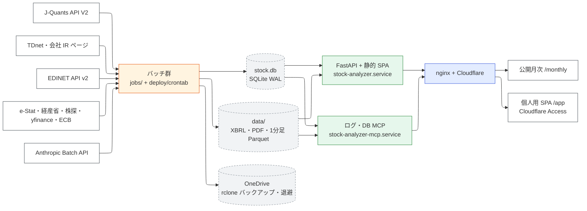

# 全体像

日本株の株価・決算・適時開示・EDINET 書類・月次 KPI・素材統計を 1 台の VPS 上に集約し、ブラウザと MCP から参照する個人用の株式分析ツールである。

詳細な仕様は機能と観点ごとに別ページで管理する。

| 知りたいこと | 参照先 |
|---|---|
| 画面一覧・各画面が呼ぶ API | [画面設計](SCREENS.md)、タブ別仕様は [画面仕様の共通規則](screen/SPEC.md)、API の共通規約は [API 仕様](screen/api.md) |
| テーブル・列・索引・ER 図 | [データモデル](SCHEMA.md)、行の状態遷移は [状態の遷移](schema/states.md) |
| バッチの起動時刻・引数・依存関係 | [ジョブ設計](JOBS.md)、取込規則は [株価・決算](jobs/market.md)・[月次](jobs/monthly.md)・[サプライ](jobs/supply.md)・[XBRL](jobs/xbrl.md)・[EDINET](jobs/edinet.md)・[共通](jobs/common.md) |
| ジョブと API が読み書きするテーブル | [データの流れ](DATA_FLOW.md) |
| コードの import 依存と VPS 構成 | [モジュールの依存](overview/modules.md)・[システム構成](overview/system.md) |
| ローカル実行手順・VPS 運用手順 | [README.md](../README.md)・[deploy/README.md](../deploy/README.md)・[AGENTS.md](../AGENTS.md) |

## システム構成

外部データ源からの取込、保存先、配信経路の全体構成を下図に示す。コードの import から生成した依存図は [モジュールの依存](overview/modules.md)、`deploy/` から生成したユニットと nginx の構成図は [システム構成](overview/system.md) にある。



アプリケーションは以下の 5 層で構成する。

| 層 | 実装と配置 |
|---|---|
| バックエンド | Python 3.10+、FastAPI、SQLAlchemy 2、pandas で実装する。共通処理は `app/` 直下、ドメイン別の処理は `app/market/`・`app/monthly/`・`app/supply/`・`app/xbrl/`・`app/edinet/`、REST API は `app/api/` に置く |
| フロントエンド | `static/index.html`、`static/css/`、`static/js/` の vanilla JS で単一ページアプリを構成する。チャート描画には `static/vendor/` から配信する `lightweight-charts` を使う |
| データストア | 構造化データはローカルの SQLite（`stock.db`）に保存する。XBRL の原本 ZIP、月次・説明資料 PDF、1 分足 Parquet などのファイルは `data/` 配下に保存する |
| バッチ | `jobs/` 配下のスクリプトを `deploy/crontab`（`deploy/cron-run.sh` 経由）で定期実行する。過去分の手動バックフィルや検証用の補助スクリプトは `tools/` に置く |
| MCP | `mcp/log_mcp.py` が本番の稼働ログと読み取り専用の `stock.db` 参照・月次編集 API を別プロセスで提供する |

外部データは用途ごとに取得元を分ける。

| 取得元 | 取り込むデータ | 主な実装 |
|---|---|---|
| J-Quants API V2（Light） | 上場銘柄マスタ、日足四本値、TOPIX、財務サマリ、決算発表予定 | `app/market/jquants.py`, `jobs/market/run_batch.py` |
| TDnet | 決算短信 XBRL・原文 HTML、月次 PDF、決算説明資料 PDF | `jobs/xbrl/tdnet_xbrl_r2.py`, `jobs/monthly/tdnet_monthly_r2.py`, `jobs/market/tdnet_briefing_r2.py` |
| EDINET API v2 | 提出者コード、有報・半期報・四半期報の財務3表とセグメント・大株主、大量保有報告書、公開買付け、自己株券買付状況報告書 | `jobs/edinet/` |
| 会社の IR ページ・eir-parts | 月次 KPI の HTML・Excel・JSON、決算説明資料 PDF | `jobs/monthly/ir_monthly_*.py`, `jobs/market/homepage_briefing.py` |
| IR BANK（HTTP） | TDnet の掲載期間を過ぎた過去の決算短信 PDF と決算説明資料 PDF（手動バックフィル。短信 PDF の取り直しだけ KAB-572 の間 cron） | `jobs/xbrl/tdnet_pdf_ingest.py`, `tools/briefing/irbank_ingest.py` |
| Anthropic Message Batches API | 決算説明資料 PDF からの数値表と要約の抽出 | `jobs/market/briefing_extract.py` |
| e-Stat・経済産業省 | 生産動態統計、石油統計、貿易統計 | `jobs/supply/material_stats.py` |
| 株探・Yahoo Finance・Frankfurter（ECB） | 夜間 PTS ランキング、1 分足（直近 7 日）、EUR 基準の為替レート | `jobs/market/pts_snapshot.py`, `jobs/market/intraday_1m.py`, `jobs/fx_rates.py` |

## J-Quants V2 の取込方針

J-Quants API は V2（`https://api.jquants.com/v2`、`x-api-key` ヘッダー認証）の Light プランを使う。エンドポイント仕様やプラン別の取得可能期間は J-Quants の MCP を正本とし、ここには本ツールの実装方針だけを書く。

| 項目 | 実装方針 |
|---|---|
| 日付単位の一括取得 | `app/market/ingest.py` は `date` を指定し、全上場銘柄の 1 日分の株価・財務サマリを 1 リクエストずつ取得する。銘柄ごとのループは行わない。日次バッチ（`jobs/market/run_batch.py`）は銘柄マスタ、当日株価、当日 TOPIX、当日財務サマリ、前営業日財務サマリ、決算発表予定（2 リクエスト）の計 7 リクエストで定常動作する |
| 調整後株価の DB 内再計算 | 日付指定の差分取込では、分割・併合・ライツイシュー（`adj_factor != 1`）が発生した銘柄の過去行が古い調整値のまま残る。API で過去分を取り直すと契約プランの取得期間より前の日足が失われるため、`app/market/adjust.py` が DB 内の調整前四本値・出来高と `adj_factor` から調整後の値を再計算する。ライツイシュー（`ex_rt = '3'`）の係数は出来高の調整に使わない |
| レート制限と自動再試行 | `app/market/jquants.py` は `/fins/` 系とそれ以外のエンドポイントで独立したスライディングウィンドウ（既定は各 60 リクエスト/分、`app/config.py`）を持ち、自主規制する。レスポンスに `pagination_key` がある限り次ページを自動で取得する。HTTP 429 は 5 秒から最大 60 秒までの指数バックオフで最大 6 回、HTTP 500・502・503・504 は 1 秒から最大 30 秒までの指数バックオフで最大 6 回再試行する |

## 分析ロジック

日足のテクニカル指標、RS ランク、ステージ判定、決算後パフォーマンスは `app/market/analytics.py` で一括計算する。閾値と期間定数はすべて `app/config.py` の `STAGE_PARAMS` と `EARNINGS_PARAMS` で定義する。

### レラティブストレングス（RS）

調整後終値 `C`（`adj_close`）と 63・126・189・252 営業日前の調整後終値から、直近四半期を 2 倍に重み付けした素点 `rs_raw` を計算する。

```text
rs_raw = ((C - C63) / C63 * 0.4 + (C - C126) / C126 * 0.2 + (C - C189) / C189 * 0.2 + (C - C252) / C252 * 0.2) * 100
```

営業日ごとにユニバース内のパーセンタイル順位を求め、上位 1% を `99`、下位 1% を `1` とする `1`〜`99` の整数ランク `rs_rank` を割り当てる。

商品区分による対象範囲は以下のとおりに分ける。

| 機能 | 対象とする `stocks.product_category` | 定数名 |
|---|---|---|
| RS ランク・ステージ判定・スクリーナー | `'011'`（内国株券）のみ。ETF・REIT・優先出資・外国株は除く | `RS_PRODUCT_CATEGORIES` |
| 銘柄検索（`/api/stocks/search`）・大量保有 | `'011'`（内国株券）と `'021'`（外国株券） | `STOCK_PRODUCT_CATEGORIES` |
| 決算速報・決算発表予定の除外対象 | `'013'`（内国 REIT）と `'022'`（外国 REIT）を除外 | `EARNINGS_EXCLUDE_PRODUCT_CATEGORIES` |

`stocks.product_category` が 1 件も入っていない DB では、RS ランク・銘柄検索ともに全銘柄を対象にフォールバックする。`compute_indicators` は計算結果のうち直近 400 営業日分（`keep_days = 400`）を `indicators` テーブルに保持する。

### ミネルヴィニのステージ判定

ミネルヴィニのトレンドテンプレートに基づき、各営業日の銘柄を `Stage 2 → Stage 4 → Stage 3 → Stage 1` の優先順で分類する。いずれの条件も満たさない日は未分類（`stage = NULL`）とする。`Stage 3` を `Stage 1` より先に判定するのは、上昇局面を終えた天井圏で 200 日移動平均線に沿って横ばいになった銘柄を、底固め（`Stage 1`）と誤判定しないためである。

判定に使う指標の定義は以下のとおりである。

| 記号・列名 | 定義 |
|---|---|
| `C` | 調整後終値（`adj_close`） |
| `MA50`・`MA150`・`MA200` | `C` の 50・150・200 営業日単純移動平均 |
| `ma200_slope_1m` | 200 日移動平均線の 21 営業日変化率（`MA200 / 21営業日前のMA200 - 1`） |
| `high_52w`・`low_52w` | 直近 252 営業日（最低 60 営業日）における `C` の最大値と最小値 |

各ステージの成立条件を優先順に示す。

| 優先順 | ステージ | 成立条件（すべて満たすときに成立） |
|---|---|---|
| 1 | Stage 2（上昇） | `C > MA50` かつ `MA50 > MA150 > MA200`、`MA200` が直近 21 営業日連続で前日比プラス、`C >= low_52w * 1.30`、`C >= high_52w * 0.75`、`rs_rank >= 70` |
| 2 | Stage 4（下降） | `C < MA200`、`ma200_slope_1m < -0.005`（21 営業日で -0.5% 未満）、`C <= low_52w * 1.10` |
| 3 | Stage 3（天井圏） | 直近 120 営業日以内に `Stage 2` の日があること、`MA200` が失速していること（`|ma200_slope_1m| < 0.005`、または `ma200_slope_1m > 0` でも直近 120 営業日最大値の半分以下）、かつ下の警戒サインのいずれか 1 つを満たすこと |
| 4 | Stage 1（底固め） | `|ma200_slope_1m| < 0.005`（21 営業日で ±0.5% 未満）、かつ直近 60 営業日のうち 70% 以上で `C` が `MA200 ± 8%` 以内に収まること |

`Stage 3` の警戒サインは次の 2 条件の論理和（OR）で判定し、出来高を伴わずに値幅だけ荒くなった銘柄も拾う。

| 警戒サイン | 判定条件 |
|---|---|
| 値動きの拡大 | 調整後の高値・安値・前日終値から求めた True Range の 20 営業日平均を `C` で割った比率が、その前の 20 営業日の値より大きい |
| 大商いの下落 | 直近 20 営業日以内に、前日までの 50 日平均出来高（`avg_volume_50`）の 1.5 倍以上の出来高で前日終値を下回った日がある |

### 決算日からの相対パフォーマンス

`compute_earnings_events` は、決算発表後に市場で実際に買える最初の調整後価格を基準値（`base_price`）とし、各期間の株価リターンと対 TOPIX 超過リターン（`株価リターン - TOPIXリターン`）を `earnings_events` テーブルに保存する。発表前の始値やストップ高で張り付いた買えない価格は基準値に使わない。

東証の大引け時刻は `2024-11-05` 以降を `15:30`、それ以前を `15:00` とする（`EARNINGS_PARAMS`）。発表時刻に応じた基準日（`base_date`）と基準値の選び方は以下のとおりである。

| 発表タイミングと当日の値動き | 基準日と基準値 | TOPIX の基準値 |
|---|---|---|
| 大引け以降の発表、または発表時刻（`disclosed_time`）が空の開示 | 翌営業日の調整後始値（`adj_open`） | 基準日の始値（欠損時は終値） |
| 大引けより前（場中）の発表で、当日が通常の引け | 発表当日の調整後終値（`adj_close`） | 発表当日の終値 |
| 場中の発表だが、発表当日がストップ高引けまたは寄らずのストップ高・ストップ安 | 翌営業日の調整後始値（`adj_open`） | 基準日の始値（欠損時は終値） |
| 始値で測る基準日が寄らずのストップ高・ストップ安 | 値が付いた最初の営業日まで基準日を先送りし、その日の調整後始値（`adj_open`） | 先送り後の基準日の始値（欠損時は終値） |

ストップ高引けと寄らずのストップ高・ストップ安は以下の条件で判定する。比例配分の約定のみが入った日も、寄った直後に張り付いて四本値が同値になった日も、日足では区別できないため同様に先送りする。

| 状態 | フラグがある行 | `upper_limit`・`lower_limit` が NULL の過去行（`app/market/price_limit.py`） |
|---|---|---|
| ストップ高引け | `close == high` かつ `upper_limit == 1` | `close == high`、かつ分割補正後の前日終値から東証の制限値幅の 99% 以上上昇 |
| 寄らずのストップ高・ストップ安 | `open == high == low == close`、かつ `upper_limit == 1` または `lower_limit == 1` | `open == high == low == close`、かつ分割補正後の前日終値から東証の制限値幅の 99% 以上変動 |

基準値から測る保有期間は以下の 3 種類である。

| 期間列 | 終点の定義 | 主な表示画面 |
|---|---|---|
| `return_1d`・`5d`・`20d`・`60d`（および `alpha_*`） | 始値基準なら `base_date` 当日を 1 営業日目、終値基準なら翌営業日を 1 営業日目として N 営業日目の終値 | 銘柄タブ（株価） |
| `return_to_date`・`alpha_to_date` | DB に入っている最新営業日の終値 | 銘柄タブ（株価） |
| `return_to_next`・`alpha_to_next` | 同じ銘柄で `disclosed_date` より後に出た最初の決算短信本体（1 期につき最初の開示のみ。訂正と予想修正のみの開示は除く）の発表日の前営業日終値。次の決算が未発表なら最新営業日の終値 | ランキングタブ（決算後パフォーマンス） |

株価チャート下のイベント切り替え（既定オフ）を有効にすると、決算発表日に「決」マーカーを表示する（`static/js/chart-core.js`）。週足・月足・年足では発表日を含む足（期間の最終営業日）にマーカーを載せ、決算速報タブのチャートでは選択中の発表日のみ設定にかかわらず表示する。

## ホスティングと SQLite 運用

本番環境は ConoHa VPS（Ubuntu）1 台とローカルディスク上の SQLite（`stock.db`）で運用する。マネージド RDB の小規模プランには複数年分の全銘柄日足と XBRL ファクトが収まらず、バッチ大量書き込み時のネットワーク往復も重くなるため、アプリとバッチが同じ SSD 上の `stock.db` と `data/` を直接読み書きする構成を採る。SQLAlchemy を使っているため、`DATABASE_URL` を差し替えれば外部 RDB にも接続できる。

本番 VPS の役割分担は以下のとおりである。ユニット・nginx・cron の正確な定義は [システム構成](overview/system.md) と [deploy/README.md](../deploy/README.md) にある。

| 役割 | 構成 |
|---|---|
| リバースプロキシ・認証 | nginx + Let's Encrypt。月次閲覧（`/monthly` と公開 GET API）は認証なしで公開し、個人用ツール（`/app` と書き込み API）は Cloudflare Access で保護する。`static/` は nginx が直接配信し、`monthly_row_order.json` と `ir_monthly_codes.json` のみ uvicorn が返す |
| アプリサーバー | `stock-analyzer.service`（uvicorn）。起動時に `deploy/uvicorn_workers.py` が CPU コア数と空きメモリからワーカー数を決め、最大 2 ワーカーで頭打ちにする（`UVICORN_WORKERS` で上書き可） |
| MCP サーバー | `stock-analyzer-mcp.service`（`mcp/log_mcp.py`）。Bearer トークン認証で稼働ログと DB 照会・月次取り込み API を提供する |
| 定期バッチ | `deploy/crontab` が `deploy/cron-run.sh` 経由で 31 本のジョブを起動する。全ジョブの時刻表は [ジョブ設計](JOBS.md) にある |
| バックアップ・退避 | `jobs/ops/backup_db.py` が日次・週次の `stock.db` ダンプを OneDrive へ送り、転送確認後に VPS 上の一時 gzip を削除する（詳細は [バックアップ設計](DESIGN_backup.md)）。`jobs/ops/backup_data.py` と `jobs/market/briefing_offsite.py` が `data/` 配下の原本を OneDrive へコピー・退避する |
| CI/CD | `main` マージ時に GitHub Actions が `deploy/update.sh` を実行し、`provision.sh`、`pip install`、`jobs/migrate.py`、サービス再起動とヘルスチェックを冪等に行う。`stock.db` の中身はパイプラインから変更しない |

Web ワーカーと 30 本超の cron ジョブが同じ `stock.db` を共有するため、`app/db.py` と各ジョブで以下のロック回避策を入れる。

| 箇所 | SQLite のロック回避・スキーマ追随の仕組み |
|---|---|
| 接続設定（`app/db.py`） | 全接続で `PRAGMA journal_mode=WAL`、`busy_timeout=30000`（30 秒）、`synchronous=NORMAL` を設定する。ファイル SQLite には接続をプールに残さない `NullPool` を使う |
| 指標の差分更新（`app/market/analytics.py`） | `sync_indicators` は既存行と値が異なる行だけを抽出し、`WRITE_CHUNK_SIZE`（50,000 行）ごとに DELETE と UPSERT を commit してライターロックの保持時間を短くする |
| 書き込み API の再試行（`app/db.py`） | 月次編集などの短い書き込みは `run_sqlite_write` で包み、`database is locked` 発生時に rollback して最大 6 回（最大 2 秒間隔の指数バックオフ）再試行する |
| デプロイ時のマイグレーション（`jobs/migrate.py`） | uvicorn 起動前に `migrate.py` が `init_db(strict=True)`、不足列の `ALTER TABLE ADD COLUMN`、索引・トリガー・ビューの整備を 1 回だけ完了させ、複数ワーカーの同時 `CREATE INDEX` を防ぐ。バッチと重なってロックされた場合は最大 10 回（5〜60 秒間隔）再試行する |
| 読み取り専用接続（`app/db.py`） | `sqlite_readonly_engine` は URI の `mode=ro` で開き、PRAGMA による書き込みを発生させない |

## ゴールデンデータの DB

`./run.sh golden`（Windows は `.\run.ps1 golden`、実装は `jobs/golden_db.py`）は、`tests/golden/db/*.csv` から開発・テスト用の `stock.db` を API キーなしで数秒で構築する。クラウドエージェントの初期セットアップ（`.cursor/install.sh`）も、`stock.db` が無ければ既定でこのゴールデン DB を作る。全銘柄データが必要なときだけ `STOCK_DB=full` を指定してバックフィルする。

`tests/golden/db/`（件数と期間は `manifest.json`）に入れるデータの範囲は以下のとおりである。

| 区分 | 対象テーブル | 内容 |
|---|---|---|
| 銘柄を絞って収録 | `daily_prices`, `statements`, `earnings_date_pubs`, `earnings_events` | `tests/golden/db/codes.txt` に列挙した 44 銘柄分（Stage 2・RS 上位、時価総額上位、REIT 1 銘柄、月次の主要銘柄）の実データ |
| 全件または期間全体を収録 | `stocks`, `topix`, `earnings_date_fetches`, `monthly_issuers`, `monthly_tables`, `monthly_elements`, `monthly_values`, `fx_rates`, `material_monthly`, `material_trade_country` | 切り出し時点の全銘柄マスタ、株価と同期間の TOPIX・為替、公開 API から取得した月次データ一式、直近年の素材統計 |
| 投入後に再計算 | `indicators`, `earnings_events`, `monthly_element_sources` | CSV 投入後に `compute_indicators` と `compute_earnings_events` で再計算し、`monthly_element_sources` を `legacy` で埋める。`indicators` の CSV は持たず、`rs_rank` は 44 銘柄内の相対順位になる |
| 未収録 | `xbrl_*`, `edinet_*`, `large_holding_*`, `briefing_*`, `tdnet_pdf_*` | ゴールデン CSV には含めない |

構築した DB には `PRAGMA user_version = 1` を記録する。`.cursor/install.sh` はこの値を見てゴールデン DB を判別し、全銘柄の当日データが混ざらないよう日次バッチをスキップする。`stocks` に既に行がある DB に対しては上書きせずエラー終了する。

モデルのスキーマを変更したときは、バックフィル済みの `stock.db` と公開月次 API から以下のコマンドで CSV を作り直す。CSV の列とモデルの不整合は `tests/test_golden_db.py` が検出する。

```bash
python tools/golden/build_golden_db.py --db stock.db --api https://kabukpi.com
```

## 対象外

以下の項目は現時点では実装しない。

- 米国株など日本株以外の市場データの取込
- 信用残・空売り残の日次データの取込
- Stage 2 移行や業績予想修正の外部通知（LINE・メール）
- PostgreSQL などの外部 RDB を使った本番運用
