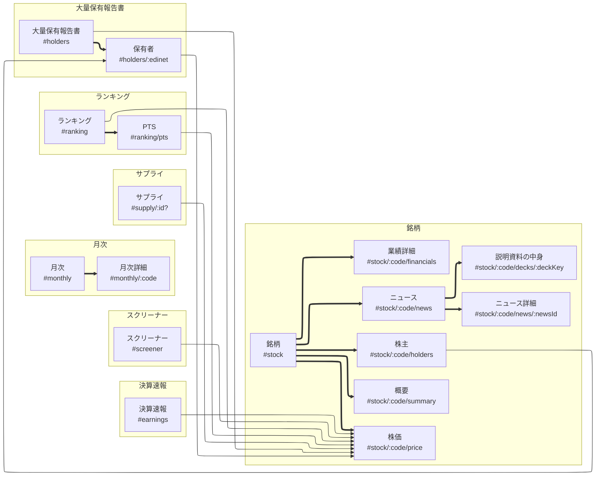

# 画面設計

- 画面と遷移は `static/js/screens.js` の `ROUTES` と `BREADCRUMBS`、画面が呼ぶ API は `static/js/*.js` の `/api/…` の文字列、API の引数は FastAPI の OpenAPI、読み書きする表は `docs/dataflow/entries.json` から拾う
- API の応答の形は載らない（ルートが応答の型を宣言していない）。形は各タブの手書きの画面仕様にある
- 読み書きする表はテストが通った道だけなので下限。読み方は [DATA_FLOW.md](DATA_FLOW.md)

## タブごとのページ

タブの画面、画面が呼ぶ API と表の図、API の引数。API は呼んでいる JS のファイル名の頭（`stock-price.js` なら銘柄）でタブに分ける。

| タブ | 画面 | JS | 呼ぶ API |
|---|---|---|---|
| [決算速報](screen/gen/earnings.md) | 決算速報 | `earnings.js` | 7 |
| [銘柄](screen/gen/stock.md) | 銘柄、概要、株価、業績詳細、ニュース、ニュース詳細、株主、説明資料の中身 | `stock-deck.js`, `stock-financials.js`, `stock-price.js`, `stock.js` | 8 |
| [スクリーナー](screen/gen/screener.md) | スクリーナー | `screener.js` | 1 |
| [月次](screen/gen/monthly.md) | 月次、月次詳細 | `monthly.js` | 3 |
| [サプライ](screen/gen/supply.md) | サプライ | `supply.js` | 4 |
| [ランキング](screen/gen/ranking.md) | ランキング、PTS | `pts.js`, `ranking.js` | 2 |
| [大量保有報告書](screen/gen/holders.md) | 大量保有報告書、保有者 | `holders.js` | 4 |
| [共通](screen/gen/common.md) |  | `chart-core.js` | 2 |

## 画面遷移

枠はタブ、箱は画面（名前とハッシュ）。矢印は「元の画面から来られる」（パンくずの戻り先になる画面）。太い矢印は、来た元が分からないときの戻り先。タブの切り替えはどの画面からもできるので線にしない。同じタブの中で互いに行き来できる画面どうしの細い線も省く（下の一覧の「来られる元」には出す）。

## 画面の一覧

| 画面 | id | タブ | ハッシュ | 既定の戻り先 | 来られる元 |
|---|---|---|---|---|---|
| 決算速報 | `earnings` | 決算速報 | `#earnings` |  |  |
| 銘柄 | `stock` | 銘柄 | `#stock` |  |  |
| 概要 | `stock-summary` | 銘柄 | `#stock/:code` `#stock/:code/summary` | `stock` | `stock`, `stock-price`, `stock-financials`, `stock-news`, `stock-holders` |
| 株価 | `stock-price` | 銘柄 | `#stock/:code/price` | `stock` | `stock`, `stock-summary`, `stock-financials`, `stock-news`, `stock-holders`, `earnings`, `screener`, `ranking`, `ranking-pts`, `supply`, `holders`, `holders-detail` |
| 業績詳細 | `stock-financials` | 銘柄 | `#stock/:code/financials` | `stock` | `stock`, `stock-summary`, `stock-price`, `stock-news`, `stock-holders` |
| ニュース | `stock-news` | 銘柄 | `#stock/:code/news` | `stock` | `stock`, `stock-summary`, `stock-price`, `stock-financials`, `stock-holders`, `stock-news-detail`, `stock-deck-detail` |
| ニュース詳細 | `stock-news-detail` | 銘柄 | `#stock/:code/news/:newsId` | `stock-news` | `stock-news` |
| 株主 | `stock-holders` | 銘柄 | `#stock/:code/holders` | `stock` | `stock`, `stock-summary`, `stock-price`, `stock-financials`, `stock-news` |
| 説明資料の中身 | `stock-deck-detail` | 銘柄 | `#stock/:code/decks/:deckKey` | `stock-news` | `stock-news` |
| スクリーナー | `screener` | スクリーナー | `#screener` |  |  |
| 月次 | `monthly` | 月次 | `#monthly` |  |  |
| 月次詳細 | `monthly-detail` | 月次 | `#monthly/:code` | `monthly` | `monthly` |
| サプライ | `supply` | サプライ | `#supply` `#supply/:id?` |  |  |
| ランキング | `ranking` | ランキング | `#ranking` |  | `ranking-pts` |
| PTS | `ranking-pts` | ランキング | `#ranking/pts` | `ranking` | `ranking` |
| 大量保有報告書 | `holders` | 大量保有報告書 | `#holders` |  |  |
| 保有者 | `holders-detail` | 大量保有報告書 | `#holders/:edinet` | `holders` | `holders`, `stock-holders` |

## 画面の JS が呼ばない API

ジョブや MCP、リンクの URL から使う。

| API | 呼ぶジョブ |
|---|---|
| `DELETE /api/v1/tables/{code}/{year}/elements` |  |
| `GET /api/stock/filings/{filing_id}/documents/{seq}` |  |
| `GET /api/stock/pdf/{disclosure_no}` |  |
| `GET /api/v1/tables/{code}/{year}/doc` |  |
| `POST /api/v1/tables/{code}/ingest` | `jobs/monthly/ir_monthly_html_ingest.py`, `jobs/monthly/ir_monthly_json_ingest.py`, `jobs/monthly/ir_monthly_xls_ingest.py`, `jobs/monthly/tdnet_monthly_pdf_ingest.py` |
| `POST /api/v1/tables/{code}/{year}/elements` |  |
| `PUT /api/v1/tables/{code}/industry` |  |
| `PUT /api/v1/tables/{code}/{year}/doc` |  |
| `PUT /api/v1/tables/{code}/{year}/elements` |  |
| `PUT /api/v1/tables/{code}/{year}/values` |  |
| `PUT /api/v1/tables/{code}/{year}/values/batch` |  |
