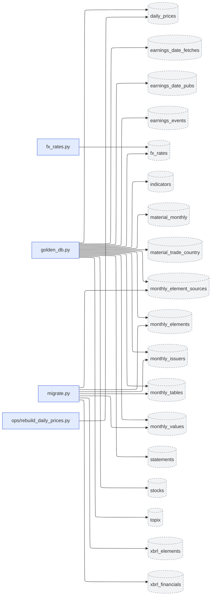

# データの流れ: 共通・運用

**自動生成。手で直さない。** 読み方と作り方は [DATA_FLOW.md](../DATA_FLOW.md)。全体の表と影響の調べ方は [ビューア](viewer.html)。

図の見方: 左が入口、右が表。実線の矢印は書く、点線は読むだけ。灰色の点線の枠はほかの機能の表。`stocks` はほぼ全部が読むので、読む線は省く（表には出す。線が残らない入口は図から外す）。

## バッチ

| バッチ | 書く | 読むだけ |
|---|---|---|
| `jobs/fx_rates.py` | `fx_rates` |  |
| `jobs/golden_db.py` | `daily_prices`, `earnings_date_fetches`, `earnings_date_pubs`, `earnings_events`, `fx_rates`, `indicators`, `material_monthly`, `material_trade_country`, `monthly_element_sources`, `monthly_elements`, `monthly_issuers`, `monthly_tables`, `monthly_values`, `statements`, `stocks`, `topix` |  |
| `jobs/migrate.py` | `monthly_element_sources`, `monthly_elements`, `monthly_issuers`, `monthly_tables`, `monthly_values`, `xbrl_elements`, `xbrl_financials` | `stocks` |
| `jobs/ops/rebuild_daily_prices.py` | `daily_prices` |  |
