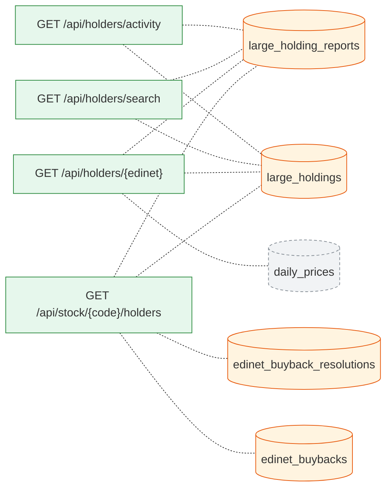

# データの流れ: EDINET・大量保有

**自動生成。手で直さない。** 読み方と作り方は [DATA_FLOW.md](../DATA_FLOW.md)。全体の表と影響の調べ方は [ビューア](viewer.html)。

図の見方: 左が入口、右が表。実線の矢印は書く、点線は読むだけ。灰色の点線の枠はほかの機能の表。`stocks` はほぼ全部が読むので、読む線は省く（表には出す。線が残らない入口は図から外す）。

## バッチ

```mermaid
flowchart LR
  n0["edinet/edinet_archive.py"]:::job
  n1["edinet/edinet_buybacks.py"]:::job
  n2["edinet/edinet_codes.py"]:::job
  n3["edinet/edinet_documents.py"]:::job
  n4["edinet/edinet_large_holdings.py"]:::job
  n5["edinet/edinet_shareholders.py"]:::job
  n6["edinet/edinet_tender_offers.py"]:::job
  n7["edinet/edinet_xbrl.py"]:::job
  n8[("edinet_archives")]:::tbl
  n9[("edinet_buyback_resolutions")]:::tbl
  n10[("edinet_buybacks")]:::tbl
  n11[("edinet_documents")]:::tbl
  n12[("edinet_filers")]:::tbl
  n13[("edinet_list_days")]:::tbl
  n14[("edinet_tender_offer_docs")]:::tbl
  n15[("edinet_tender_offers")]:::tbl
  n16[("large_holding_reports")]:::tbl
  n17[("large_holdings")]:::tbl
  n18[("stocks")]:::ext
  n19[("xbrl_contexts")]:::ext
  n20[("xbrl_element_mappings")]:::ext
  n21[("xbrl_elements")]:::ext
  n22[("xbrl_facts")]:::ext
  n23[("xbrl_filings")]:::ext
  n24[("xbrl_financials")]:::ext
  n25[("xbrl_job_runs")]:::ext
  n26[("xbrl_major_shareholders")]:::ext
  n27[("xbrl_pdf_matches")]:::ext
  n28[("xbrl_segments")]:::ext
  n29[("xbrl_shareholder_filings")]:::ext
  n30[("xbrl_shareholding_by_category")]:::ext
  n31[("xbrl_std_items")]:::ext
  n0 --> n8
  n0 -.- n10
  n0 -.- n11
  n0 -.- n14
  n0 -.- n16
  n0 -.- n23
  n1 --> n8
  n1 --> n9
  n1 --> n10
  n1 -.- n11
  n1 -.- n12
  n2 --> n11
  n2 --> n12
  n2 --> n18
  n3 --> n11
  n3 -.- n12
  n3 --> n13
  n4 --> n8
  n4 -.- n11
  n4 -.- n12
  n4 --> n16
  n4 --> n17
  n5 -.- n11
  n5 -.- n19
  n5 -.- n21
  n5 -.- n22
  n5 -.- n23
  n5 --> n26
  n5 --> n29
  n5 --> n30
  n6 --> n8
  n6 -.- n11
  n6 -.- n12
  n6 --> n14
  n6 --> n15
  n7 --> n8
  n7 -.- n11
  n7 --> n19
  n7 -.- n20
  n7 --> n21
  n7 --> n22
  n7 --> n23
  n7 --> n24
  n7 --> n25
  n7 --> n26
  n7 --> n27
  n7 --> n28
  n7 --> n29
  n7 --> n30
  n7 -.- n31
  classDef job fill:#e3ecff,stroke:#3b5bdb
  classDef api fill:#e6f7ec,stroke:#2b8a3e
  classDef tbl fill:#fff4e0,stroke:#e8590c
  classDef ext fill:#f1f3f5,stroke:#868e96,stroke-dasharray:4 3
```

| バッチ | 書く | 読むだけ |
|---|---|---|
| `jobs/edinet/edinet_archive.py` | `edinet_archives` | `edinet_buybacks`, `edinet_documents`, `edinet_tender_offer_docs`, `large_holding_reports`, `xbrl_filings` |
| `jobs/edinet/edinet_buybacks.py` | `edinet_archives`, `edinet_buyback_resolutions`, `edinet_buybacks` | `edinet_documents`, `edinet_filers`, `stocks` |
| `jobs/edinet/edinet_codes.py` | `edinet_documents`, `edinet_filers`, `stocks` |  |
| `jobs/edinet/edinet_documents.py` | `edinet_documents`, `edinet_list_days` | `edinet_filers`, `stocks` |
| `jobs/edinet/edinet_large_holdings.py` | `edinet_archives`, `large_holding_reports`, `large_holdings` | `edinet_documents`, `edinet_filers`, `stocks` |
| `jobs/edinet/edinet_shareholders.py` | `xbrl_major_shareholders`, `xbrl_shareholder_filings`, `xbrl_shareholding_by_category` | `edinet_documents`, `xbrl_contexts`, `xbrl_elements`, `xbrl_facts`, `xbrl_filings` |
| `jobs/edinet/edinet_tender_offers.py` | `edinet_archives`, `edinet_tender_offer_docs`, `edinet_tender_offers` | `edinet_documents`, `edinet_filers`, `stocks` |
| `jobs/edinet/edinet_xbrl.py` | `edinet_archives`, `xbrl_contexts`, `xbrl_elements`, `xbrl_facts`, `xbrl_filings`, `xbrl_financials`, `xbrl_job_runs`, `xbrl_major_shareholders`, `xbrl_pdf_matches`, `xbrl_segments`, `xbrl_shareholder_filings`, `xbrl_shareholding_by_category` | `edinet_documents`, `stocks`, `xbrl_element_mappings`, `xbrl_std_items` |

## API

| API | 書く | 読むだけ |
|---|---|---|
| `GET /api/holders/activity` |  | `large_holding_reports`, `large_holdings`, `stocks` |
| `GET /api/holders/search` |  | `large_holding_reports`, `large_holdings`, `stocks` |
| `GET /api/holders/{edinet}` |  | `daily_prices`, `large_holding_reports`, `large_holdings`, `stocks` |
| `GET /api/stock/{code}/holders` |  | `edinet_buyback_resolutions`, `edinet_buybacks`, `large_holding_reports`, `large_holdings`, `stocks` |

## テーブル

ほかの機能のバッチ・API も含めて、その表を書く・読む入口。

### edinet_archives

- 書く: `jobs/edinet/edinet_archive.py`, `jobs/edinet/edinet_buybacks.py`, `jobs/edinet/edinet_large_holdings.py`, `jobs/edinet/edinet_tender_offers.py`, `jobs/edinet/edinet_xbrl.py`
- 読むだけ: （観測なし）

### edinet_buyback_resolutions

- 書く: `jobs/edinet/edinet_buybacks.py`
- 読むだけ: `GET /api/stock/{code}/holders`

### edinet_buybacks

- 書く: `jobs/edinet/edinet_buybacks.py`
- 読むだけ: `jobs/edinet/edinet_archive.py`, `GET /api/stock/{code}/holders`

### edinet_documents

- 書く: `jobs/edinet/edinet_codes.py`, `jobs/edinet/edinet_documents.py`
- 読むだけ: `jobs/edinet/edinet_archive.py`, `jobs/edinet/edinet_buybacks.py`, `jobs/edinet/edinet_large_holdings.py`, `jobs/edinet/edinet_shareholders.py`, `jobs/edinet/edinet_tender_offers.py`, `jobs/edinet/edinet_xbrl.py`, `jobs/xbrl/xbrl_normalize.py（XBRL・決算書類）`

### edinet_filers

- 書く: `jobs/edinet/edinet_codes.py`
- 読むだけ: `jobs/edinet/edinet_buybacks.py`, `jobs/edinet/edinet_documents.py`, `jobs/edinet/edinet_large_holdings.py`, `jobs/edinet/edinet_tender_offers.py`

### edinet_list_days

- 書く: `jobs/edinet/edinet_documents.py`
- 読むだけ: （観測なし）

### edinet_tender_offer_docs

- 書く: `jobs/edinet/edinet_tender_offers.py`
- 読むだけ: `jobs/edinet/edinet_archive.py`

### edinet_tender_offers

- 書く: `jobs/edinet/edinet_tender_offers.py`
- 読むだけ: （観測なし）

### large_holding_reports

- 書く: `jobs/edinet/edinet_large_holdings.py`
- 読むだけ: `jobs/edinet/edinet_archive.py`, `GET /api/holders/activity`, `GET /api/holders/search`, `GET /api/holders/{edinet}`, `GET /api/stock/{code}/holders`

### large_holdings

- 書く: `jobs/edinet/edinet_large_holdings.py`
- 読むだけ: `GET /api/holders/activity`, `GET /api/holders/search`, `GET /api/holders/{edinet}`, `GET /api/stock/{code}/holders`
