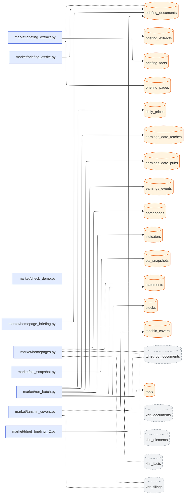
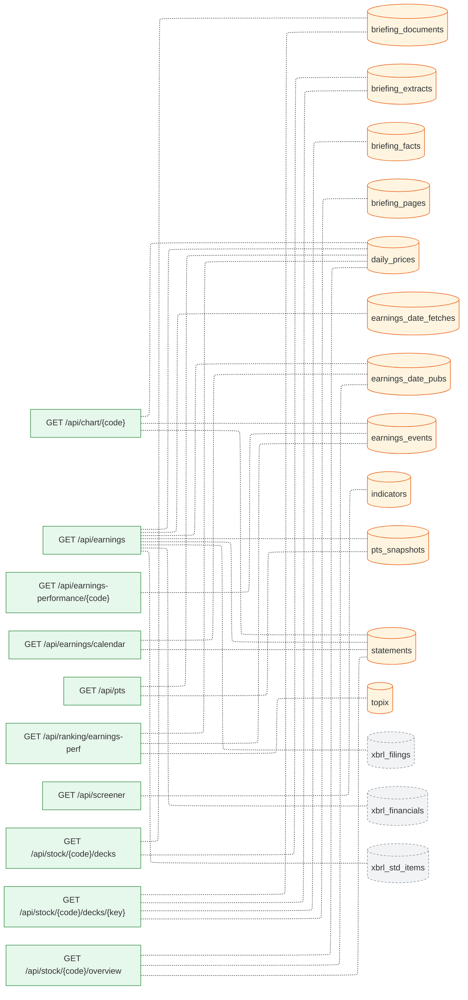

# データの流れ: 株価・決算

読み方と作り方は [DATA_FLOW.md](../DATA_FLOW.md)。全体の表と影響の調べ方は [ビューア](viewer.html)。

図の見方: 左がバッチ・API、右が表。実線の矢印は書き込み、点線は読み取りだけ。灰色の点線の枠はほかの機能の表。`stocks` はほぼ全部が読み取るので、読み取りの線は省く（表には出す。線が残らないバッチ・API は図から外す）。

## バッチ

| バッチ | 書き込み | 読み取りだけ |
|---|---|---|
| `jobs/market/briefing_extract.py` | `briefing_extracts`, `briefing_facts`, `briefing_pages` | `briefing_documents` |
| `jobs/market/briefing_offsite.py` | `briefing_documents` |  |
| `jobs/market/check_demo.py` |  | `statements`, `stocks` |
| `jobs/market/homepage_briefing.py` | `briefing_documents` | `tanshin_covers` |
| `jobs/market/homepages.py` | `homepages` | `statements`, `tdnet_pdf_documents`, `xbrl_elements`, `xbrl_facts`, `xbrl_filings` |
| `jobs/market/pts_snapshot.py` | `pts_snapshots` |  |
| `jobs/market/run_batch.py` | `daily_prices`, `earnings_date_fetches`, `earnings_date_pubs`, `earnings_events`, `indicators`, `statements`, `stocks`, `topix` |  |
| `jobs/market/tanshin_covers.py` | `tanshin_covers` | `stocks`, `tdnet_pdf_documents`, `xbrl_documents`, `xbrl_filings` |
| `jobs/market/tdnet_briefing_r2.py` | `briefing_documents` |  |

## API

| API | 書き込み | 読み取りだけ |
|---|---|---|
| `GET /api/chart/{code}` |  | `daily_prices`, `earnings_events`, `statements`, `stocks` |
| `GET /api/earnings` |  | `daily_prices`, `earnings_date_fetches`, `earnings_date_pubs`, `pts_snapshots`, `statements`, `stocks`, `xbrl_filings`, `xbrl_financials`, `xbrl_std_items` |
| `GET /api/earnings-performance/{code}` |  | `earnings_events` |
| `GET /api/earnings/calendar` |  | `earnings_date_pubs`, `statements`, `stocks` |
| `GET /api/pts` |  | `daily_prices`, `pts_snapshots` |
| `GET /api/ranking/earnings-perf` |  | `daily_prices`, `earnings_events`, `stocks`, `topix` |
| `GET /api/screener` |  | `indicators`, `stocks` |
| `GET /api/stock/{code}/decks` |  | `briefing_documents`, `briefing_extracts`, `stocks` |
| `GET /api/stock/{code}/decks/{key}` |  | `briefing_documents`, `briefing_extracts`, `briefing_facts`, `briefing_pages` |
| `GET /api/stock/{code}/overview` |  | `daily_prices`, `earnings_date_pubs`, `statements`, `stocks` |
| `GET /api/stocks/search` |  | `stocks` |

## テーブル

ほかの機能のバッチ・API も含めて、その表を読み書きするバッチ・API。

### briefing_documents

- 書き込み: `jobs/market/briefing_offsite.py`, `jobs/market/homepage_briefing.py`, `jobs/market/tdnet_briefing_r2.py`
- 読み取りだけ: `jobs/market/briefing_extract.py`, `GET /api/stock/{code}/decks`, `GET /api/stock/{code}/decks/{key}`

### briefing_extracts

- 書き込み: `jobs/market/briefing_extract.py`
- 読み取りだけ: `GET /api/stock/{code}/decks`, `GET /api/stock/{code}/decks/{key}`

### briefing_facts

- 書き込み: `jobs/market/briefing_extract.py`
- 読み取りだけ: `GET /api/stock/{code}/decks/{key}`

### briefing_pages

- 書き込み: `jobs/market/briefing_extract.py`
- 読み取りだけ: `GET /api/stock/{code}/decks/{key}`

### daily_prices

- 書き込み: `jobs/golden_db.py（共通・運用）`, `jobs/market/run_batch.py`, `jobs/ops/rebuild_daily_prices.py（共通・運用）`
- 読み取りだけ: `GET /api/chart/{code}`, `GET /api/earnings`, `GET /api/earnings/detail/{code}（XBRL・決算書類）`, `GET /api/holders/{edinet}（EDINET・大量保有）`, `GET /api/pts`, `GET /api/ranking/earnings-perf`, `GET /api/stock/{code}/overview`

### data_versions

- 書き込み: （観測なし）
- 読み取りだけ: `GET /api/v1/tables（月次）`

### earnings_date_fetches

- 書き込み: `jobs/golden_db.py（共通・運用）`, `jobs/market/run_batch.py`
- 読み取りだけ: `GET /api/earnings`

### earnings_date_pubs

- 書き込み: `jobs/golden_db.py（共通・運用）`, `jobs/market/run_batch.py`
- 読み取りだけ: `GET /api/earnings`, `GET /api/earnings/calendar`, `GET /api/stock/{code}/overview`

### earnings_events

- 書き込み: `jobs/golden_db.py（共通・運用）`, `jobs/market/run_batch.py`
- 読み取りだけ: `GET /api/chart/{code}`, `GET /api/earnings-performance/{code}`, `GET /api/ranking/earnings-perf`

### fx_rates

- 書き込み: `jobs/fx_rates.py（共通・運用）`, `jobs/golden_db.py（共通・運用）`
- 読み取りだけ: （観測なし）

### homepages

- 書き込み: `jobs/market/homepages.py`
- 読み取りだけ: （観測なし）

### indicators

- 書き込み: `jobs/golden_db.py（共通・運用）`, `jobs/market/run_batch.py`
- 読み取りだけ: `GET /api/screener`

### pts_snapshots

- 書き込み: `jobs/market/pts_snapshot.py`
- 読み取りだけ: `GET /api/earnings`, `GET /api/pts`

### statements

- 書き込み: `jobs/golden_db.py（共通・運用）`, `jobs/market/run_batch.py`, `jobs/xbrl/xbrl_statements.py（XBRL・決算書類）`
- 読み取りだけ: `jobs/market/check_demo.py`, `jobs/market/homepages.py`, `jobs/monthly/ir_monthly_html_ingest.py（月次）`, `jobs/monthly/ir_monthly_json_ingest.py（月次）`, `jobs/monthly/ir_monthly_xls_ingest.py（月次）`, `jobs/monthly/tdnet_monthly_pdf_ingest.py（月次）`, `jobs/xbrl/xbrl_parse.py（XBRL・決算書類）`, `GET /api/chart/{code}`, `GET /api/earnings`, `GET /api/earnings/calendar`, `GET /api/earnings/detail/{code}（XBRL・決算書類）`, `GET /api/stock/{code}/overview`, `POST /api/v1/tables/{code}/ingest（月次）`

### stocks

- 書き込み: `jobs/edinet/edinet_codes.py（EDINET・大量保有）`, `jobs/golden_db.py（共通・運用）`, `jobs/market/run_batch.py`
- 読み取りだけ: `jobs/edinet/edinet_buybacks.py（EDINET・大量保有）`, `jobs/edinet/edinet_documents.py（EDINET・大量保有）`, `jobs/edinet/edinet_large_holdings.py（EDINET・大量保有）`, `jobs/edinet/edinet_tender_offers.py（EDINET・大量保有）`, `jobs/edinet/edinet_xbrl.py（EDINET・大量保有）`, `jobs/market/check_demo.py`, `jobs/market/tanshin_covers.py`, `jobs/migrate.py（共通・運用）`, `jobs/monthly/ir_monthly_html_ingest.py（月次）`, `jobs/monthly/ir_monthly_html_r2.py（月次）`, `jobs/monthly/ir_monthly_json_ingest.py（月次）`, `jobs/monthly/ir_monthly_r2.py（月次）`, `jobs/monthly/ir_monthly_xls_ingest.py（月次）`, `jobs/monthly/tdnet_monthly_pdf_ingest.py（月次）`, `jobs/monthly/tdnet_monthly_r2.py（月次）`, `jobs/xbrl/tdnet_xbrl_r2.py（XBRL・決算書類）`, `jobs/xbrl/xbrl_parse.py（XBRL・決算書類）`, `DELETE /api/v1/tables/{code}/{year}/elements（月次）`, `GET /api/chart/{code}`, `GET /api/earnings`, `GET /api/earnings/calendar`, `GET /api/earnings/detail/{code}（XBRL・決算書類）`, `GET /api/holders/activity（EDINET・大量保有）`, `GET /api/holders/search（EDINET・大量保有）`, `GET /api/holders/{edinet}（EDINET・大量保有）`, `GET /api/ranking/earnings-perf`, `GET /api/screener`, `GET /api/stock/{code}/decks`, `GET /api/stock/{code}/filings（XBRL・決算書類）`, `GET /api/stock/{code}/financials（XBRL・決算書類）`, `GET /api/stock/{code}/holders（EDINET・大量保有）`, `GET /api/stock/{code}/overview`, `GET /api/stocks/search`, `GET /api/v1/tables（月次）`, `POST /api/v1/tables/{code}/ingest（月次）`, `POST /api/v1/tables/{code}/{year}/elements（月次）`, `PUT /api/v1/tables/{code}/industry（月次）`, `PUT /api/v1/tables/{code}/{year}/doc（月次）`, `PUT /api/v1/tables/{code}/{year}/elements（月次）`, `PUT /api/v1/tables/{code}/{year}/values（月次）`, `PUT /api/v1/tables/{code}/{year}/values/batch（月次）`

### tanshin_covers

- 書き込み: `jobs/market/tanshin_covers.py`
- 読み取りだけ: `jobs/market/homepage_briefing.py`

### topix

- 書き込み: `jobs/golden_db.py（共通・運用）`, `jobs/market/run_batch.py`
- 読み取りだけ: `GET /api/ranking/earnings-perf`
