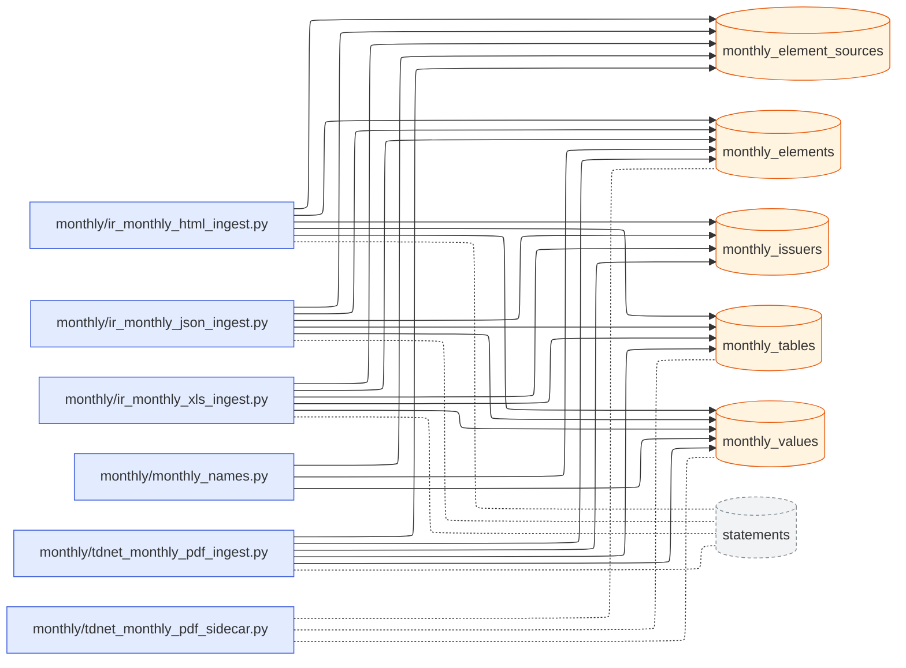
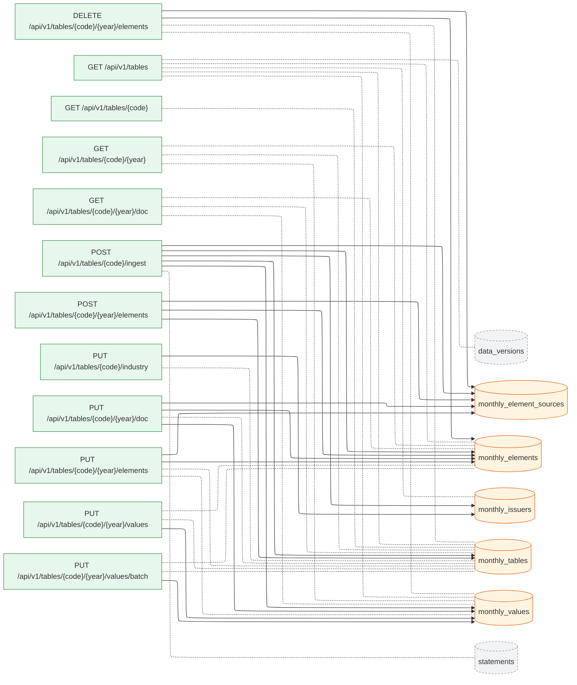

# データの流れ: 月次

読み方と作り方は [DATA_FLOW.md](../DATA_FLOW.md)。全体の表と影響の調べ方は [ビューア](viewer.html)。

図の見方: 左がバッチ・API、右が表。実線の矢印は書き込み、点線は読み取りだけ。灰色の点線の枠はほかの機能の表。`stocks` はほぼ全部が読み取るので、読み取りの線は省く（表には出す。線が残らないバッチ・API は図から外す）。

## バッチ

| バッチ | 書き込み | 読み取りだけ | 呼ぶ API |
|---|---|---|---|
| `jobs/monthly/ir_monthly_html_ingest.py` | `monthly_element_sources`, `monthly_elements`, `monthly_issuers`, `monthly_tables`, `monthly_values` | `statements`, `stocks` | `GET /api/v1/tables/{code}` `POST /api/v1/tables/{code}/ingest` |
| `jobs/monthly/ir_monthly_html_r2.py` |  | `stocks` |  |
| `jobs/monthly/ir_monthly_json_ingest.py` | `monthly_element_sources`, `monthly_elements`, `monthly_issuers`, `monthly_tables`, `monthly_values` | `statements`, `stocks` | `POST /api/v1/tables/{code}/ingest` |
| `jobs/monthly/ir_monthly_r2.py` |  | `stocks` |  |
| `jobs/monthly/ir_monthly_xls_ingest.py` | `monthly_element_sources`, `monthly_elements`, `monthly_issuers`, `monthly_tables`, `monthly_values` | `statements`, `stocks` | `GET /api/v1/tables/{code}/{year}` `POST /api/v1/tables/{code}/ingest` |
| `jobs/monthly/monthly_names.py` | `monthly_element_sources`, `monthly_elements`, `monthly_values` |  |  |
| `jobs/monthly/tdnet_monthly_pdf_ingest.py` | `monthly_element_sources`, `monthly_elements`, `monthly_issuers`, `monthly_tables`, `monthly_values` | `statements`, `stocks` | `GET /api/v1/tables/{code}` `POST /api/v1/tables/{code}/ingest` |
| `jobs/monthly/tdnet_monthly_pdf_sidecar.py` |  | `monthly_elements`, `monthly_tables`, `monthly_values` | `GET /api/v1/tables/{code}/{year}` |
| `jobs/monthly/tdnet_monthly_r2.py` |  | `stocks` |  |

## API

| API | 書き込み | 読み取りだけ |
|---|---|---|
| `DELETE /api/v1/tables/{code}/{year}/elements` | `monthly_element_sources`, `monthly_elements` | `monthly_tables`, `monthly_values`, `stocks` |
| `GET /api/v1/tables` |  | `data_versions`, `monthly_elements`, `monthly_issuers`, `monthly_tables`, `monthly_values`, `stocks` |
| `GET /api/v1/tables/{code}` |  | `monthly_tables` |
| `GET /api/v1/tables/{code}/{year}` |  | `monthly_elements`, `monthly_tables`, `monthly_values` |
| `GET /api/v1/tables/{code}/{year}/doc` |  | `monthly_elements`, `monthly_tables`, `monthly_values` |
| `POST /api/v1/tables/{code}/ingest` | `monthly_element_sources`, `monthly_elements`, `monthly_issuers`, `monthly_tables`, `monthly_values` | `statements`, `stocks` |
| `POST /api/v1/tables/{code}/{year}/elements` | `monthly_element_sources`, `monthly_elements`, `monthly_tables` | `stocks` |
| `PUT /api/v1/tables/{code}/industry` | `monthly_issuers` | `monthly_tables`, `stocks` |
| `PUT /api/v1/tables/{code}/{year}/doc` | `monthly_element_sources`, `monthly_elements`, `monthly_values` | `monthly_tables`, `stocks` |
| `PUT /api/v1/tables/{code}/{year}/elements` | `monthly_element_sources`, `monthly_elements` | `monthly_tables`, `monthly_values`, `stocks` |
| `PUT /api/v1/tables/{code}/{year}/values` | `monthly_values` | `monthly_elements`, `monthly_tables`, `stocks` |
| `PUT /api/v1/tables/{code}/{year}/values/batch` | `monthly_values` | `monthly_elements`, `monthly_tables`, `stocks` |

## テーブル

ほかの機能のバッチ・API も含めて、その表を読み書きするバッチ・API。

### monthly_element_sources

- 書き込み: `jobs/golden_db.py（共通・運用）`, `jobs/migrate.py（共通・運用）`, `jobs/monthly/ir_monthly_html_ingest.py`, `jobs/monthly/ir_monthly_json_ingest.py`, `jobs/monthly/ir_monthly_xls_ingest.py`, `jobs/monthly/monthly_names.py`, `jobs/monthly/tdnet_monthly_pdf_ingest.py`, `DELETE /api/v1/tables/{code}/{year}/elements`, `POST /api/v1/tables/{code}/ingest`, `POST /api/v1/tables/{code}/{year}/elements`, `PUT /api/v1/tables/{code}/{year}/doc`, `PUT /api/v1/tables/{code}/{year}/elements`
- 読み取りだけ: （観測なし）

### monthly_elements

- 書き込み: `jobs/golden_db.py（共通・運用）`, `jobs/migrate.py（共通・運用）`, `jobs/monthly/ir_monthly_html_ingest.py`, `jobs/monthly/ir_monthly_json_ingest.py`, `jobs/monthly/ir_monthly_xls_ingest.py`, `jobs/monthly/monthly_names.py`, `jobs/monthly/tdnet_monthly_pdf_ingest.py`, `DELETE /api/v1/tables/{code}/{year}/elements`, `POST /api/v1/tables/{code}/ingest`, `POST /api/v1/tables/{code}/{year}/elements`, `PUT /api/v1/tables/{code}/{year}/doc`, `PUT /api/v1/tables/{code}/{year}/elements`
- 読み取りだけ: `jobs/monthly/tdnet_monthly_pdf_sidecar.py`, `GET /api/v1/tables`, `GET /api/v1/tables/{code}/{year}`, `GET /api/v1/tables/{code}/{year}/doc`, `PUT /api/v1/tables/{code}/{year}/values`, `PUT /api/v1/tables/{code}/{year}/values/batch`

### monthly_issuers

- 書き込み: `jobs/golden_db.py（共通・運用）`, `jobs/migrate.py（共通・運用）`, `jobs/monthly/ir_monthly_html_ingest.py`, `jobs/monthly/ir_monthly_json_ingest.py`, `jobs/monthly/ir_monthly_xls_ingest.py`, `jobs/monthly/tdnet_monthly_pdf_ingest.py`, `POST /api/v1/tables/{code}/ingest`, `PUT /api/v1/tables/{code}/industry`
- 読み取りだけ: `GET /api/v1/tables`

### monthly_tables

- 書き込み: `jobs/golden_db.py（共通・運用）`, `jobs/migrate.py（共通・運用）`, `jobs/monthly/ir_monthly_html_ingest.py`, `jobs/monthly/ir_monthly_json_ingest.py`, `jobs/monthly/ir_monthly_xls_ingest.py`, `jobs/monthly/tdnet_monthly_pdf_ingest.py`, `POST /api/v1/tables/{code}/ingest`, `POST /api/v1/tables/{code}/{year}/elements`
- 読み取りだけ: `jobs/monthly/tdnet_monthly_pdf_sidecar.py`, `DELETE /api/v1/tables/{code}/{year}/elements`, `GET /api/v1/tables`, `GET /api/v1/tables/{code}`, `GET /api/v1/tables/{code}/{year}`, `GET /api/v1/tables/{code}/{year}/doc`, `PUT /api/v1/tables/{code}/industry`, `PUT /api/v1/tables/{code}/{year}/doc`, `PUT /api/v1/tables/{code}/{year}/elements`, `PUT /api/v1/tables/{code}/{year}/values`, `PUT /api/v1/tables/{code}/{year}/values/batch`

### monthly_values

- 書き込み: `jobs/golden_db.py（共通・運用）`, `jobs/migrate.py（共通・運用）`, `jobs/monthly/ir_monthly_html_ingest.py`, `jobs/monthly/ir_monthly_json_ingest.py`, `jobs/monthly/ir_monthly_xls_ingest.py`, `jobs/monthly/monthly_names.py`, `jobs/monthly/tdnet_monthly_pdf_ingest.py`, `POST /api/v1/tables/{code}/ingest`, `PUT /api/v1/tables/{code}/{year}/doc`, `PUT /api/v1/tables/{code}/{year}/values`, `PUT /api/v1/tables/{code}/{year}/values/batch`
- 読み取りだけ: `jobs/monthly/tdnet_monthly_pdf_sidecar.py`, `DELETE /api/v1/tables/{code}/{year}/elements`, `GET /api/v1/tables`, `GET /api/v1/tables/{code}/{year}`, `GET /api/v1/tables/{code}/{year}/doc`, `PUT /api/v1/tables/{code}/{year}/elements`
