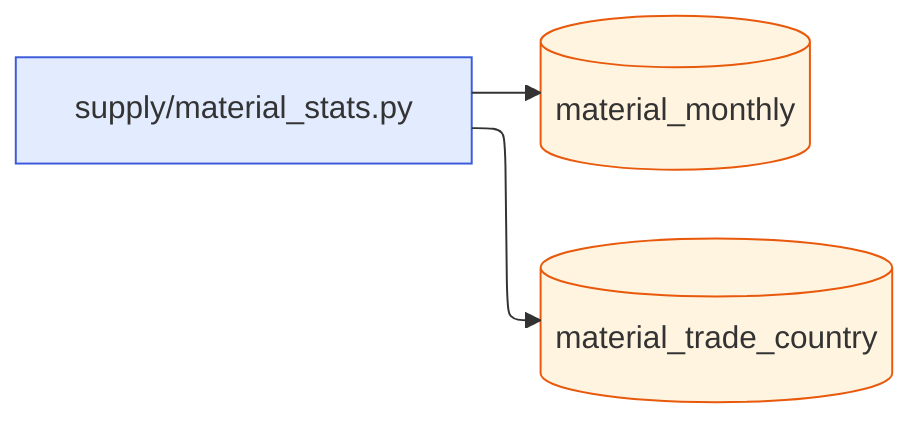
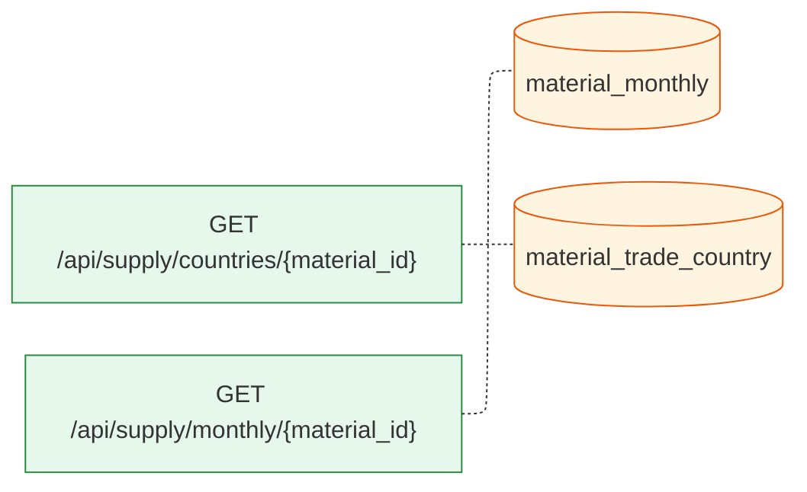

# データの流れ: サプライ

読み方と作り方は [DATA_FLOW.md](../DATA_FLOW.md)。全体の表と影響の調べ方は [ビューア](viewer.html)。

図の見方: 左がバッチ・API、右が表。実線の矢印は書き込み、点線は読み取りだけ。灰色の点線の枠はほかの機能の表。`stocks` はほぼ全部が読み取るので、読み取りの線は省く（表には出す。線が残らないバッチ・API は図から外す）。

## バッチ

| バッチ | 書き込み | 読み取りだけ |
|---|---|---|
| `jobs/supply/material_stats.py` | `material_monthly`, `material_trade_country` |  |

## API

| API | 書き込み | 読み取りだけ |
|---|---|---|
| `GET /api/supply/countries/{material_id}` |  | `material_trade_country` |
| `GET /api/supply/monthly/{material_id}` |  | `material_monthly` |

## テーブル

ほかの機能のバッチ・API も含めて、その表を読み書きするバッチ・API。

### material_monthly

- 書き込み: `jobs/golden_db.py（共通・運用）`, `jobs/supply/material_stats.py`
- 読み取りだけ: `GET /api/supply/monthly/{material_id}`

### material_trade_country

- 書き込み: `jobs/golden_db.py（共通・運用）`, `jobs/supply/material_stats.py`
- 読み取りだけ: `GET /api/supply/countries/{material_id}`
