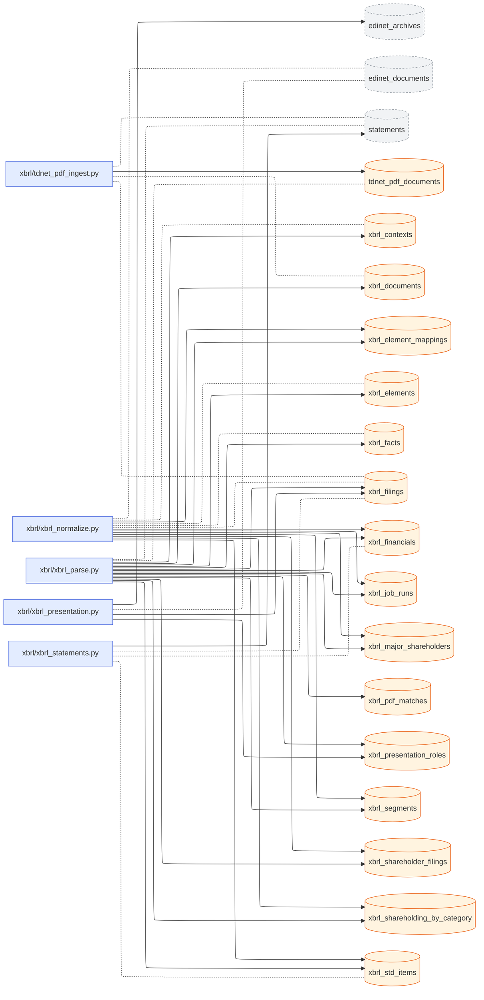
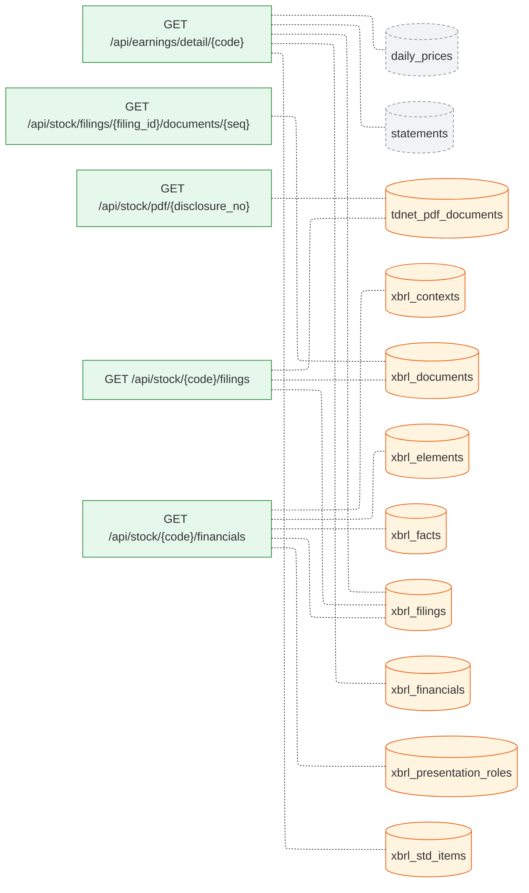

# データの流れ: XBRL・決算書類

読み方と作り方は [DATA_FLOW.md](../DATA_FLOW.md)。全体の表と影響の調べ方は [ビューア](viewer.html)。

図の見方: 左がバッチ・API、右が表。実線の矢印は書き込み、点線は読み取りだけ。灰色の点線の枠はほかの機能の表。`stocks` はほぼ全部が読み取るので、読み取りの線は省く（表には出す。線が残らないバッチ・API は図から外す）。

## バッチ

| バッチ | 書き込み | 読み取りだけ |
|---|---|---|
| `jobs/xbrl/tdnet_pdf_ingest.py` | `tdnet_pdf_documents` | `statements`, `stocks`, `xbrl_documents`, `xbrl_filings` |
| `jobs/xbrl/tdnet_xbrl_r2.py` |  | `stocks` |
| `jobs/xbrl/xbrl_normalize.py` | `xbrl_element_mappings`, `xbrl_financials`, `xbrl_job_runs`, `xbrl_major_shareholders`, `xbrl_segments`, `xbrl_shareholder_filings`, `xbrl_shareholding_by_category`, `xbrl_std_items` | `edinet_documents`, `xbrl_contexts`, `xbrl_elements`, `xbrl_facts`, `xbrl_filings` |
| `jobs/xbrl/xbrl_parse.py` | `xbrl_contexts`, `xbrl_documents`, `xbrl_element_mappings`, `xbrl_elements`, `xbrl_facts`, `xbrl_filings`, `xbrl_financials`, `xbrl_job_runs`, `xbrl_major_shareholders`, `xbrl_pdf_matches`, `xbrl_presentation_roles`, `xbrl_segments`, `xbrl_shareholder_filings`, `xbrl_shareholding_by_category`, `xbrl_std_items` | `statements`, `stocks`, `tdnet_pdf_documents` |
| `jobs/xbrl/xbrl_presentation.py` | `edinet_archives`, `xbrl_filings`, `xbrl_presentation_roles` | `edinet_documents` |
| `jobs/xbrl/xbrl_statements.py` | `statements` | `xbrl_filings`, `xbrl_financials`, `xbrl_std_items` |

## API

| API | 書き込み | 読み取りだけ |
|---|---|---|
| `GET /api/earnings/detail/{code}` |  | `daily_prices`, `statements`, `stocks`, `xbrl_filings`, `xbrl_financials`, `xbrl_std_items` |
| `GET /api/stock/filings/{filing_id}/documents/{seq}` |  | `xbrl_documents` |
| `GET /api/stock/pdf/{disclosure_no}` |  | `tdnet_pdf_documents` |
| `GET /api/stock/{code}/filings` |  | `stocks`, `tdnet_pdf_documents`, `xbrl_documents`, `xbrl_filings` |
| `GET /api/stock/{code}/financials` |  | `stocks`, `xbrl_contexts`, `xbrl_elements`, `xbrl_facts`, `xbrl_filings`, `xbrl_presentation_roles` |

## テーブル

ほかの機能のバッチ・API も含めて、その表を読み書きするバッチ・API。

### tdnet_pdf_documents

- 書き込み: `jobs/xbrl/tdnet_pdf_ingest.py`
- 読み取りだけ: `jobs/market/homepages.py（株価・決算）`, `jobs/market/tanshin_covers.py（株価・決算）`, `jobs/xbrl/xbrl_parse.py`, `GET /api/stock/pdf/{disclosure_no}`, `GET /api/stock/{code}/filings`

### xbrl_contexts

- 書き込み: `jobs/edinet/edinet_xbrl.py（EDINET・大量保有）`, `jobs/xbrl/xbrl_parse.py`
- 読み取りだけ: `jobs/edinet/edinet_shareholders.py（EDINET・大量保有）`, `jobs/xbrl/xbrl_normalize.py`, `GET /api/stock/{code}/financials`

### xbrl_documents

- 書き込み: `jobs/xbrl/xbrl_parse.py`
- 読み取りだけ: `jobs/market/tanshin_covers.py（株価・決算）`, `jobs/xbrl/tdnet_pdf_ingest.py`, `GET /api/stock/filings/{filing_id}/documents/{seq}`, `GET /api/stock/{code}/filings`

### xbrl_element_mappings

- 書き込み: `jobs/xbrl/xbrl_normalize.py`, `jobs/xbrl/xbrl_parse.py`
- 読み取りだけ: `jobs/edinet/edinet_xbrl.py（EDINET・大量保有）`

### xbrl_elements

- 書き込み: `jobs/edinet/edinet_xbrl.py（EDINET・大量保有）`, `jobs/migrate.py（共通・運用）`, `jobs/xbrl/xbrl_parse.py`
- 読み取りだけ: `jobs/edinet/edinet_shareholders.py（EDINET・大量保有）`, `jobs/market/homepages.py（株価・決算）`, `jobs/xbrl/xbrl_normalize.py`, `GET /api/stock/{code}/financials`

### xbrl_facts

- 書き込み: `jobs/edinet/edinet_xbrl.py（EDINET・大量保有）`, `jobs/xbrl/xbrl_parse.py`
- 読み取りだけ: `jobs/edinet/edinet_shareholders.py（EDINET・大量保有）`, `jobs/market/homepages.py（株価・決算）`, `jobs/xbrl/xbrl_normalize.py`, `GET /api/stock/{code}/financials`

### xbrl_filings

- 書き込み: `jobs/edinet/edinet_xbrl.py（EDINET・大量保有）`, `jobs/xbrl/xbrl_parse.py`, `jobs/xbrl/xbrl_presentation.py`
- 読み取りだけ: `jobs/edinet/edinet_archive.py（EDINET・大量保有）`, `jobs/edinet/edinet_shareholders.py（EDINET・大量保有）`, `jobs/market/homepages.py（株価・決算）`, `jobs/market/tanshin_covers.py（株価・決算）`, `jobs/xbrl/tdnet_pdf_ingest.py`, `jobs/xbrl/xbrl_normalize.py`, `jobs/xbrl/xbrl_statements.py`, `GET /api/earnings（株価・決算）`, `GET /api/earnings/detail/{code}`, `GET /api/stock/{code}/filings`, `GET /api/stock/{code}/financials`

### xbrl_financials

- 書き込み: `jobs/edinet/edinet_xbrl.py（EDINET・大量保有）`, `jobs/migrate.py（共通・運用）`, `jobs/xbrl/xbrl_normalize.py`, `jobs/xbrl/xbrl_parse.py`
- 読み取りだけ: `jobs/xbrl/xbrl_statements.py`, `GET /api/earnings（株価・決算）`, `GET /api/earnings/detail/{code}`

### xbrl_job_runs

- 書き込み: `jobs/edinet/edinet_xbrl.py（EDINET・大量保有）`, `jobs/xbrl/xbrl_normalize.py`, `jobs/xbrl/xbrl_parse.py`
- 読み取りだけ: （観測なし）

### xbrl_major_shareholders

- 書き込み: `jobs/edinet/edinet_shareholders.py（EDINET・大量保有）`, `jobs/edinet/edinet_xbrl.py（EDINET・大量保有）`, `jobs/xbrl/xbrl_normalize.py`, `jobs/xbrl/xbrl_parse.py`
- 読み取りだけ: （観測なし）

### xbrl_pdf_matches

- 書き込み: `jobs/edinet/edinet_xbrl.py（EDINET・大量保有）`, `jobs/xbrl/xbrl_parse.py`
- 読み取りだけ: （観測なし）

### xbrl_presentation_roles

- 書き込み: `jobs/edinet/edinet_xbrl.py（EDINET・大量保有）`, `jobs/xbrl/xbrl_parse.py`, `jobs/xbrl/xbrl_presentation.py`
- 読み取りだけ: `GET /api/stock/{code}/financials`

### xbrl_segments

- 書き込み: `jobs/edinet/edinet_xbrl.py（EDINET・大量保有）`, `jobs/xbrl/xbrl_normalize.py`, `jobs/xbrl/xbrl_parse.py`
- 読み取りだけ: （観測なし）

### xbrl_shareholder_filings

- 書き込み: `jobs/edinet/edinet_shareholders.py（EDINET・大量保有）`, `jobs/edinet/edinet_xbrl.py（EDINET・大量保有）`, `jobs/xbrl/xbrl_normalize.py`, `jobs/xbrl/xbrl_parse.py`
- 読み取りだけ: （観測なし）

### xbrl_shareholding_by_category

- 書き込み: `jobs/edinet/edinet_shareholders.py（EDINET・大量保有）`, `jobs/edinet/edinet_xbrl.py（EDINET・大量保有）`, `jobs/xbrl/xbrl_normalize.py`, `jobs/xbrl/xbrl_parse.py`
- 読み取りだけ: （観測なし）

### xbrl_std_items

- 書き込み: `jobs/xbrl/xbrl_normalize.py`, `jobs/xbrl/xbrl_parse.py`
- 読み取りだけ: `jobs/edinet/edinet_xbrl.py（EDINET・大量保有）`, `jobs/xbrl/xbrl_statements.py`, `GET /api/earnings（株価・決算）`, `GET /api/earnings/detail/{code}`
