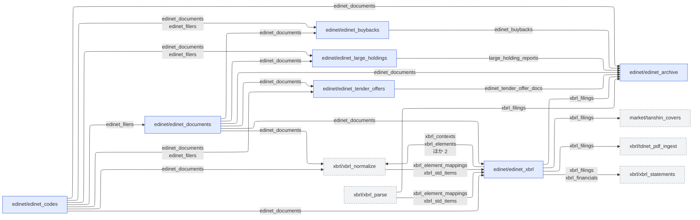

# ジョブ設計: EDINET・大量保有

読み方と作り方は [JOBS.md](../../JOBS.md)。表との線は [データの流れ](../../dataflow/edinet.md)。

## ジョブ間の依存

矢印の元が書き込んだ表を、先が読み取るだけで使う（cron のジョブ同士。線の字はその表）。灰色の点線の枠はほかの機能のジョブ。`stocks` と、両方が書き込む表、ファイル（`data/`）の受け渡しは出ない。

## edinet/edinet_archive

`jobs/edinet/edinet_archive.py`

- 起動: 毎日 0〜6 時の毎時 15 分（`--limit 1000`）
- 書き込み: `edinet_archives`
- 読み取りだけ: `edinet_buybacks`, `edinet_documents`, `edinet_tender_offer_docs`, `large_holding_reports`, `xbrl_filings`

| 引数 | 種類 | 既定 | 説明 |
|---|---|---|---|
| `--limit` | int | `1000` | 最大件数（0 以下は無制限） |
| `--dry-run` | フラグ |  | 対象の件数と先頭 10 件だけ |

## edinet/edinet_buybacks

`jobs/edinet/edinet_buybacks.py`

- 起動: 毎日 9〜23 時の毎時 25 分（`--limit 500`）
- 書き込み: `edinet_archives`, `edinet_buyback_resolutions`, `edinet_buybacks`
- 読み取りだけ: `edinet_documents`, `edinet_filers`, `stocks`

| 引数 | 種類 | 既定 | 説明 |
|---|---|---|---|
| `--from` |  |  | file_date YYYY-MM-DD |
| `--to` |  |  | file_date YYYY-MM-DD |
| `--retry-failed` | フラグ |  |  |
| `--reparse` | フラグ |  | 取り込み済みもダウンロードし直す |
| `--limit` | int |  | 最大件数（0 以下は無制限） |
| `--refresh-only` | フラグ |  | ダウンロードせず、訂正・取下げ・最新だけ付け直す |

## edinet/edinet_codes

`jobs/edinet/edinet_codes.py`

- 起動: 毎日 07:30
- 書き込み: `edinet_documents`, `edinet_filers`, `stocks`
- 読み取りだけ: （観測なし）

| 引数 | 種類 | 既定 | 説明 |
|---|---|---|---|
| `--zip` |  |  | Edinetcode.zip のパス（省略時はダウンロード） |

## edinet/edinet_documents

`jobs/edinet/edinet_documents.py`

- 起動: 毎日 8〜23 時の毎時 40 分
- 書き込み: `edinet_documents`, `edinet_list_days`
- 読み取りだけ: `edinet_filers`, `stocks`

| 引数 | 種類 | 既定 | 説明 |
|---|---|---|---|
| `--from` |  |  | YYYY-MM-DD |
| `--to` |  |  | YYYY-MM-DD（省略時は今日） |
| `--backfill-years` | int |  | N 年前から（最大 10） |
| `--force` | フラグ |  | 確定済みの日も取り直す |

## edinet/edinet_large_holdings

`jobs/edinet/edinet_large_holdings.py`

- 起動: 毎日 9〜23 時の毎時 05 分（`--limit 1000`）
- 書き込み: `edinet_archives`, `large_holding_reports`, `large_holdings`
- 読み取りだけ: `edinet_documents`, `edinet_filers`, `stocks`

| 引数 | 種類 | 既定 | 説明 |
|---|---|---|---|
| `--from` |  |  | file_date YYYY-MM-DD |
| `--to` |  |  | file_date YYYY-MM-DD |
| `--retry-failed` | フラグ |  |  |
| `--reparse` | フラグ |  | 取り込み済みもダウンロードし直す |
| `--doc-id` | append |  | 指定した docID だけ（繰り返し可） |
| `--reparse-fixes` | フラグ |  | config/large_holding_date_fixes.json の docID を取り直す |
| `--limit` | int |  | 最大件数（0 以下は無制限） |
| `--refresh-only` | フラグ |  | ダウンロードせず、訂正・取下げ・最新だけ付け直す |

## edinet/edinet_shareholders

`jobs/edinet/edinet_shareholders.py`

- 起動: cron に無い
- 書き込み: `xbrl_major_shareholders`, `xbrl_shareholder_filings`, `xbrl_shareholding_by_category`
- 読み取りだけ: `edinet_documents`, `xbrl_contexts`, `xbrl_elements`, `xbrl_facts`, `xbrl_filings`

| 引数 | 種類 | 既定 | 説明 |
|---|---|---|---|
| `--rebuild` | フラグ |  | parsed の EDINET filing から大株主・所有者別を作り直す |
| `--refresh-only` | フラグ |  | ダウンロードせず、訂正・取下げ・最新だけ付け直す |
| `--code` |  |  | stocks.code 5 桁 |

## edinet/edinet_tender_offers

`jobs/edinet/edinet_tender_offers.py`

- 起動: 毎日 9〜23 時の毎時 20 分（`--limit 100`）
- 書き込み: `edinet_archives`, `edinet_tender_offer_docs`, `edinet_tender_offers`
- 読み取りだけ: `edinet_documents`, `edinet_filers`, `stocks`

| 引数 | 種類 | 既定 | 説明 |
|---|---|---|---|
| `--from` |  |  | file_date YYYY-MM-DD |
| `--to` |  |  | file_date YYYY-MM-DD |
| `--retry-failed` | フラグ |  |  |
| `--reparse` | フラグ |  | 取り込み済みもダウンロードし直す |
| `--limit` | int |  | 最大件数（0 以下は無制限） |
| `--refresh-only` | フラグ |  | ダウンロードせず、案件の表だけ作り直す |

## edinet/edinet_xbrl

`jobs/edinet/edinet_xbrl.py`

- 起動: 毎日 8〜23 時の毎時 50 分（`--limit 300`）
- 書き込み: `edinet_archives`, `xbrl_contexts`, `xbrl_elements`, `xbrl_facts`, `xbrl_filings`, `xbrl_financials`, `xbrl_job_runs`, `xbrl_major_shareholders`, `xbrl_pdf_matches`, `xbrl_presentation_roles`, `xbrl_segments`, `xbrl_shareholder_filings`, `xbrl_shareholding_by_category`
- 読み取りだけ: `edinet_documents`, `stocks`, `xbrl_element_mappings`, `xbrl_std_items`

| 引数 | 種類 | 既定 | 説明 |
|---|---|---|---|
| `--from` |  |  | file_date YYYY-MM-DD |
| `--to` |  |  | file_date YYYY-MM-DD |
| `--code` |  |  | stocks.code 5 桁 |
| `--no-quarterly` | フラグ |  | 四半期報告書（140/150）を除く |
| `--retry-failed` | フラグ |  |  |
| `--reparse` | フラグ |  | 取り込み済みもダウンロードし直す |
| `--limit` | int |  | 最大件数（0 以下は無制限） |
