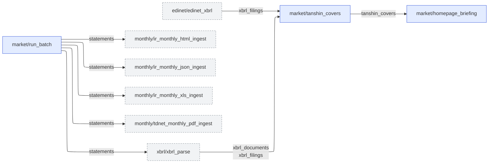

# ジョブ設計: 株価・決算

**自動生成。手で直さない。** 読み方と作り方は [JOBS.md](../../JOBS.md)。表との線は [データの流れ](../../dataflow/market.md)。

## ジョブ間の依存

矢印の元が書いた表を、先が読むだけで使う（cron のジョブ同士。線の字はその表）。灰色の点線の枠はほかの機能のジョブ。`stocks` と、両方が書く表、ファイル（`data/`）の受け渡しは出ない。

## market/briefing_extract

`jobs/market/briefing_extract.py`

- 起動: cron に無い
- 書く: `briefing_extracts`, `briefing_facts`, `briefing_pages`
- 読むだけ: `briefing_documents`

| 引数 | 種類 | 既定 | 説明 |
|---|---|---|---|
| `--code` | append | `[]` | 4 or 5 digit code (repeatable) |
| `--limit` | int |  | how many presentations, newest first |
| `--redo` | フラグ |  | read again presentations already done / failed |
| `--no-thinking` | フラグ |  | thinking を止める（出力が減る。精度は未検証） |
| `--dry-run` | フラグ |  | PDF を読んで依頼の数を数えるだけ。API に出さない |

## market/briefing_offsite

`jobs/market/briefing_offsite.py`

- 起動: 毎日 01:40
- 書く: `briefing_documents`
- 読むだけ: （観測なし）

| 引数 | 種類 | 既定 | 説明 |
|---|---|---|---|
| `--dest` |  | `None` | data/briefing の代わり |
| `--dry-run` | フラグ |  | 対象を出すだけ。コピーも索引も削除もしない |
| `--limit` | int | `None` | この実行で手を付ける最大件数 |

## market/check_demo

`jobs/market/check_demo.py`

- 起動: cron に無い
- 書く: （観測なし）
- 読むだけ: `statements`, `stocks`

引数: なし

## market/homepage_briefing

`jobs/market/homepage_briefing.py`

- 起動: 日曜 22:25（`--years 5 --ledger /var/log/app/homepage_briefing_ledger.json`）
- 起動: 毎日 12〜23 時の毎時 00 分（`--years 5 --pending 7 --ledger /var/log/app/homepage_briefing_ledger.json`）
- 続けて走る順: xbrl/tdnet_xbrl_r2 → xbrl/xbrl_parse → xbrl/xbrl_normalize → xbrl/xbrl_statements → market/tanshin_covers → market/tdnet_briefing_r2 → **market/homepage_briefing**
- 書く: `briefing_documents`
- 読むだけ: `tanshin_covers`

| 引数 | 種類 | 既定 | 説明 |
|---|---|---|---|
| `--dest` |  | `DEFAULT_DEST` | destination directory |
| `--config` |  | `str(DEFAULT_CONFIG)` | issuer list JSON |
| `--only` | append |  | stock code in the config (repeatable) |
| `--limit` | int |  | new PDFs per issuer in this run, from the top of the page |
| `--years` | int |  | skip documents older than N years from today |
| `--ledger` |  |  | JSON of old documents and --pending checks (not under dest) |
| `--pending` | int |  | only issuers with a material-flagged tanshin in the last N days |
| `--dry-run` | フラグ |  | list new PDFs, do not download |

## market/homepages

`jobs/market/homepages.py`

- 起動: cron に無い
- 書く: `homepages`
- 読むだけ: `statements`, `tdnet_pdf_documents`, `xbrl_elements`, `xbrl_facts`, `xbrl_filings`

| 引数 | 種類 | 既定 | 説明 |
|---|---|---|---|
| `--code` | append | `[]` | 4 or 5 digit code (repeatable) |
| `--all` | フラグ |  | every ordinary stocks.code |
| `--dry-run` | フラグ |  | print plan, do not write |
| `--refresh` | フラグ |  | re-pick auto sources; never overwrites manual |
| `--set` | nargs=2 |  | store a manual URL |
| `--set-file` |  |  | store manual URLs from a JSON file (entries: code, url) |
| `--compare-hosts` | フラグ |  | XBRL vs 短信 host match (read only) |

## market/intraday_1m

`jobs/market/intraday_1m.py`

- 起動: 平日 20:30
- 書く: （観測なし）
- 読むだけ: （観測なし）

| 引数 | 種類 | 既定 | 説明 |
|---|---|---|---|
| `--codes` | nargs=* |  | J-Quants 5 桁コード。省略で内国株全銘柄 |
| `--limit` | int | `0` |  |
| `--sleep` | float | `0.5` | 1 銘柄ごとの待ち（秒） |
| `--dest` | Path | `None` | 既定は data/intraday/1m |

## market/pts_snapshot

`jobs/market/pts_snapshot.py`

- 起動: 火〜土曜 00:00 平日 15:30 平日 16〜23 時の毎時 00・30 分
- 書く: `pts_snapshots`
- 読むだけ: （観測なし）

引数: なし

## market/run_batch

`jobs/market/run_batch.py`

- 起動: 毎日 19:30
- 書く: `daily_prices`, `earnings_date_fetches`, `earnings_date_pubs`, `earnings_events`, `indicators`, `statements`, `stocks`, `topix`
- 読むだけ: （観測なし）

| 引数 | 種類 | 既定 | 説明 |
|---|---|---|---|
| `--date` |  |  | 取得日 YYYY-MM-DD (省略時は今日) |
| `--backfill` | int |  | 年数を指定して初回バックフィル |
| `--refetch-prices` | フラグ |  | DB にある日足を全部取り直して指標を計算し直す |
| `--readjust-prices` | フラグ |  | 調整後株価を DB の調整前の値と調整係数から全銘柄計算し直して指標も計算し直す |
| `--no-recompute` | フラグ |  | 指標の再計算をスキップ |

## market/tanshin_covers

`jobs/market/tanshin_covers.py`

- 起動: 毎日 12〜23 時の毎時 00 分（`--days 1`）
- 起動: 毎日 23:35（`--days 3`）
- 続けて走る順: xbrl/tdnet_xbrl_r2 → xbrl/xbrl_parse → xbrl/xbrl_normalize → xbrl/xbrl_statements → **market/tanshin_covers** → market/tdnet_briefing_r2 → market/homepage_briefing
- 書く: `tanshin_covers`
- 読むだけ: `stocks`, `tdnet_pdf_documents`, `xbrl_documents`, `xbrl_filings`

| 引数 | 種類 | 既定 | 説明 |
|---|---|---|---|
| `--code` | append | `[]` | 4 or 5 digit code (repeatable) |
| `--limit` | int |  | how many companies, newest filings first |
| `--days` | int |  | companies that filed in the last N days JST (inclusive) |
| `--dry-run` | フラグ |  |  |

## market/tdnet_briefing_r2

`jobs/market/tdnet_briefing_r2.py`

- 起動: 毎日 12〜23 時の毎時 00 分（`1`）
- 起動: 毎日 22:10（`7`）
- 続けて走る順: xbrl/tdnet_xbrl_r2 → xbrl/xbrl_parse → xbrl/xbrl_normalize → xbrl/xbrl_statements → market/tanshin_covers → **market/tdnet_briefing_r2** → market/homepage_briefing
- 書く: `briefing_documents`
- 読むだけ: （観測なし）

| 引数 | 種類 | 既定 | 説明 |
|---|---|---|---|
| `days`（位置） | int |  | days back from today JST (inclusive) |
| `--dest` |  | `DEFAULT_DEST` | destination directory |
| `--dry-run` | フラグ |  | list matches, do not download |
