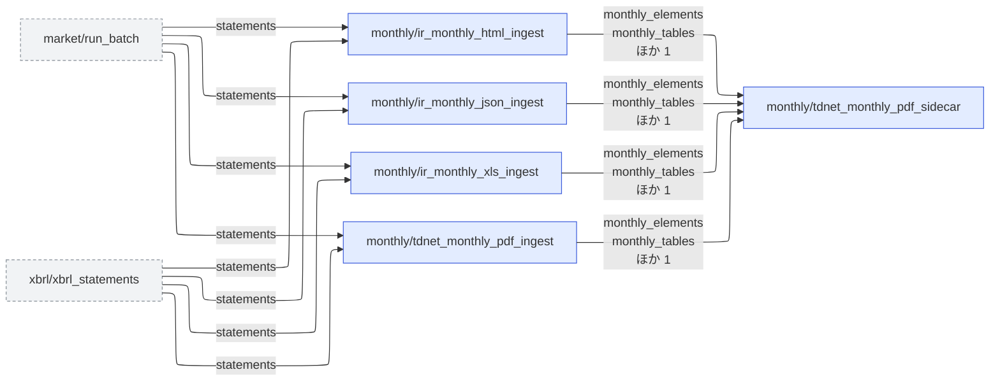

# ジョブ設計: 月次

読み方と作り方は [JOBS.md](../../JOBS.md)。表との線は [データの流れ](../../dataflow/monthly.md)。

## ジョブ間の依存

矢印の元が書き込んだ表を、先が読み取るだけで使う（cron のジョブ同士。線の字はその表）。灰色の点線の枠はほかの機能のジョブ。`stocks` と、両方が書き込む表、ファイル（`data/`）の受け渡しは出ない。

## monthly/ir_monthly_html_ingest

`jobs/monthly/ir_monthly_html_ingest.py`

- 起動: 毎日 10:30 毎日 16:30（`--ledger /var/log/app/html_ingest_ledger.json`）
- 呼ぶ API: `GET /api/v1/tables/{code}`, `POST /api/v1/tables/{code}/ingest`
- 書き込み: `monthly_element_sources`, `monthly_elements`, `monthly_issuers`, `monthly_tables`, `monthly_values`
- 読み取りだけ: `statements`, `stocks`

| 引数 | 種類 | 既定 | 説明 |
|---|---|---|---|
| `--dest` |  | `DEFAULT_DEST` | monthly dest directory |
| `--only` | append | `[]` | limit to these codes (repeatable) |
| `--dry-run` | フラグ |  | print plan, do not POST |
| `--ledger` |  | `str(DEFAULT_LEDGER)` | sha256 skip ledger (not under dest) |
| `--base-url` |  | `DEFAULT_BASE_URL` | loopback origin |
| `--report` |  |  | optional JSONL report path |
| `--force` | フラグ |  | POST even if the sidecar sha256 is in the ledger, with row force; requires --only |
| `--months` | append | `[]` | calendar YYYY-MM sent as only_months (e.g. 2026-07,2026-08); requires --force |

## monthly/ir_monthly_html_r2

`jobs/monthly/ir_monthly_html_r2.py`

- 起動: 毎日 10:20 毎日 16:20
- 書き込み: （観測なし）
- 読み取りだけ: `stocks`

| 引数 | 種類 | 既定 | 説明 |
|---|---|---|---|
| `--dest` |  | `DEFAULT_DEST` | destination directory |
| `--config` |  | `str(DEFAULT_CONFIG)` | issuer registry JSON |
| `--only` | append | `[]` | limit to these codes (repeatable) |
| `--dry-run` | フラグ |  | list URLs, do not download |
| `--reparse` | フラグ |  | rebuild ingest JSON from saved HTML |
| `--force` | フラグ |  | re-save HTML and rebuild ingest JSON even if unchanged; requires --only |

## monthly/ir_monthly_json_ingest

`jobs/monthly/ir_monthly_json_ingest.py`

- 起動: 毎日 10:30 毎日 16:30
- 呼ぶ API: `POST /api/v1/tables/{code}/ingest`
- 書き込み: `monthly_element_sources`, `monthly_elements`, `monthly_issuers`, `monthly_tables`, `monthly_values`
- 読み取りだけ: `statements`, `stocks`

| 引数 | 種類 | 既定 | 説明 |
|---|---|---|---|
| `--json` |  |  | path to fixture JSON; omit to GET the spec URL |
| `--code` |  | `CODE` | issuer code (default 7649) |
| `--as-of` | str |  | disclosure date YYYY-MM-DD |
| `--dry-run` | フラグ |  | print JSON, do not POST |
| `--base-url` |  | `DEFAULT_BASE_URL` | loopback origin |

## monthly/ir_monthly_r2

`jobs/monthly/ir_monthly_r2.py`

- 起動: 毎日 10:00 毎日 16:00
- 書き込み: （観測なし）
- 読み取りだけ: `stocks`

| 引数 | 種類 | 既定 | 説明 |
|---|---|---|---|
| `--dest` |  | `DEFAULT_DEST` | destination directory |
| `--config` |  | `str(DEFAULT_CONFIG)` | issuer registry JSON |
| `--only` | append | `[]` | limit to these codes (repeatable) |
| `--dry-run` | フラグ |  | list matched URLs, do not download |

## monthly/ir_monthly_xls_ingest

`jobs/monthly/ir_monthly_xls_ingest.py`

- 起動: 毎日 10:40 毎日 16:40（`--all --post`）
- 呼ぶ API: `GET /api/v1/tables/{code}/{year}`, `POST /api/v1/tables/{code}/ingest`
- 書き込み: `monthly_element_sources`, `monthly_elements`, `monthly_issuers`, `monthly_tables`, `monthly_values`
- 読み取りだけ: `statements`, `stocks`

| 引数 | 種類 | 既定 | 説明 |
|---|---|---|---|
| `--xls` |  |  | path to workbook |
| `--dest` |  | `str(DEFAULT_DEST)` | monthly dest; used when --xls is omitted |
| `--code` |  | `CODE` | issuer code (default 1878) |
| `--all` | フラグ |  | every issuer in ir_monthly_xls.json; latest workbook under --dest (cron) |
| `--as-of` | str |  | disclosure date YYYY-MM-DD |
| `--source-url` |  |  | IR file URL (afieldfile /YYYY/MM/DD/ becomes as_of) |
| `--from-year` | int | `DEFAULT_FROM_YEAR` | first calendar year to keep |
| `--dry-run` | フラグ |  | print JSON, do not POST |
| `--post` | フラグ |  | POST to loopback /api/v1/tables/{code}/ingest |
| `--base-url` |  | `DEFAULT_BASE_URL` | loopback origin |

## monthly/monthly_names

`jobs/monthly/monthly_names.py`

- 起動: cron に無い（Actions: `monthly-names.yml`）
- 書き込み: `monthly_element_sources`, `monthly_elements`, `monthly_values`
- 読み取りだけ: （観測なし）

| 引数 | 種類 | 既定 | 説明 |
|---|---|---|---|
| `mode`（位置） | plan / apply、nargs=? | `plan` |  |

## monthly/tdnet_monthly_pdf_ingest

`jobs/monthly/tdnet_monthly_pdf_ingest.py`

- 起動: 毎日 18:30 毎日 21:30（`--ledger /var/log/app/pdf_ingest_ledger.json`）
- 呼ぶ API: `GET /api/v1/tables/{code}`, `POST /api/v1/tables/{code}/ingest`
- 書き込み: `monthly_element_sources`, `monthly_elements`, `monthly_issuers`, `monthly_tables`, `monthly_values`
- 読み取りだけ: `statements`, `stocks`

| 引数 | 種類 | 既定 | 説明 |
|---|---|---|---|
| `--dest` |  | `DEFAULT_DEST` | monthly dest directory |
| `--only` | append | `[]` | limit to these codes (repeatable) |
| `--dry-run` | フラグ |  | print plan, do not POST |
| `--ledger` |  | `str(DEFAULT_LEDGER)` | sha256 skip ledger (not under dest) |
| `--base-url` |  | `DEFAULT_BASE_URL` | loopback origin |
| `--report` |  |  | optional JSONL report path |
| `--force` | フラグ |  | POST even if the sidecar sha256 is in the ledger, with row force; requires --only |
| `--months` | append | `[]` | calendar YYYY-MM sent as only_months (e.g. 2026-07,2026-08); requires --force |

## monthly/tdnet_monthly_pdf_sidecar

`jobs/monthly/tdnet_monthly_pdf_sidecar.py`

- 起動: 毎日 18:20 毎日 21:20
- 呼ぶ API: `GET /api/v1/tables/{code}/{year}`
- 書き込み: （観測なし）
- 読み取りだけ: `monthly_elements`, `monthly_tables`, `monthly_values`

| 引数 | 種類 | 既定 | 説明 |
|---|---|---|---|
| `--dest` |  | `DEFAULT_DEST` | f'monthly directory (default {DEFAULT_DEST})' |
| `--db` |  | `None` | sqlite file (default DATABASE_URL / repo stock.db) |
| `--only` | append | `[]` | issuer code (4 or 5 char; repeatable) |
| `--dry-run` | フラグ |  | print plans, do not write sidecars |

## monthly/tdnet_monthly_r2

`jobs/monthly/tdnet_monthly_r2.py`

- 起動: 毎日 18:00 毎日 21:00（`7`）
- 書き込み: （観測なし）
- 読み取りだけ: `stocks`

| 引数 | 種類 | 既定 | 説明 |
|---|---|---|---|
| `days`（位置） | int |  | days back from today JST (inclusive) |
| `--dest` |  | `DEFAULT_DEST` | destination directory |
