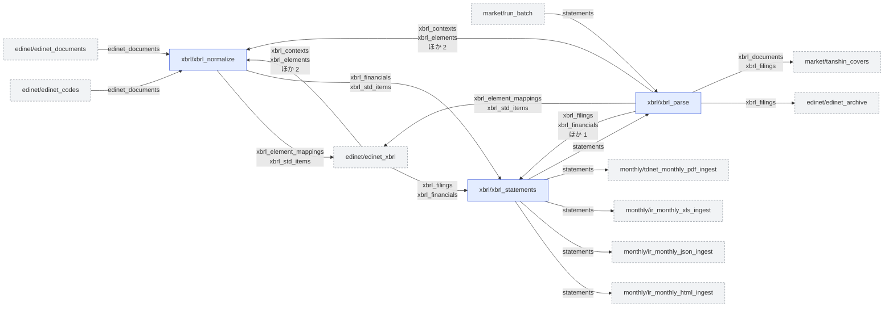

# ジョブ設計: XBRL・決算書類

**自動生成。手で直さない。** 読み方と作り方は [JOBS.md](../../JOBS.md)。表との線は [データの流れ](../../dataflow/xbrl.md)。

## ジョブ間の依存

矢印の元が書いた表を、先が読むだけで使う（cron のジョブ同士。線の字はその表）。灰色の点線の枠はほかの機能のジョブ。`stocks` と、両方が書く表、ファイル（`data/`）の受け渡しは出ない。

## xbrl/tdnet_xbrl_r2

`jobs/xbrl/tdnet_xbrl_r2.py`

- 起動: 毎日 12〜23 時の毎時 00 分（`2`）
- 続けて走る順: **xbrl/tdnet_xbrl_r2** → xbrl/xbrl_parse → xbrl/xbrl_normalize → xbrl/xbrl_statements → market/tanshin_covers → market/tdnet_briefing_r2 → market/homepage_briefing
- 書く: （観測なし）
- 読むだけ: `stocks`

| 引数 | 種類 | 既定 | 説明 |
|---|---|---|---|
| `days`（位置） | int |  | days back from today JST (inclusive) |
| `--dest` |  | `DEFAULT_DEST` | destination directory |

## xbrl/xbrl_normalize

`jobs/xbrl/xbrl_normalize.py`

- 起動: 毎日 12〜23 時の毎時 00 分
- 続けて走る順: xbrl/tdnet_xbrl_r2 → xbrl/xbrl_parse → **xbrl/xbrl_normalize** → xbrl/xbrl_statements → market/tanshin_covers → market/tdnet_briefing_r2 → market/homepage_briefing
- 書く: `xbrl_element_mappings`, `xbrl_financials`, `xbrl_job_runs`, `xbrl_major_shareholders`, `xbrl_segments`, `xbrl_shareholder_filings`, `xbrl_shareholding_by_category`, `xbrl_std_items`
- 読むだけ: `edinet_documents`, `xbrl_contexts`, `xbrl_elements`, `xbrl_facts`, `xbrl_filings`

| 引数 | 種類 | 既定 | 説明 |
|---|---|---|---|
| `--rebuild` | フラグ |  | xbrl_financials / xbrl_segments / 大株主を消して parsed filing を全部やり直す |
| `--code` |  |  | 5桁コードに限定（--rebuild と併用可） |
| `--since` | date.fromisoformat |  | YYYY-MM-DD 以降に提出された parsed filing を、消さずに 1 件ずつやり直す |
| `--source` | tdnet / tdnet_pdf / edinet |  | filing の source に限定 |

## xbrl/xbrl_parse

`jobs/xbrl/xbrl_parse.py`

- 起動: 毎日 12〜23 時の毎時 00 分
- 続けて走る順: xbrl/tdnet_xbrl_r2 → **xbrl/xbrl_parse** → xbrl/xbrl_normalize → xbrl/xbrl_statements → market/tanshin_covers → market/tdnet_briefing_r2 → market/homepage_briefing
- 書く: `xbrl_contexts`, `xbrl_documents`, `xbrl_element_mappings`, `xbrl_elements`, `xbrl_facts`, `xbrl_filings`, `xbrl_financials`, `xbrl_job_runs`, `xbrl_major_shareholders`, `xbrl_pdf_matches`, `xbrl_presentation_roles`, `xbrl_segments`, `xbrl_shareholder_filings`, `xbrl_shareholding_by_category`, `xbrl_std_items`
- 読むだけ: `statements`, `stocks`, `tdnet_pdf_documents`

| 引数 | 種類 | 既定 | 説明 |
|---|---|---|---|
| `command`（位置） | parse / load-mappings / report-unmapped、nargs=? | `parse` |  |
| `--from` |  |  | YYYY-MM-DD |
| `--to` |  |  | YYYY-MM-DD |
| `--doc-id` |  |  |  |
| `--retry-failed` | フラグ |  |  |
| `--reparse` | フラグ |  | parsed/skipped で sha が同じ ZIP も再パースする（KAB-48 の Summary 取りこぼし直し） |
| `--dest` |  | `XBRL_DEST` |  |
| `--limit` | int | `50` |  |

## xbrl/xbrl_presentation

`jobs/xbrl/xbrl_presentation.py`

- 起動: cron に無い
- 書く: `edinet_archives`, `xbrl_filings`, `xbrl_presentation_roles`
- 読むだけ: `edinet_documents`

| 引数 | 種類 | 既定 | 説明 |
|---|---|---|---|
| `--source` | SOURCES、append |  | 繰り返し可。無ければ両方 |
| `--code` | append | `[]` | 4 桁または 5 桁。繰り返し可 |
| `--limit` | int | `0` | 最大件数（0 以下は無制限） |
| `--batch` | int | `None` | N 件ごとに進み具合を 1 行出す |
| `--sleep` | float | `0.0` | EDINET・OneDrive から取ったあと待つ秒数 |
| `--local-only` | フラグ |  | EDINET・OneDrive に行かない。手元（data/edinet）に無い書類は印を付けずに飛ばす |
| `--archived-only` | フラグ |  | 退避の記録（edinet_archives）がある EDINET の書類だけ。OneDrive からの読み出しを測るとき |
| `--offsite-chunk` | int | `0` | 退避済みの ZIP を N 件ずつ OneDrive から一時フォルダへまとめて写してから読む（0 は 1 件ずつ） |
| `--dest` |  | `XBRL_DEST` | 短信 XBRL の ZIP の根（raw_path の起点） |
| `--redo-flat` | フラグ |  | 埋めてある（ok）が要素に深さの無い書類を読み直す。ZIP が無い・読めないときは今の行を残す |
| `--dry-run` | フラグ |  | 対象の件数だけ |

## xbrl/xbrl_statements

`jobs/xbrl/xbrl_statements.py`

- 起動: 毎日 12〜23 時の毎時 00 分
- 続けて走る順: xbrl/tdnet_xbrl_r2 → xbrl/xbrl_parse → xbrl/xbrl_normalize → **xbrl/xbrl_statements** → market/tanshin_covers → market/tdnet_briefing_r2 → market/homepage_briefing
- 書く: `statements`
- 読むだけ: `xbrl_filings`, `xbrl_financials`, `xbrl_std_items`

| 引数 | 種類 | 既定 | 説明 |
|---|---|---|---|
| `--since` | date.fromisoformat |  | f'YYYY-MM-DD 以降に提出された短信。省略時は直近 {DEFAULT_DAYS} 日' |
