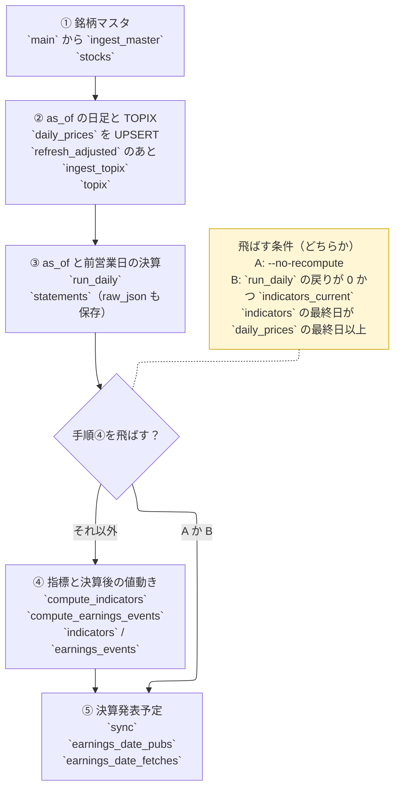

# 取込と保存の規則: 株価・決算・説明資料

各ジョブの起動時刻・引数・読み書きするテーブルは自動生成の [ジョブ設計](gen/market.md) と [バッチ一覧](../JOBS.md) にまとめる。このページでは J-Quants の株価・決算、決算説明資料、PTS・分足、ホームページ URL・短信表紙の取込と算出の規則を定める。

## 日次バッチ

対象ジョブは [`market/run_batch`](gen/market.md#marketrun_batch)（`jobs/market/run_batch.py`）である。引数の `--date YYYY-MM-DD` で基準日 `as_of`（省略時は実行当日の JST 日付）を上書きできる。

### 実行手順

毎日 19:30（`deploy/crontab`）に、`--date` が無ければ今日を `as_of` として日次の手順 1〜5 を実行する。欠いた営業日をここから遡って埋めない。穴埋めは `--backfill` である。

| 順番 | 対象 | 期間・単位 | 主な処理 |
|---|---|---|---|
| 1 | `stocks` | `as_of` の銘柄一覧 | `ingest_master` が API から受け取った行を UPSERT する。商品区分では落とさない |
| 2 | `daily_prices`・`topix` | `as_of` の 1 日 | 日足を UPSERT する。その行の `adj_factor` が `1.0` 以外の銘柄は、過去の調整後株価を `refresh_adjusted` で計算し直す。その後、同じ日の TOPIX を UPSERT する |
| 3 | `statements` | `as_of` と、それより前で株価がある最後の日 | 両方の決算サマリーを UPSERT し、応答の JSON を `raw_json` に保存する。前営業日は 19:30 より後の開示を拾う取り直し |
| 4 | `indicators`・`earnings_events` | 指標は既定で直近 400 日（`keep_days`）を残す | `compute_indicators` のあと `compute_earnings_events`。`product_category` が 1 件でも入っていれば内国株券（`011`）だけを指標にする |
| 5 | `earnings_date_pubs`・`earnings_date_fetches` | 台帳に無い発表日に、今日と昨日を足す | `sync` が `fins_earnings_date` を UPSERT する。`stocks` には発表日の列が無い |

手順 4 を省略する条件は次の 2 つである。どちらも日次（`run_daily` が件数を返すとき）の話で、`--backfill`・`--refetch-prices`・`--readjust-prices` は件数を置かないので条件 B には入らない。

| 条件 | 挙動 |
|---|---|
| A. `--no-recompute` | 手順 4 を飛ばし、手順 5 へ進む |
| B. `run_daily` の戻りが 0 で、`indicators_current` が真 | 戻りは当日の株価行数、当日の TOPIX 行数、当日の決算行数、前営業日に増えた決算件数の和。0 になるのは API が空のときで、既存行の上書きも件数に入る。`indicators` の最終日が `daily_prices` の最終日以上、または株価行が無いとき真 |

この図は手書きで、ソースからは生成しない。下の根拠の関数か、図のテーブルを変える実装をしたら、図も直す。`--backfill`・`--refetch-prices`・`--readjust-prices` は描いていない。

| 図の名前 | 根拠 |
|---|---|
| `main` | `jobs/market/run_batch.py` `main` |
| `ingest_master` | `app/market/ingest.py` `ingest_master` |
| `refresh_adjusted` | `app/market/ingest.py` `refresh_adjusted` |
| `ingest_topix` | `app/market/ingest.py` `ingest_topix` |
| `run_daily` | `app/market/ingest.py` `run_daily` |
| `compute_indicators` | `app/market/analytics.py` `compute_indicators` |
| `compute_earnings_events` | `app/market/analytics.py` `compute_earnings_events` |
| `indicators_current` | `app/market/analytics.py` `indicators_current` |
| `sync` | `app/market/earnings_schedule.py` `sync` |

日次の J-Quants は、銘柄マスタ 1 回、`as_of` の日足 1 回、`as_of` の TOPIX 1 回、`as_of` の決算 1 回、前営業日の決算 1 回（その前に株価があるとき）である。手順 5 は対象日の数だけ `fins_earnings_date` を 1 回ずつ叩く。台帳が埋まっていても今日と昨日は叩く。

### 取り込む対象と変換

テーブルごとの絞り込みと保存時の変換規則は次のとおりである。

| テーブル | 取り込む対象と変換規則 |
|---|---|
| `stocks` | `ingest_master` は API が返した銘柄を商品区分で落とさずに UPSERT する。行に含まれない `edinet_code` は上書きしない |
| `daily_prices` | `close` と `adj_close` が両方空の行は捨てる。生値（`open`・`high`・`low`・`close`・`volume`）と J-Quants の分割調整済み値（`adj_*`）の両方に加え、`turnover`・`adj_factor`（`AdjFactor`）・`upper_limit`（`UL`）・`lower_limit`（`LL`）を保存する |
| `statements` | `stocks` に存在する銘柄コードだけを残し、API 応答の JSON 全文を `raw_json` にそのまま保存する。`config/market/statement_period_fixes.json` で `"drop": true` が付いた開示（`default_dropped_disclosures`。KAB-573）は J-Quants の応答から取り込まず（`upsert_statements` で落とすので日次・銘柄指定・バックフィルのどれでも同じ）、日付補正が登録された開示は 4 つの日付列を補正して UPSERT する。短信 XBRL からも作らない（`app/xbrl/statements.py` の `merge_into` が `skipped` を返す） |

短信 XBRL から先に作られた行（`source='xbrl'`）は、後から同じ `disclosure_no` の J-Quants 行が届いたとき（`app/market/ingest.py` の `upsert_statements`）、`code` や開示日では引かず、`raw_json` の差し替えと `NULL` だった数値列（`app/xbrl/statements.py` の `NUMERIC_COLUMNS`）の補完だけを行う。4 つの日付列（`period_start`・`period_end`・`fiscal_year_start`・`fiscal_year_end`）はこの関数では書かない。詳細は [XBRL の設計](xbrl.md)「statements との関係」を参照する。

### 期の誤りの候補の検知と補正

提出者が XBRL の会計期間タグ（たとえば `2025` と `2026` の取り違え）を誤って提出すると、J-Quants の `statements` にも誤った期末日が入る。日次バッチでは、J-Quants から初めて届いた開示（それまで `source='xbrl'` だけで存在していた行を含む）のうち、次の条件に当てはまるものを `WARNING jquants statements period-candidate` としてログに出力する。

| 対象区分 | 候補として警告する条件 |
|---|---|
| 通期（`FY` の `FinancialStatements` または `DividendForecastRevision`） | `period_end != fiscal_year_end`、または `period_end - period_start > 400` 日、または `disclosed_date - period_end >= 365` 日のいずれかに該当する |
| 四半期（`1Q`・`2Q`・`3Q` の `FinancialStatements`） | `disclosed_date - period_end >= 300` 日であり、かつ同一 `(code, type_of_period, period_end)` の過去の短信と `net_sales` が異なる |

提出者側の誤りであることを確認した開示は、`config/market/statement_period_fixes.json` に `disclosure_no`・`code`・`evidence` と、正しい期末ではなく J-Quants が返す誤った `period_end`（取込はこの値と一致したときだけ 4 つの日付列を 1 年進める）、または `"drop": true`（`period_end` は付けない）を登録する。同じ `disclosure_no` を日付補正と `drop` の両方、または 2 回登録すると読み込みで `ValueError` になる。`drop` は、訂正短信なのに J-Quants の行が壊れている開示（KAB-573: ニッスイの `20250521559959` は XBRL データの訂正が無いのに、純利益が非支配株主を含む額で EPS・配当・予想が空）を、元の開示を残して消すために使う。

既に DB に入っている行は `python -m tools.market.fix_statement_periods` で確かめ（書かない）、`--write` を付けて直す。出力は開示ごとに 1 行で、日付補正は `changed`・`unchanged`・`missing`・`xbrl-raw`・`mismatch`、`drop` は行が残っていれば `drop`、無ければ `missing`。最後の `statement_period_fixes` 行に `drop=` の件数と `written=` が出る。`--write` は `changed` の行の 4 つの日付列を書き換え、`drop` の行は `statements` から消す。同じ銘柄・同じ開示日の `statements` がほかに無くなれば `earnings_events` のその行も消す。その開示の `tdnet_pdf_documents`（短信 PDF の本文）は消さない。書類は正しく、`statements` の行が無ければ PDF から財務の行は作らない（`no-statement`）。`earnings_events` は日付補正では更新しない。`raw_json` が XBRL 由来のままの行（`xbrl-raw`）は変更しない。

### 予想の取り下げの印

`statements.withdrawn_forecasts` には、その開示で取り下げた（未定にした）予想の項目を入れる（KAB-551）。項目は通期の業績 `net_sales`・`operating_profit`・`ordinary_profit`・`profit`・`eps` と年間配当 `div_annual` で、カンマ区切りで持つ。値の集合はアプリ側で縛り（`app/models.py` の `ItemSet`）、知らない項目名は書き込み時に弾く。印の無い開示は `NULL` である。

J-Quants の決算サマリーの空欄は「この開示では触れていない」と「取り下げ・未定」を見分けられないので、J-Quants からは印を付けない。J-Quants の取込（`upsert_statements`）はこの列を書かないので、J-Quants の行と XBRL の行のどちらが先に届いても、付けた印は消えない。

印の出どころは次の 2 つで、読む側は `app/market/withdrawals.py` の `withdrawn_items` で両方を合わせて「この開示で取り下げた項目」を得る。

| 出どころ | 付け方 |
|---|---|
| 短信 XBRL（列） | `jobs/xbrl/xbrl_statements.py` が、修正前の予想の行があり修正後の予想の行が無い項目を印にする（年間配当は期末の修正後の行も無いときだけ。株式分割に伴う配当予想の修正は年間の修正後が無く期末の修正後だけがあるので印を付けない。判定は [XBRL の設計](xbrl.md)「短信 XBRL から `statements` 行を作る規則」）。業績予想・配当予想の修正の書類は作った行に付け、どちらにも分類されない書類（`doc_type='other'`。「業績予想の取り下げに関するお知らせ」「連結決算への移行に伴う連結業績予想の公表に関するお知らせ」など）は行を作らず、同じ開示番号の行が既にあるときだけ付ける |
| 一覧（`config/market/forecast_withdrawals.json`） | XBRL が無い過去の開示は、原本で取り下げを確かめた開示番号ごとに `{"disclosure_no": "…", "code": "…", "items": ["net_sales", "operating_profit", "ordinary_profit", "profit", "eps"], "evidence": "…"}` を `withdrawals` に書く。DB には書かない。開示番号の重複・空の `items`・知らない項目名は読み込み時に `ValueError` で止める |

予想を開示ごとに畳む共通の層（`app/market/forecasts.py`）は、当期の予想（第 1〜3 四半期の決算短信と予想修正の業績 5 項目）を列 `fy_*` から、本決算の来期予想（`NxF*`）・年間配当予想（`FDivAnn`・`NxFDivAnn`）・株数（`AvgSh` など）を `raw_json` から読む。短信 XBRL から作った行は J-Quants の応答で `raw_json` が差し替わっても列の値は残るので、列 `fy_*` は `raw_json` の `F*` を含む（両方に値があって食い違う行は無い）。印のある項目をその開示から未定にし、次の決算短信（または値を出し直した予想修正）で戻す。同じ期の 2 本目の決算短信（`fiscal_year_end`・`type_of_period`・`type_of_document` が同じもの。訂正短信や数値データの追加）は、それまでの同じ期の決算短信が言った値から変わった項目だけを上書きする。空欄と同じ値の載せ直しは「触れていない」とみなす（KAB-555・KAB-567）。訂正短信は予想の欄を空にしたり元の短信の予想を載せ直したりするので、全部を置き換えると予想が未定になる、または間に出た予想修正が修正前の値に戻る。訂正で予想を未定にしたことは、印で表す。`type_of_document` が違うもの（日本基準から IFRS への組替の再提出など）は別の決算短信として全部を置き換える。共通の層では、この開示の区分は `correction` で、修正履歴は年度の状態を消さずに変わった項目だけを更新し、株価チャートは実績（四半期の営業利益）を読み直す。決算短信は `(年度の始まり, 四半期)` と `(年度末, 四半期)` の両方で比べ、どちらでも既に見たそれぞれの最新より前のもの（過年度の訂正の再提出、遅れて出た過去の期の短信、同じ年度の前の四半期の訂正が後から出たもの）は、業績の予想にも年間配当予想（取り下げの印を含む）にも使わない（KAB-565。`93680` が過去 2 期の短信を出し直し、配当予想が分割前の 60 円に戻っていた）。最新はキーごとに別に持つ。予想修正（決算短信本体でない開示）は、年度末が最後に使った決算短信の予想の年度より前なら、業績も配当も取り下げの印も読まない（KAB-566。本決算の短信なら年度末がその短信の年度末以前、第 1〜3 四半期ならその短信の年度末より前。`57410` は本決算の直後に前期の予想修正が並び、来期の予想 EPS が前期の修正値になっていた）。読まない予想修正も、修正履歴ではその年度の行に出す。年度の始まりは `fiscal_year_start` で、空の行は `fiscal_year_end` の 1 年前の翌日とみなす。年度末だけで比べると、決算期変更で年度末が早まった短信（`60850` は 3 月から 2 月に変え、3Q までは年度末 3 月末、本決算は 2 月末。`92520` は 2Q から 8 月末）を古い期として捨てる。年度の始まりだけで比べると、`fiscal_year_start` が 1 行だけ誤っている銘柄（`62090` の 3Q の訂正が 2023-10-02 始まり、`29010` の本決算が 2024-09-01 始まり）で、その後の本決算やその行自体を捨てる。株価チャートの予想 EPS、銘柄の概要の年間配当予想、決算速報の修正履歴（`app/market/revisions.py`。年度ごとに畳み、印のある開示は `forecast_withdrawn` の行）が使う。一覧の予想修正バッジ（下の「予想修正の検知」）は `raw_json` を読まずに同じ考え方で通期営業利益予想だけを畳み、印は一覧に出る銘柄の予想修正のみの開示（決算短信本体でない行）について開示番号で別に読む。決算短信本体の印は読まないが、決算短信の空欄は未定として扱うので、空欄の予想に付いた印と結果は変わらない（同じ期の 2 本目の決算短信の空欄は前の値のままにするので、ここだけは印と食い違いうる）。

列を足す前に入った XBRL 由来の行と取り下げのお知らせには印が無い。`jobs/migrate.py`（デプロイの `deploy/update.sh` が呼ぶ）で列を足したあと、`python jobs/xbrl/xbrl_statements.py --since <最初の TDnet XBRL の提出日>` を流すと、その日以降の解析済みの書類から行を作り直して印を付ける（`statements` の数値は XBRL の値で上書きし直す）。印を付ける前後の画面の違いは `python tools/market/compare_withdrawals.py <stock.db>` で比べる（DB は読み取り専用で開き、列が無い・空の DB では `xbrl_financials` から同じ判定で印を作る。違いの出た銘柄を、印のある銘柄・列 `fy_*` に値があって `raw_json` の `F*` が空の予想修正の行を持つ銘柄・それ以外に分け、それ以外があれば終了コード 1）。修正履歴・一覧のバッジ・株価チャートの予想 EPS の階段を載せ替えた前後（git `a99e5ca`、チャートは KAB-551 の前の `0f67a65` と今）の違いは `tools/market/export_revisions.py` で比べる。`PYTHONPATH=<木> python tools/market/export_revisions.py export <stock.db> <out.jsonl>` を `a99e5ca`（または `0f67a65`）を展開した木と今の木で 1 回ずつ流し、`python tools/market/export_revisions.py compare <旧.jsonl> <新.jsonl> [--show]` で、違いの出た銘柄ごとに変わったもの（修正履歴・バッジ・チャート）を出し、銘柄を「印がある」「列 `fy_*` に値があって `raw_json` の `F*` が空の予想修正がある（チャートだけ）」「一部の項目だけの予想修正がある」「決算短信の空欄（未定）の後のバッジ」「古い期の決算短信がある」「同じ日の開示で時刻の順と開示番号の順が逆になる開示がある」（載せ替え後は共通の層と同じく日付・時刻・開示番号の順に並べる）、「決算期変更（同じ `fiscal_year_start` で `fiscal_year_end` が違う決算短信、または年度の始まりのキーと年度末のキーで新旧が食い違う決算短信がある。修正履歴とチャート）」、「それ以外」に分ける（「それ以外」があれば終了コード 1）。KAB-555・KAB-567 の前後を比べるときは、違いがすべて同じ期の 2 本目の決算短信の日以降に出る銘柄を「同じ期の 2 本目の決算短信」（`same_period_report`）に先に分ける。

### 再実行・バックフィル・取り直し

日次バッチの再実行と一括取り直しオプションの挙動は次のとおりである。

| 実行モード | 対象日の選び方 | 完了・再実行時の挙動 | 中断・異常終了する条件 |
|---|---|---|---|
| 日次の通常再実行 | `as_of` の 1 日。決算は前営業日も取り直す | 同じ日を何度流しても UPSERT である | 手順 5 の通信失敗時は例外を再送出して非ゼロで終わる |
| `--backfill [YEARS]` | 過去 `YEARS` 年（既定 `BACKFILL_YEARS=5`）の取引カレンダーのうち、`daily_prices` にまだ日付が無い営業日 | 1 営業日ごとに株価と決算を同一トランザクションで commit し、最後に `indicators`・`earnings_events` と発表予定を更新する | 取引カレンダーが空のとき、または途中で 1 日でも失敗したときはその日を rollback して即座に中断する。再実行すれば残りの営業日から再開する |
| `--refetch-prices` | `daily_prices` に `upper_limit` と `lower_limit` がともに `NULL` の行が残っている日付だけ | 対象日の日足を API から取り直して `UL`・`LL`（`0` または `1`）を埋め、`indicators`・`earnings_events` と発表予定を更新する | 途中で失敗しても commit 済みの日は `UL`・`LL` が埋まるため、再実行時は残りの日だけを処理する。失敗した日数が 1 以上なら終了コード `1` |
| `--readjust-prices` | API から株価を取り直さず、DB 内の全銘柄の `daily_prices` を対象にする | 生値と `adj_factor` から全期間の `adj_*` を計算し直し、`indicators`・`earnings_events` と発表予定を更新する | `close` が `NULL` の行は調整後を書き直さない。完走する |

分割・併合の調整済み株価（`app/market/adjust.py`）は、将来の権利落ち日の `adj_factor` を過去に遡って累積乗算して算出する。日 $u > d$ に `adj_factor` $f_u$ があるとき、日 $d$ の累積係数は $F_d = \prod_{u > d} f_u$ となり、株価は `raw * F_d`、出来高は `volume / F_d` になる（1→2 分割なら権利落ち日当日の $f_u = 0.5$）。J-Quants が返す日足の `adj_*` は取得日時点の係数でしか調整されていないため、後から分割が発生した銘柄は過去分の再計算が要る。日次バッチは `adj_factor` が `1.0` 以外の日足を取り込んだ時点でその銘柄の過去分を自動で再計算し、過去データの整合を一括で作り直すときだけ `--readjust-prices` を使う。

### 決算発表予定の同期

手順 5（`app/market/earnings_schedule.py` の `sync`）は `fins_earnings_date` を `earnings_date_pubs` と `earnings_date_fetches` に書く。`stocks` には発表日の列が無い。

1. 対象日は、`as_of` から過去 `EARNINGS_DATE_LOOKBACK_DAYS`（`5 * 365 - 7` 日）までのうち台帳 `earnings_date_fetches` に無い日に、今日と昨日を足す。昨日は台帳にあっても取り直す（`days_to_fetch`）。
2. 各日を `ingest_pub_date` が UPSERT し、空の応答も台帳に `n=0` で残す。頼んだ日と `pub_date` が違う行は捨てる。
3. HTTP が失敗した日は書く前に例外が上がる。`run_batch.py` はそれを再送出して非ゼロで終わる。

---

## 決算の数字の扱い

決算サマリーの集計と単独四半期値は `app/market/analytics.py`、速報一覧の予想修正バッジは同ファイルの `forecast_revision`、複数指標の修正履歴は `app/revisions.py`（J-Quants 側は `app/market/revisions.py` の `jquants_points`、XBRL 側は `app/xbrl/revisions.py` の `xbrl_points`）、速報 API は `app/api/earnings.py` が担う。

### J-Quants 決算データの癖

J-Quants V2 の `/fins/summary`（`statements` テーブル）には次の仕様上の特徴があるため、アプリ側で正規化して扱う。

| 項目 | J-Quants V2 の仕様 | アプリ側の扱い |
|---|---|---|
| 実績値（`Sales`・`OP`・`OdP`・`NP`・`EPS`） | 1Q・2Q・3Q・FY のすべてが期首からの累計値（YTD）で格納される | 前四半期の累計値を差し引いて Q 単独値を算出する |
| 予想値（`FSales`・`FOP`・`FOdP`・`FNP`・`FEPS`・`NxF*`） | 各開示時点の最新予想値だけが入り、修正前の前回予想値は同じ行に入らない | 速報一覧のバッジは同一 `fiscal_year_end` の開示を古い順に畳んだ `fy_operating_profit` と比べる（下の「予想修正の検知」）。複数指標の履歴は別 |
| 予想修正の単独開示（`DocType = *ForecastRevision*`） | 実績列がすべて `NULL` になり、予想列だけに値が入る。`EarnForecastRevision` で `CurPerType` が `1Q`・`3Q` の開示は四半期の速報値で、末尾なしの `FSales`・`FOP`・`FOdP`・`FNP`・`FEPS` に通期予想ではなくその四半期の累計値が入り、そのまま `fy_*` と `raw_json` に残る | 決算速報一覧からは外し、予想修正の履歴比較には含める。`1Q`・`3Q` 型の `EarnForecastRevision` は読む側（`app/market/analytics.py` の `is_quarter_flash_revision`）で通期予想として使わない（株価チャートの予想 EPS・修正履歴・予想修正の判定。KAB-553） |
| 訂正開示（数値データ訂正・一部訂正など） | 元の行は消えず、同じ `(code, type_of_period, fiscal_year_end)` に新しい `disclosure_no` の行が追加される。訂正であることを示す項目は無く、記載の無い項目は空文字列（前回からの変更の有無を表さない） | PL 4 項目の変化有無で「重複」と「数値訂正」を切り分ける。前年同期・前四半期として引く行は下の「同じ期の行が複数あるとき」 |
| 会計基準の変更 | 同じ期の数値が新しい会計基準の `DocType` で再開示されることがある | 原則として会計基準ごとに系列を分け、重複期間で連続性が確認できるときだけ前基準の四半期を引き継ぐ |

### 速報一覧に出す開示

決算速報の一覧（`GET /api/earnings`）と月間カレンダーは、`type_of_document` に `FinancialStatements` を含み、かつ REIT（商品区分 `013` 内国 REIT・`022` 外国 REIT、`EARNINGS_EXCLUDE_PRODUCT_CATEGORIES`）を除いた開示を母集団とする。

同一の `(code, type_of_period, fiscal_year_end)` に対して過去の `FinancialStatements` 行（`disclosed_date` が前日以前、または同日で `disclosure_no` が小さい行）があるときは、主要 PL 4 項目（`net_sales`・`operating_profit`・`ordinary_profit`・`profit`。`PL_KEYS`。EPS は入れない）を比較して採否を決める。判定は `app/market/analytics.py` の `disclosure_state`、一覧とカレンダーの SQL は `app/api/earnings.py` の `_not_duplicate` である。

| 開示のパターン | 速報一覧・カレンダーでの扱い |
|---|---|
| 同じ期の先行開示があり、PL 4 項目がすべて一致する（`NULL` 同士を含む） | HTML の文言訂正や添付差替などの重複開示（`duplicate`）とみなし、一覧にもカレンダーにも出さない |
| 同じ期の先行開示があり、PL 4 項目のいずれかが変化している | 数値訂正（`restated: true`）として一覧に残し、画面に `数値訂正` バッジを表示する |
| 1 つの銘柄が同じ日に複数の異なる期を初めて開示する（期ズレのまとめ出しなど） | 速報一覧では 1 銘柄 1 行に潰さず、期ごとに別々の行として残す |
| `ForecastRevision`・`DividendForecastRevision`・`Other*` など `FinancialStatements` を含まない開示 | 速報一覧には出さない。同じ日の予想修正のみの開示は、その日の短信のバッジにも畳まない（下の「予想修正の検知」） |

月間カレンダーの日別件数（`actual_month_facts`）も上とまったく同じ条件で重複開示と REIT を除外したうえで、`COUNT(DISTINCT code)`（その日に開示した銘柄数）を集計する。そのため、1 銘柄が同じ日に複数の期を同時に初出開示した日は、一覧が期ごとの複数行になる一方でカレンダーの件数は 1 銘柄 1 件になる。

### 同じ期の行が複数あるとき

伸び率・Q 単独値・進捗率などで、ほかの期の実績を引く `find_statement`（`app/market/analytics.py`）は、年度末が最も近い同じ四半期の決算短信のうち、開示日・開示時刻・開示番号の順で最後の行を採る（同じ日の訂正は開示時刻で後の方。KAB-570。`81420` の 2023/01 期は 15:00 の元の短信でなく 18:40 の数値データ訂正）。その行の空の実績（`net_sales`・`operating_profit`・`ordinary_profit`・`profit`・`eps`。`CARRIED_KEYS`）は、同じ `fiscal_year_end`・`type_of_period`・`type_of_document` の行を古い順に畳んだ値で埋める。畳むとき、その行で値のある項目がそれまでの値とすべて同じ（金額は差が 100 万円未満、EPS は株数をそろえて差が 0.01 未満）なら空の項目はそれまでの値のまま、1 つでも違えば空の項目は空にする（KAB-571。`95560` の 2026/07 期の訂正は、サマリーの無い ZIP から作った行で EPS が空だが、売上・利益は元と同じなので元の EPS 54.75 を使う。利益の変わった訂正の空の EPS には、古い EPS を混ぜない）。返す行の発表日（`disclosed_date`・`disclosed_time`。決算速報の詳細の過去の期の行の発表日）は、その期の最初の決算短信のものにする（数字は最後の行と埋めた値）。埋めるのは返す値だけで、`statements` の行は書き換えない。この規則は TLA+ の模型（`tools/formal/actuals_pick` の `RowSpec`。スキル `formal-actuals-pick`）で全順序を検査している。

### Q単独値の算出

累計値から Q 単独値を求める対象は、`net_sales`・`gross_profit`（`xbrl_financials` から補完）・`operating_profit`・`ordinary_profit`・`profit`・`eps` の 6 項目（`METRIC_KEYS`）である。同一の `(fiscal_year_end, 連結・非連結区分, 会計基準)` の系列内で次の差分から算出する。

| 期 | Q 単独値の算出式 |
|---|---|
| `1Q` | `1Q` の累計値をそのまま単独値とする |
| `2Q` | `2Q` 累計値 − `1Q` 累計値 |
| `3Q` | `3Q` 累計値 − `2Q` 累計値 |
| `FY` | `FY` 累計値 − `3Q` 累計値（`4Q` 単独値） |

直前の四半期が欠けているときは、累計値を単独値と誤認させないため `None` を返す（画面ではハイフン表示になる）。

期の途中で会計基準を変更した銘柄（たとえば 3Q や本決算から IFRS へ移行し、新基準の 2Q・3Q が DB に無いケース）では、同一 `fiscal_year_end`・同一連結区分の旧基準の直前四半期をフォールバック候補にする。ただし無条件には引かず、新旧の基準が同じ期を両方開示している重複行が存在し、両方に値があるすべての指標の差が `±5%` 以内（`STANDARD_TOLERANCE = 0.05`）に収まるときだけ旧基準の累計値を差し引く。組替で売上計上範囲などが変わって `5%` を超えて乖離している場合は連続性なしとみなし、`None` のままにする。

決算期変更などの変則決算では、単独四半期の期間日数（`period_end - period_start`、2Q 以降は直前四半期の `period_end` からの日数）が `75〜105` 日（`QUARTER_DAYS_RANGE`）から外れる期の YoY（Q 単独・累計とも）を `None` にする。通期の期間日数が `350〜380` 日から外れる期には変則月数の注記（`irregular_months`）を付ける。

### 予想修正の検知

一覧の予想修正バッジ（`forecast_revision`。`app/market/analytics.py`）は、その決算短信の通期営業利益予想（`statements.fy_operating_profit`）を、同じ `fiscal_year_end` の直前の時点の予想と比べる。売上・経常利益・純利益・EPS と、本決算の来期予想（`raw_json` の `NxF*`）は見ない。XBRL での補完もしない。

直前の時点の予想は、同じ `fiscal_year_end` の開示を `(disclosed_date, disclosure_no)` の順に畳んで作る（KAB-551）。

| 開示 | 直前の予想の扱い |
|---|---|
| 営業利益の取り下げの印がある開示 | 予想なしにする |
| `fy_operating_profit` に値がある開示（`DocType` を問わない） | その値にする |
| 同じ年度でもっと新しい四半期の決算短信を見た後の決算短信（前の四半期の訂正など） | 畳まない（共通の層の古い期の決算短信と同じ）。この開示自身も判定しない |
| 同じ期の 2 本目の決算短信（`type_of_period`・`type_of_document` が同じ） | 前の版と違う値のときだけその値にする。空欄・同じ値は前の値のまま。この開示自身も、同じ値の載せ直しなら判定しない |
| `fy_operating_profit` が空の決算短信本体 | 未定として予想なしにする |
| `fy_operating_profit` が空の予想修正のみの開示 | 触れていないので前の値のまま |
| `1Q`・`3Q` 型の `EarnForecastRevision`（予想列が四半期の累計値。KAB-553） | 畳まない。この開示自身も判定しない |
| 比べる短信と同じ日の予想修正のみの開示 | 畳まない（同じ日に短信と予想修正を出すと、新しい値どうしで比べて消えるため） |

| 比較結果 | 判定値 |
|---|---|
| `(今回 - 直前) / abs(直前)` が `+0.1%` 以上（`EARNINGS_PARAMS["revision_noise_th"]`） | `{direction: "up", pct}`（上方修正） |
| 同じく `-0.1%` 以下 | `{direction: "down", pct}`（下方修正） |
| `±0.1%` 未満、今回の予想が空、直前の予想が無い・`0` | `None`（修正なし・据え置き・初出・未定や取り下げの後） |

`pct` は `(今回 - 直前) / abs(直前) * 100` を小数第 1 位に丸めた値で、赤字予想の縮小は `up` になる。

複数指標の修正履歴はバッジとは別である。`app/revisions.py` の `revision_rows` が、`jquants_points` と `xbrl_points` を期初予想・数値が変わった修正・実績の行に並べる。損益（`PL_KEYS`）のどれかが変わった開示だけを修正行にする。直前が `0` 以下の増減は `growth_cell` が `pct` を空にし、状態（黒転・赤転・赤字継続）だけを返す。

なお DB や内部辞書にある似た名前の項目は用途が異なるため、一覧の予想修正バッジにはこの `forecast_revision` を使う。

| 既存の列・キー | 実際の意味 | 予想修正一覧にそのまま使わない理由 |
|---|---|---|
| `earnings_events.surprise_eps_pct` | 本決算の確定 `EPS` と直前予想 `FEPS` の乖離率 | 本決算の着地サプライズ専用であり、1Q〜3Q の予想修正には入らない |
| `statements.type_of_document == '*ForecastRevision*'` | 予想修正の単独開示かどうか | 四半期短信と同時に出した予想修正は通常の短信 `DocType` になるため拾えない |
| `quarter_summary.revised_up` | `forecast_revision.direction == "up"` の真偽値 | 上方修正かどうかしか持たず、下方修正（`down`）と据え置き（`None`）を区別できない |

---

## 決算説明資料

決算説明資料と質疑応答資料の PDF は、TDnet の適時開示・IR BANK（過去の適時開示アーカイブ）・各社の IR ページの 3 経路から集め、テーブル `briefing_documents` で一元管理する。

### 表題の採否

3 経路とも `app/market/briefing_title.py` の `is_material_title`（内部の `classify_title`）で表題を NFKC 正規化してから採否を判定する。先に除外語を検査し、除外語を含まない表題だけを採択条件にかける。

| 判定順 | 条件 | 結果 |
|---|---|---|
| 1. 訂正の除外 | `訂正`・`誤記` を含む | 不採用（`correction`） |
| 2. 案内・予告の除外 | 日本語の `お知らせ`・`開催`・`中止`・`延期`・`公開について`・`掲載について`、または英語の `notice`・`correction`・`postponement`・`cancellation`・`canceled`・`cancelled` を単語として含む | 不採用（`notice`） |
| 3. 日本語の資料名 | 決算語（`決算`・`四半期`・`中間`・`通期`・`業績`）と資料種別（`説明会資料`・`説明資料`・`補足資料`・`補足説明資料`・`プレゼンテーション資料`・`決算資料`）の両方を含む | 採用（`material`） |
| 4. 日本語の定型単独名 | `決算プレゼンテーション`・`決算データブック`・`決算ファクトブック`・`決算ハンドブック`・`決算サマリー` のいずれかを含む | 採用（`material`） |
| 5. 質疑応答 | 日本語の `質疑`（`質疑応答`・`主な質疑` など）または英語の `Q&A`・`questions and answers` と、日英いずれかの決算語の両方を含む | 採用（`material`） |
| 6. 英語の資料名 | 英語の決算語（`earning`・`financial results`・`results briefing`）と英語の資料種別（`presentation`・`briefing materials`・`supplementary materials`・`supplemental materials`）の両方を含む | 採用（`material`） |
| 7. その他 | 上記のいずれにも当たらない（決算短信、業績予想の修正、統合報告書、中期経営計画単体、「事業計画及び成長可能性に関する事項」など） | 不採用（`other`） |

### 保存先と索引

手元に置く PDF は `data/briefing/YYYY-MM-DD/{code}_{pubdate}_{safe_title}_{doc_id}.pdf`（`SHARE_ROOT` 設定時は `$SHARE_ROOT/briefing/...`、CLI の `--dest` で変更可）に保存する。銘柄コードは `stocks` マスタと照合して J-Quants の 5 桁コード（末尾 `0` または英字入りコード）に揃える。

索引テーブル `briefing_documents` は `(source, doc_id)` を一意キーとし、経路ごとに次の値を持つ。

| `source` | 取得元 | `doc_id` の作り方 | `status` と `storage` |
|---|---|---|---|
| `tdnet` | TDnet の適時開示一覧 | TDnet の PDF ファイル名 stem（`1401...`） | 保存した行は `status='saved'`・`storage='local'`、REIT や表題除外は `status='skipped'`・`storage=NULL` |
| `irbank` | IR BANK の過去分 | 18 桁の開示番号 | 常に `status='saved'`。銘柄内の最新資料から 1 年以内は `storage='local'`、1 年以上前は直接 OneDrive へ送り `storage='onedrive'` |
| `homepage` | 各社の IR ページ・eir-parts | 正規化 URL（ホスト小文字・クエリ維持・`#fragment` 除去）の SHA-256 先頭 16 桁に `hp_` を付けた文字列 | 保存時は `status='saved'`・`storage='local'` |

銘柄詳細の資料一覧 API（`GET /api/stock/{code}/decks`、`app/api/stock_decks.py`）は `status='saved'` の行を `disclosed_date` の新しい順に返す。同じ `(code, disclosed_date)` に複数経路の行があるときは、表題から年度・四半期・括弧・社名・`決算`・`資料` を除いた正規化文字列（`normalize_deck_title`）が一致する場合だけ同一資料とみなして `tdnet > irbank > homepage` の優先順で 1 件に絞る。正規化後の表題が異なれば（本編と質疑応答、同日に出た 1Q と 2Q など）両方とも残す。また PDF の配信 URL（`pdf_url`）を返すのは `storage='local'` で実ファイルが手元にある行だけであり、`storage='onedrive'` の行は一覧のメタデータだけを表示する。

### TDnet の適時開示

対象ジョブは [`market/tdnet_briefing_r2`](gen/market.md#markettdnet_briefing_r2)（`jobs/market/tdnet_briefing_r2.py`）である。日次 cron は直近 7 日間（`N=7`）の開示一覧を走査して取りこぼしを拾い直す。

一覧の表題に候補語（`説明資料`・`説明会`・`補足資料`・`プレゼン`・`決算資料`・`質疑`・`Presentation`・`Briefing`・`Supplementary`・`Q&A`）を含む開示を取り出し、`classify_title` で採否を決める。商品区分 `013`・`022` の REIT は除外し、`stocks.name` に `インフラ`（マスタ未登録時は TDnet の会社名に `インフラ投資法人`）を含むインフラファンドは残す。

除外した開示も `status='skipped'`（`skip_reason` に `reit` または `title`）として `briefing_documents` に記録するため、翌日以降の 7 日窓では再判定しない。採否規則を変えた後に過去窓を再評価するときだけ `--retry-skipped` を付ける。

### IR BANK の過去分

TDnet の開示一覧は過去約 1 か月分しか遡れないため、それより前の適時開示で出た決算説明資料は `tools/briefing/irbank_ingest.py` で一度だけ一括取得する。定期 cron には載せず、VPS 上では `deploy/cron-run.sh` 経由（ジョブ名 `irbank_ingest`）で起動してバッチログに残す。

#### 対象銘柄と取得の流れ

`stocks.edinet_code` が入っている上場銘柄のうち、REIT を除いた銘柄（インフラファンドは含む）を対象とし、完了台帳 `briefing_irbank_scans` に記録済みの銘柄を飛ばす（`--rescan` 指定時または `--code` 個別指定時は再走査する）。

1. `https://irbank.net/{edinet_code}/results` を取得し（銘柄間スリープ `SLEEP_LIST = 2.0` 秒）、`/{edinet_code}/{18桁}` 形式のリンクを拾う。直前の見出し要素（`dt`・`h2`・`h3`・`h4`）から区分を取り、`PR情報` セクションのリンクは除外する。公開日は親要素の `YYYY/MM/DD` → 表題先頭の日付 → 18 桁 ID 先頭の `20YYMMDD` の順で決める。
2. 表題に `is_material_title` を通し、同じ `(code, disclosed_date)` に正規化表題（`normalize_deck_title`）が一致する `tdnet`（または保存済みの `irbank`）の資料が既にあればダウンロードせずに飛ばす。
3. 中間ページ `https://irbank.net/tdnet/{18桁}` を開いて `https://f.irbank.net/pdf/{18桁}.pdf` の URL を抜き出し（1 件あたり `SLEEP_PDF = 2.0` 秒）、先頭が `%PDF-` であることを確かめて保存する。

#### 空き容量の保護・OneDrive 直送・完了台帳

ローカルディスクの圧迫と取得漏れを防ぐため、保存先と完了記録を次の規則で制御する。

| 項目 | 規則 |
|---|---|
| 空き容量の下限 | PDF や一時ファイルを書く直前に毎回 `shutil.disk_usage(--dest).free` を調べ、取得不能または定数 `MIN_FREE_BYTES` 未満ならその PDF を書かずに `stopped=disk_low` を出して終了コード `0` で止める |
| 1 年以上前の資料の直送 | 対象銘柄の既存 `briefing_documents`（`status='saved'`）と今回の一覧を合わせた最新公開日から 1 年以上前（`disclosed_date <= year_before(latest)`）の PDF は、`data/briefing` には置かず一時ファイルから `rclone copyto` で `{BACKUP_OFFSITE_REMOTE}:{BACKUP_OFFSITE_PATH}/data/briefing/...` へ直接転送し、`storage='onedrive'` で索引に記録する |
| レート制限での即停止 | 一覧・中間ページ・PDF のいずれかで HTTP `429` または `503` が返ったときは `stopped=rate_limited` を出して終了コード `1` で即座に止める |
| `briefing_irbank_scans` への記録 | 1 銘柄を最後まで処理できたとき（個別 PDF が HTTP `404` だった分は `missing` に数えて完了扱いにする）、または一覧ページ自体が HTTP `404`（`list_missing`）だったときに記録する。一覧の通信失敗・PDF 取得や OneDrive 転送の失敗（`failed > 0`）・レート制限・空き容量不足で止まった銘柄は記録しないため、次回実行時に続きから再試行される |

共有ディレクトリのマウントが切れているときは `abort_if_disconnected` で非ゼロ終了し、`--limit`・`--code`・`--dry-run` で対象や書き込み有無を切り替えられる。

### 会社の IR ページ

TDnet には決算説明資料を出さず自社の Web サイトにのみ掲載する銘柄は、[`market/homepage_briefing`](gen/market.md#markethomepage_briefing)（`jobs/market/homepage_briefing.py`）で取得する。対象銘柄は `config/market/briefing_homepages.json` に登録する。

#### 設定ファイルの項目

`config/market/briefing_homepages.json` の `targets` 配列に銘柄ごとの辞書を並べる。

| キー | 役割 |
|---|---|
| `code` | 5 桁の銘柄コード（必須） |
| `ir_url` | 決算説明資料の一覧ページの URL（`skip` でない限り必須）。HTTP リダイレクトと `<meta http-equiv="refresh">`（最大 `MAX_REFRESH = 2` 回）を自動でたどるため、年度別ページへ転送する会社は転送元の固定 URL を書く |
| `link_re` | その会社固有の資料名（「IR資料」単体など `is_material_title` だけでは拾えないもの）を通す追加正規表現（任意） |
| `skip`・`note` | 認証壁・外部ビュワー専用・動的 SPA などで HTML から PDF を直接取れない銘柄に `"skip": true` と理由の `note` を書く（ジョブは飛ばす） |

#### 会社の HTML ページからの抽出

通常の HTML ページ（`jobs/market/homepage_briefing.py` の `parse_deck_links`）では `<a href="...">` を走査し、アンカー文字列から括弧内のファイル容量表記・`(PDF形式)`・「新しいウィンドウで開きます」などの注記と末尾の `PDF` を除去して表題を作る。リンク文字列が `PDF` だけだった場合は、直前の文字列が `MAX_LABEL`（60 文字）以内であればそれを表題に採用する。

リンクの採否は次の条件で決める。

| 条件 | 扱い |
|---|---|
| スキームが `http`・`https` でない、またはパス末尾が `.pdf` でない | 除外する。ホストが自社サイトか配信基盤かでは落とさない |
| 表題に英文版の語（`英文`・`英語`・`English`、`is_english_version`）を含む（`KAB-434`） | 除外する（日本語版の表題と英文版のリンクが別の `<a>` に分かれているページでも英文版を拾わない） |
| `is_material_title` を通らない（引数は `決算 ` を前置した表題。`link_re` 指定時は `link_re` にも合わない） | 除外する |

公開日 `pubdate` は、(1) リンク文字列内の日付 → (2) リンク前後の文脈（前 200 文字・後ろ 80 文字）の日付 → (3) ダウンロードした PDF のメタデータ（`ModDate` → `CreationDate`） → (4) URL パス内の日付（`20YY-MM-DD` または `20YYMMDD`） → (5) ジョブ実行日の順で最初に取れた値を採用する。(1)〜(4) で取れた日付がジョブ実行日より未来だった場合は実行日に丸める。

#### eir-parts のフィードからの抽出

プロネクサスの `eir-parts` は HTML 本体ではなく JSONP フィード（`https://<subdom>.eir-parts.net/V4Public/EIR/<code>/<lang>/announcement/announcement_<N>.js`）に資料一覧を持つため、`ir_url` にはこの `.js` の URL を登録する（番号 `<N>` は会社ごとに異なるため実ページの `<script src>` で確認する）。

JSONP 内の `item` のうち、`type == "pdf"` かつ `news_type` が `ir_material` で始まり、URL が HTTP(S) の `.pdf` であるものを候補にする。英文版（`is_english_version`）と、同じ `(fiscal_ym, quarter)` に日本語の項目が別にある英語のみの表題は除外する。さらに `news_type` が `ir_material_for_fiscal_ym` で始まり、`fiscal_ym` が 6 桁（`YYYYMM`）で、表題にまだ `{YYYY}年` が入っていないときは、先頭に `{YYYY}年{M}月期 ` を補ってから `is_material_title`（または `link_re`）で判定する。公開日にはフィードの `format_date`（`YYYY/MM/DD`）を使う。

#### 年数の絞り込み・台帳・cron の分担

`--years N` を付けると、実行日の N 年前の応当日 `cutoff` より古い資料を保存しない。

| ケース | 判定タイミングと挙動 |
|---|---|
| `eir-parts` のフィード項目 | ダウンロード前に `format_date < cutoff` が分かるため、通信せずに `old` に数えて飛ばす |
| 会社の HTML ページで、表題・文脈日付・URL から読める年 `hint_year` が `cutoff.year` より小さい | ダウンロードせずに `old` に数えて飛ばす（会計年度の「2026年3月期」は `2026` として扱うため、年明けの 3Q・通期資料は落ちない） |
| 会社の HTML ページで、`hint_year` が読めないか `cutoff.year` と同じ | `--ledger` の `old` に `cutoff` 未満の公開日が記録済みなら通信せずに `old` に数えて飛ばす。未記録なら PDF を取得して確定した公開日で判定し、`cutoff` 未満なら保存せずに `old` 台帳へ記録する（`--dry-run` のときは台帳に書かず、取得して判定する候補は保存側に数える） |

台帳ファイル（`--ledger data/briefing_homepages_state.json`）は、一覧取得まで失敗なく終えた銘柄コードの集合 `done` と、取得後に古いと判明した `doc_id -> YYYYMMDD` の辞書 `old`（銘柄あたり最新 500 件まで）を JSON で保持し、一時ファイルからの `os.replace` で原子的に書き換える。

本番の cron はこの台帳を使って 2 系統に分担する。

1. 日次の全件巡回は `--years 1 --ledger ...` で走り、`done` に入っている全銘柄の直近 1 年分の新着だけを素早く拾う（初回未完了の銘柄は `--pending` 側に任せて飛ばす）。
2. 毎時の初回キャッチアップは `--years 1 --ledger ... --pending 50` で走り、`briefing_homepages.json` に新しく追加されてまだ `done` に入っていない銘柄を先頭から最大 50 社ずつ消化する。未消化の銘柄が無ければ通信せずに終了する。

銘柄間は `SLEEP_PAGE = 1.0` 秒、PDF 間は `SLEEP_PDF = 1.0` 秒空ける。HTTP `429`・`503` を受けたときは即座に巡回を打ち切り、その回に 1 件も保存できていなければ終了コード `1` にする。また対象銘柄のすべてで一覧取得に失敗したときも終了コード `1`、未知の `--code` や `1` 未満の数値オプションを指定したときは終了コード `2` になる。

### OneDrive へ移す

対象ジョブは [`market/briefing_offsite`](gen/market.md#marketbriefing_offsite)（`jobs/market/briefing_offsite.py`）である。ローカルディスクの容量を空けるため、銘柄ごとに最新資料から 1 年以上前のローカル PDF を OneDrive へ移す。

銘柄ごとに `briefing_documents` の `status='saved'`（`local` と `onedrive` の両方を含む）の最大 `disclosed_date` を求め、その 1 年前の応当日 `cutoff` 以前（`disclosed_date <= cutoff`）で `storage='local'` の行を移動対象にする。常に最新の 1 年分が手元に残り、何年も新しい資料を出していない銘柄の最後の 1 年分も手元に残る。

1 ファイルごとの手順と異常時の扱いは次のとおりである。

| 状態・手順 | 挙動 |
|---|---|
| 正常な移動 | `rclone copyto` で `{BACKUP_OFFSITE_REMOTE}:{BACKUP_OFFSITE_PATH}/data/briefing/{rel_path}` へ転送し、`rclone lsjson` でリモート側のバイト数がローカルと一致することを確かめてから、`briefing_documents.storage = 'onedrive'` を commit し、最後にローカルファイルを `unlink` して空になった日付フォルダを消す |
| 手元に実ファイルが無い | 索引を書き換えずに `gone` に数えてログに出し、ジョブの終了コードは変えない |
| 転送失敗・サイズ不一致 | `storage='local'` とローカルファイルをそのまま残して `failed` に数え、ジョブ終了時に終了コード `1` を返す（次回再試行される） |
| commit 後の `unlink` 失敗 | `storage='onedrive'` は維持したまま警告ログだけを出し、`failed` には数えない |

多重起動を防ぐため、起動時に `/tmp/stock-analyzer-briefing_offsite.lock` の非ブロッキング `flock` を取り、あわせて `/proc/<pid>/cmdline` でも既存の `briefing_offsite.py` プロセスの有無を確認する。既に動いているプロセスがあれば何も移さずに終了コード `0` で抜ける。OneDrive 側の疎通確認（`probe_offsite`）に失敗したときは終了コード `1` で終了する。

### 決算説明資料の読み取り

対象ジョブは [`market/briefing_extract`](gen/market.md#marketbriefing_extract)（`jobs/market/briefing_extract.py`）である。ローカルにある決算説明資料 PDF をページ単位で画像化し、Anthropic の Message Batches API（モデル `claude-haiku-5-5`・`EFFORT = "low"`・`MAX_TOKENS = 16000`・プロンプト版数 `PROMPT_VERSION = "deck-v3"`）で構造化 JSON に読み取って `briefing_extracts` テーブルに保存する。定期 cron には載せず、`ANTHROPIC_API_KEY` を設定した環境でサブコマンドを手動実行する。

#### サブコマンドと対象資料の選び方

サブコマンドは `submit`・`collect`・`status` の 3 つである。

| サブコマンド | 役割 |
|---|---|
| `submit` | 未処理の資料をページ分類・PNG 化して Batch API へ投入し、`briefing_extracts` に `status='submitted'` で記録する。`--code` または `--limit` の少なくとも一方が必須である |
| `collect` | `status='submitted'` のバッチの状態を照会し（`--wait` 指定時は完了まで待機）、完了分を後処理して `status='done'` または `'failed'` で保存する |
| `status` | `briefing_extracts` のステータス別件数を集計して表示する |

`submit` の候補は `briefing_documents` の `status='saved'` かつ `storage='local'` の行のうち、表題が説明会書き起こし（`書き起こし`・`スクリプト`・`Transcript`・`Script`、`is_script_title`）でないものである。同じ `(code, disclosed_date)` に正規化表題が一致する資料が複数経路にあるときは `tdnet > irbank > homepage` の 1 件だけに絞る。既定では `briefing_extracts` に行が無い資料だけを対象とし、`--redo` を付けたときは `done` と `failed` も再投入対象に含める（処理中の `submitted` は `--redo` でも二重投入しない）。

1 回の Batch API 呼び出しには最大 `BATCH_MAX_REQUESTS`（5,000 件）かつリクエスト合計サイズ上限（`BATCH_MAX_BYTES`）まで詰め、上限を超えるときは複数のバッチに分割して投入する。

#### ページ分類と送信除外

`pypdfium2` で各ページのテキストと `150 dpi` の PNG 画像を取り出し、次の分類で不要なページを送信前に除外する。全ページが除外された資料や PDF を開けなかった資料は `skipped` に数え、`briefing_extracts` には行を作らない。

| ページ分類 | 判定条件 | Batch API への送信 |
|---|---|---|
| `divider` | 空白を除いた本文が 120 文字未満で、西暦年（`1990〜2100`）以外に `31` を超える数値が無い表紙・目次・セクション扉 | 送らない |
| `disclaimer` | 免責語（`将来予測`・`免責`・`インサイダー取引`・`Disclaimer`・`forward-looking` など）を含み、ページ内の数値が 15 個未満の注意事項ページ | 送らない |
| `chart_or_table`・`table_or_text`・`text` | 上記以外の本文・表・グラフページ | 画像と抽出テキストを送る（システムプロンプトに `cache_control: ephemeral` を付ける） |

#### 応答の後処理と検算

`collect` でバッチ結果を受け取ると、ページごとの応答テキストに `app/market/briefing_extract.py` の後処理をかけて `summary_json` を組み立てる。1 ページでも応答失敗または JSON パース失敗があった資料は `status='failed'` にする（次回 `--redo` で再投入できる）。

| 後処理ステップ | 内容 |
|---|---|
| JSON の修復と切り出し（`parse_json`） | コードフェンスを剥がし、配列の閉じ括弧 `]` が抜けたまま `}` で閉じている箇所を補ってから先頭の JSON オブジェクトを読む。閉じた後ろにまだ文字列が残り、かつオブジェクト内に `tables` も `facts` も無いときは途中の括弧閉じ過ぎとみなしてエラーにし、`tables` または `facts` が揃っていれば末尾の余剰文言を捨てる |
| 表から `facts` への展開（`facts_from_tables`） | 2 次元配列で返った `tables`（`headers`・`rows`・`unit`・`note`）の各セルを `table_index`・`row_index`・`col_index` 付きの `facts` に展開し、表外の KPI・グラフ値（`facts`）と一本化する |
| 単位換算の重複除去（`drop_scaled_duplicates`） | 同じ `(page, section, metric, period, scope)` に単位接頭辞（`千`・`百`・`万`・`百万`・`億`・`十億`・`10億`・`兆`・`K`・`M`・`B`・`mn`・`bn` など）付きの値と基本単位の値があり、片方が他方の `1,000` 倍（許容差 `±2%`）のときは AI が勝手に単位換算した重複とみなして基本単位側を落とす（表セル由来 > `raw` あり > 短い単位表記を優先して残す） |
| 内訳の合計検算（`check_sums`） | 同じ `(page, section, parent, period)` に `breakdown_of` の内訳が 2 件以上あり、期間・親単位とも比率（`%`・`pt` など）でないときに内訳の和と親の値を突き合わせる（許容差は `|parent| * 1.5%` と丸め誤差の大きい方） |

合計検算の結果は親ファクトの `sum_status` に記録する。

| `sum_status` | 意味 |
|---|---|
| `ok` | 内訳の単純合計が許容差内で親と一致する |
| `split` | 内訳が 3〜18 件あり、2 つの部分集合に分けるとそれぞれが親と一致する（セグメント別と地域別の内訳が同じ親にぶら下がったケースなど） |
| `paren` | 括弧書きの `raw` を負数として符号反転すると親と一致する |
| `partial` | 内訳がすべて `0` 以上で合計が親より小さい（主な内訳だけの抜粋） |
| `mismatch` | 上記のいずれでも親と一致しない |

銘柄詳細 API（`GET /api/stock/{code}/decks` および `GET /api/stock/{code}/decks/{id}/extract`）は、`status='done'` かつ `prompt_version` が現行の `PROMPT_VERSION`（`deck-v3`）と一致する行だけを読み取り済みとして画面に返す。

---

## PTS・分足

### PTS ランキング

対象ジョブは [`market/pts_snapshot`](gen/market.md#marketpts_snapshot)（`jobs/market/pts_snapshot.py`）、表示画面は [PTS ランキング](../screen/pts.md) である。

株探の夜間 PTS ランキング 3 ページ（値上がり率 `night_up`・値下がり率 `night_down`・出来高 `night_volume`）をそれぞれ最大 `MAX_PAGES = 5` ページ（1 ページ 15 銘柄、最大 75 銘柄）まで巡回し、`pts_snapshots` に保存する。リクエスト間はページ送り・ランキング切り替えともに `PAUSE_S = 3.0` 秒空ける。

1 ページ目の見出し `通常取引 D日終値` から通常取引の営業日 `session_date`（直近 3 か月以内で当日以前の該当日）を特定し、`<time>` 要素の `YYYY-MM-DD HH:MM` を `as_of` にする。リンク `/stock/?code=XXXX` の 4 桁コードには末尾 `'0'` を足して 5 桁の `code` に揃える。既に同じ `(session_date, ranking, as_of)` のスナップショットが `pts_snapshots` にあるときは `unchanged` として 2 ページ目以降を取得せずに終える。また取り込み時点では `stocks` マスタによる除外をかけず、ETF や上場廃止銘柄の除外は読み出し側の `/api/pts` で行う。

1 ページ目にテーブルが無い場合（休場日やメンテナンス中）は `0` 件として正常終了し、3 つのランキングすべてが `httpx.HTTPError` で失敗したときだけ終了コード `1` を返す。

### 分足

対象ジョブは [`market/intraday_1m`](gen/market.md#marketintraday_1m)（`jobs/market/intraday_1m.py`）である。Yahoo Finance（`yfinance`）から 1 分足を取得し、営業日ごとの Parquet ファイル `data/intraday/1m/YYYY/YYYY-MM-DD.parquet`（zstd 圧縮、`SHARE_ROOT` 設定時は `$SHARE_ROOT/intraday/1m/...`）に追記する。

既定の対象は `stocks.product_category = '011'`（内国株券）の全銘柄であり、4 桁または英字入りの証券コードに `.T` を付けたティッカーで直近 `--days` 日分（既定 `5`、最大 `7`）を 1 銘柄ずつ取得する（間隔 `--pause`、既定 `0.25` 秒）。列は `code`・`ts`（`Asia/Tokyo`）・`open`・`high`・`low`・`close`・`volume`（`NaN` は `0` に埋めた `int64`）である。

Yahoo Finance が返す過去数日分の 1 分足は取得時点の分割比率で調整済みになっている一方、既に保存済みの Parquet は取得日当時の生値であるため、権利落ち日をまたいで古い日を上書き・追記すると価格水準が食い違う。そこで日別の書き込み（`writable`・`write_day`）に次の保護をかける。

| 対象日・銘柄の状態 | 書き込みの扱い |
|---|---|
| その日の Parquet に既に同じ `code` の行がある | 上書きせず既存行をそのまま残す |
| 今回の巡回全体で取れた最新営業日 `latest` 当日のデータ | そのまま書き込む |
| `latest` より前の営業日 `d` のデータ | DB の `daily_prices` が `latest` 当日まで入っており、`(d, latest]` の間に `adj_factor != 1.0` の日が無く、`d` 当日の日足の `high` が正で、かつ 1 分足の最高値と日足 `high` の比が `1 / 1.2` 以上 `1.2` 以下（`SPLIT_RATIO = 1.2`）のときだけ書き込む。いずれか 1 つでも満たさなければ捨てる |

`YFRateLimitError` を受けたときは `60` 秒 → `300` 秒待って再試行し、3 回目も制限された時点で残りの未取得銘柄をすべて打ち切って `failed` に加算する。成功銘柄が `0` 件のとき、または `failed` が対象銘柄数の 1 割を超えたとき（`failed > len(codes) // 10`）は終了コード `1` を返す。

---

## ホームページ URL・短信の表紙

### ホームページ URL

対象ジョブは [`market/homepages`](gen/market.md#markethomepages)（`jobs/market/homepages.py`、規則は `app/market/homepages.py`）である。選んだ 1 本を `homepages`（`url`・`host`・`source`・`origin`）に保存する。`stocks` の列には書かない。

#### どれを残すか

`manual` の行は `sync_homepages` が上書きしない。自動の 2 経路は新しい方を採る（`Candidate.sort_key` は日時、次に経路の順位、次に URL 文字列）。日時が同じときだけ `xbrl_url`（順位 80）が `tanshin_html`（順位 40）に勝つ。

| `source` | 情報源と規則 |
|---|---|
| `manual` | `jobs/market/homepages.py` の `--set` または `--set-file`（`entries` の `code` と `url`）が `set_manual` を呼ぶ。`normalize_url` を通らない文字列は `ValueError` になり、`url` を空にして固定する書き方は無い |
| `xbrl_url` | `_load_xbrl_urls`。銘柄ごとに最新 1 件の fact。名前空間 `tse-ed-t` または `tse-re-t`、ローカル名 `URL`。`CompanyUrl` は見ない。`source='tdnet'` では絞らない |
| `tanshin_html` | `_load_tanshin`。`status='ok'` かつ `html_gz` があり、表題に `決算短信` か `FinancialStatements` があるか、同じ `disclosure_no` の `statements.type_of_document` に `FinancialStatements` がある行を新しい順に、URL が取れるまで見る。件数の上限は無い。表題に `訂正` がある行と、`bytes` が `SHORT_HTML_BYTES`（5,000）未満の行は飛ばす |

新しいコードに書類が無く、`PREDECESSOR_CODES` に旧コードがある 3 銘柄（`641A0`・`642A0`・`590A0`）だけ、旧コードの候補をコピーする。

#### URL の正規化と除外

自動経路と手動設定は `normalize_url` を通す。PDF 演算子やフォント名を剥がす処理は無い。短信 HTML はその前に `(cid:N)` を `N + 29` の ASCII に戻す。

1. 空白を除き、全角のコロン・スラッシュ・ピリオドを半角にし、末尾の句読点を落とす。先頭が `http://` や `https://` の繰り返しなら内側の 1 つを残す。書かれた `http://` は `https://` に変えない。
2. スキームが無く、文字列全体がドメイン（パスが付いてもよい）なら `https://` を補う。`www.` で始まることや `.jp` で終わることは条件にしない。
3. ホストの末尾ラベルが ICANN の TLD にも RFC 2606 の予約（`example`・`invalid`・`localhost`・`test`）にも無いものは捨てる。スキーム無しで足した URL の末尾が文書拡張子（`pdf`・`xlsx` など）のときも捨てる。
4. `w3.org`・`tdnet.info`・`edinet-fsa.go.jp`・`jpx.co.jp`・`sec.gov`・`twitter.com`・`x.com`・`facebook.com`・`youtube.com`・`linkedin.com`・`instagram.com`・`prtimes.jp`・`line.me`・`irbank.net` は完全一致かサブドメイン一致で捨てる。`86970` だけ `jpx.co.jp` を残す。
5. パスに `/wp-content/` があるもの、パスかクエリが文書・動画・アーカイブの拡張子（`.pdf`・`.xlsx`・`.zip`・`.mp4` など）で終わるものは捨てる。

#### 短信 HTML からの抽出

`pick_homepage_url` はタグを剥がした全文を見る。先頭何文字かで切らない。`ホームページ`・`ＨＰ`・`URL`・`ＵＲＬ` の直後 400 文字（`_LABEL_WINDOW`）から、スキーム無しのドメインも含めて最初に通った URL を採る。ラベルが無いときは全文の `http`・`https` の最初の 1 本を採る（このときはスキーム無しを拾わない）。同一ホストかどうかでは捨てない。

`sync_homepages` は `source='manual'` 以外を実行のたびに選び直す。`--refresh` は受け取るが関数は読まない（挙動は同じ）。`--code` が普通株の 4 桁・5 桁にならないときは `ordinary_code` が `ValueError` を上げ、終了コード `2` にはしない。

### 短信表紙の説明資料

対象ジョブは [`market/tanshin_covers`](gen/market.md#markettanshin_covers)（`jobs/market/tanshin_covers.py`、規則は `app/market/tanshin_cover.py`）である。決算短信の「決算補足説明資料作成の有無」と「決算説明会開催の有無」を読み、その短信の行を `tanshin_covers` に書く。別の日の行は消さない。同じ日の別書類だけ `_drop_same_day` が消す。

対象は `is_cover_target`。商品区分 `011`（内国株券）と `021`（外国株券）は対象にする。`013`（REIT）は銘柄名に `ファンド` も `インフラ` も無いときだけ対象にする。`014` と `023`（ETF・ETN）は対象外。それ以外の空でない区分（`022` を含む）は対象外。区分が空のときは社名と題名に `ファンド`・`投資信託`・`ETF`・`ETN` が無いときだけ対象にする。

各銘柄について、`xbrl_filings`（`source='tdnet'`、新しい順に 40 件）と `tdnet_pdf_documents`（`status='ok'` かつ `html_gz` があり、新しい順に 40 件）から、題名が `決算短信` を含み、`訂正` と「の修正について」「の一部修正」を含まない最初の 1 件を選ぶ（`is_cover_tanshin_title`）。XBRL 側は加えて `is_amendment` でなく、`part='summary'` の HTML があること。予想修正・配当・月次だけの題名は `決算短信` を含まないので、ここで落ちる。

2 つの候補のどちらを書くかは `_pick` が決める。

| 開示日の関係 | 採用する候補 |
|---|---|
| 日付が異なる | フラグが読めたかどうかにかかわらず、新しい日の候補 |
| 日付が同じ | 時刻が新しい順に見て、有無が片方でも読めた最初の候補。どちらも読めなければ時刻が新しい方 |

PDF の変換 HTML（先頭 8,000 文字に `svg` があり `ix:nonnumeric` が無い。`_is_pdf_html`）は 1 ページ目の行だけを読む。それ以外は見える文字を全部読む。`parse_cover_text` は「決算補足説明資料作成の有無」「決算説明会開催の有無」（先頭に中間・四半期が付いてもよい）の直後の `有` を `True`、`無` を `False` にする。`有・無` の併記は読まない。パターンに当たらなければ `None` であり、`未定` を特別に見る処理は無い。直後の括弧（80 文字以内）は、単位注記（`百万円`・`千円`・`切捨て` など）でなく、対象者や開催形態（`向け`・`投資家`・`アナリスト`・`機関`・`証券`・`電話会議`・`動画`・`配信`）を含むときだけ `material_note`・`briefing_note` に残す。
