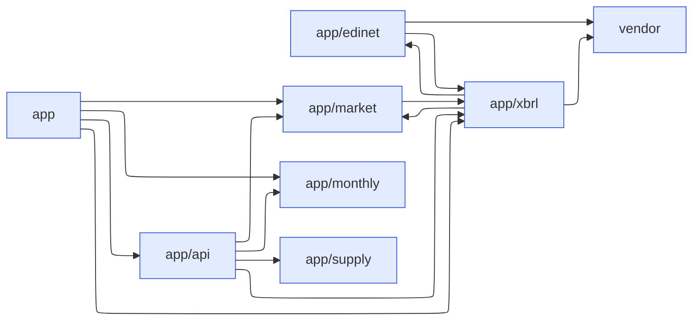
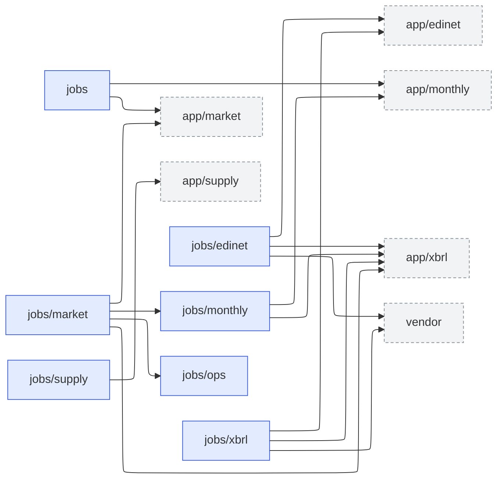
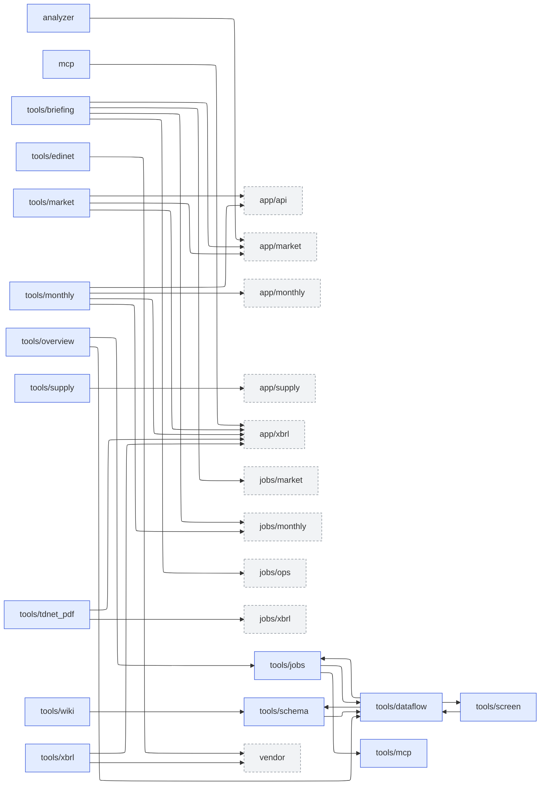

# モジュールの依存

入口は [OVERVIEW.md](../OVERVIEW.md)。

`app`・`jobs`・`mcp`・`tools`・`analyzer` の Python の `import` を AST で読み、パッケージ単位にまとめた。関数の中の `import` も数える。

- パッケージは `app/<機能>`・`jobs/<機能>`・`tools/<名前>`・`mcp`・`analyzer`。各フォルダの直下のファイルは `app`・`jobs`・`tools` の名前で 1 つにする
- `vendor` は `app/xbrlp` と `app/edinet_wrapper` をまとめた 1 つの箱
- ほぼ全部が使う共通（`app` 直下の db・models・config など、`jobs` 直下）へ向かう線は図から省く。表には出す
- 青い枠はその図の主役、灰色の点線の枠はそれ以外。点線の矢印は `app` が `jobs` を使っている線（「jobs と app」の図）
- `import` があるだけで、実行時に呼ぶかは見ない。テストは数えない

## app の中

## jobs と app

矢印は `import` する側から、される側へ。

## tools・mcp・analyzer

これらを向く線・これらから出る線。`app`・`jobs` 直下（共通）への線は省く。

## パッケージごとの依存先

図で省いた共通も含む。

| パッケージ | 依存先 |
|---|---|
| `analyzer` | `app`, `app/market` |
| `app` | `app/api`, `app/market`, `app/monthly`, `app/xbrl` |
| `app/api` | `app`, `app/market`, `app/monthly`, `app/supply`, `app/xbrl` |
| `app/edinet` | `app`, `app/xbrl`, `vendor` |
| `app/market` | `app`, `app/xbrl` |
| `app/monthly` | `app` |
| `app/supply` | `app` |
| `app/xbrl` | `app`, `app/edinet`, `app/market`, `vendor` |
| `jobs` | `app`, `app/market`, `app/monthly` |
| `jobs/edinet` | `app`, `app/edinet`, `app/xbrl`, `vendor` |
| `jobs/market` | `app`, `app/market`, `app/xbrl`, `jobs`, `jobs/monthly`, `jobs/ops` |
| `jobs/monthly` | `app`, `app/monthly`, `app/xbrl`, `jobs` |
| `jobs/ops` | `app`, `jobs` |
| `jobs/supply` | `app`, `app/supply`, `jobs` |
| `jobs/xbrl` | `app`, `app/edinet`, `app/xbrl`, `jobs`, `vendor` |
| `mcp` | `app`, `app/xbrl` |
| `tools` |  |
| `tools/briefing` | `app`, `app/market`, `jobs`, `jobs/market`, `jobs/monthly`, `jobs/ops` |
| `tools/ci` |  |
| `tools/dataflow` | `app`, `tools/jobs`, `tools/schema`, `tools/screen` |
| `tools/edinet` | `app`, `vendor` |
| `tools/golden` | `app` |
| `tools/jobs` | `tools/dataflow`, `tools/mcp` |
| `tools/lint` |  |
| `tools/market` | `app`, `app/api`, `app/market`, `app/xbrl` |
| `tools/mcp` |  |
| `tools/monthly` | `app`, `app/api`, `app/monthly`, `app/xbrl`, `jobs`, `jobs/monthly` |
| `tools/ops` |  |
| `tools/overview` | `tools/dataflow`, `tools/jobs` |
| `tools/prodslice` | `app` |
| `tools/schema` | `app`, `tools/dataflow` |
| `tools/screen` | `app`, `tools/dataflow` |
| `tools/supply` | `app/supply` |
| `tools/tdnet_pdf` | `app`, `app/xbrl`, `jobs/xbrl` |
| `tools/wiki` | `tools/schema` |
| `tools/xbrl` | `app`, `app/xbrl`, `vendor` |
| `vendor` |  |
