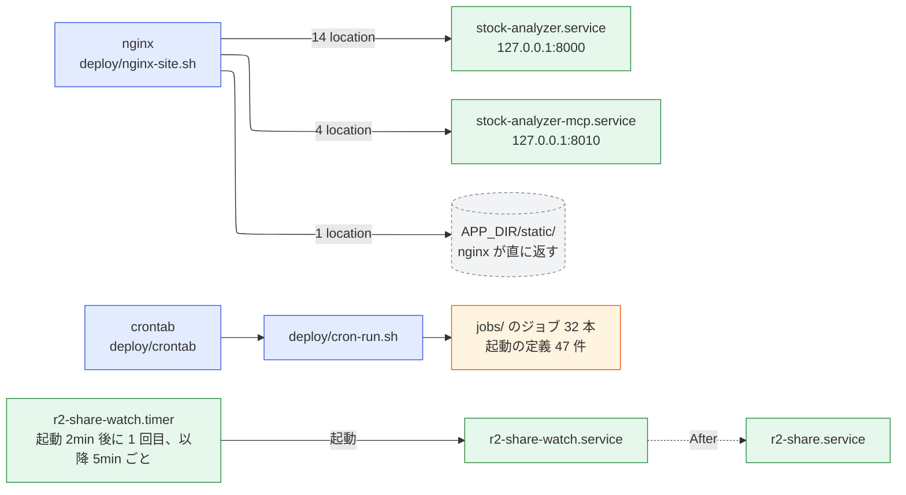

# システム構成

入口は [OVERVIEW.md](../OVERVIEW.md)。

`deploy/` の systemd のユニット・crontab・nginx の設定のスクリプトから、書いてある範囲だけを拾った。推測で箱や線は足さない。

- systemd: `deploy/*.service`・`*.timer` の `[Unit]` `[Service]` `[Timer]` `[Install]`
- cron: `deploy/crontab`（`Asia/Tokyo`）。ジョブごとの時刻と引数は [JOBS.md](../JOBS.md)
- nginx: `deploy/nginx-site.sh` の `proxy_block`（シェルの here-doc）にある `location` と、その中の `proxy_pass`・`alias`・`return`・`auth_request`。正規表現で読むので、書き方を変えると読めなくなり、テストが落ちる
- 図で nginx とユニットをつなぐのは、ユニットが開くポート（`Environment=…_PORT=` と `uvicorn-start.sh` の `--port`）が nginx の上流のポートと同じときだけ

## 図

実線は呼ぶ・中継する、点線は systemd の `After`（起動の順）。

## systemd のユニット

| ユニット | 説明 | 起動するもの | After | 入る先 | 再起動 | 待ち受けるポート |
|---|---|---|---|---|---|---|
| `cve-2026-98432.service` | CVE-2026-98432 IPv4 TCP IP-option filter | `/usr/sbin/nft -c -f /etc/cve-2026-98432.nft` `/usr/sbin/nft -f /etc/cve-2026-98432.nft` | `systemd-modules-load.service` | `sysinit.target` |  |  |
| `r2-share-watch.service` | Restart rclone R2 mount if it is not listed or unlistable | `/home/stock/stock-analyzer/deploy/r2-share-watch.sh` | `r2-share.service` |  |  |  |
| `r2-share-watch.timer` | Check rclone R2 mount every 5 minutes | タイマー: 起動 2min 後に 1 回目、以降 5min ごと（起こす先 `r2-share-watch.service`） |  | `timers.target` |  |  |
| `r2-share.service` | rclone mount Cloudflare R2 bucket share | `/usr/bin/rclone mount r2:share /home/stock/r2-share --config /home/stock/.config/rclone/rclone.conf --vfs-cache-mode writes --dir-cache-time 10s --umask 022 --cache-dir /home/stock/.cache/rclone` | `network-online.target` | `default.target` | always |  |
| `stock-analyzer-mcp.service` | stock-analyzer logs MCP (read-only) | `/home/stock/stock-analyzer/.venv/bin/python mcp/log_mcp.py` | `network.target` | `multi-user.target` | on-failure | 8010 |
| `stock-analyzer.service` | stock-analyzer (FastAPI) | `/bin/bash /home/stock/stock-analyzer/deploy/uvicorn-start.sh` | `network.target` | `multi-user.target` | on-failure | 8000 |

## nginx の location

上流は `APP_UPSTREAM=127.0.0.1:8000`, `MCP_UPSTREAM=127.0.0.1:8010`（スクリプトの既定値。環境変数で変わる）。「Cloudflare Access」の列は `auth_request /_cf_access;` が入っているもの。

| location | 行き先 | Cloudflare Access | 備考 |
|---|---|---|---|
| `= /_cf_access` | `127.0.0.1:8000` へ中継（`APP_UPSTREAM`） |  | 内部だけ |
| `= /` | 301 で `/monthly` へ |  |  |
| `= /robots.txt` | `127.0.0.1:8000` へ中継（`APP_UPSTREAM`） |  |  |
| `= /sitemap.xml` | `127.0.0.1:8000` へ中継（`APP_UPSTREAM`） |  |  |
| `= /favicon.ico` | `127.0.0.1:8000` へ中継（`APP_UPSTREAM`） |  |  |
| `^~ /monthly` | `127.0.0.1:8000` へ中継（`APP_UPSTREAM`） |  |  |
| `= /static/monthly_row_order.json` | `127.0.0.1:8000` へ中継（`APP_UPSTREAM`） |  |  |
| `= /static/ir_monthly_codes.json` | `127.0.0.1:8000` へ中継（`APP_UPSTREAM`） |  |  |
| `^~ /static/` | nginx が直に返す `APP_DIR/static/` |  |  |
| `= /api/v1/tables` | `127.0.0.1:8000` へ中継（`APP_UPSTREAM`） |  |  |
| `~ ^/api/v1/tables/[0-9][0-9A-Z]{3}[0-9](?:/[0-9]{4})?$` | `127.0.0.1:8000` へ中継（`APP_UPSTREAM`） |  |  |
| `^~ /app` | `127.0.0.1:8000` へ中継（`APP_UPSTREAM`） | あり |  |
| `^~ /docs` | `127.0.0.1:8000` へ中継（`APP_UPSTREAM`） | あり |  |
| `^~ /redoc` | `127.0.0.1:8000` へ中継（`APP_UPSTREAM`） | あり |  |
| `= /openapi.json` | `127.0.0.1:8000` へ中継（`APP_UPSTREAM`） | あり |  |
| `^~ /.well-known/oauth-` | `127.0.0.1:8010` へ中継（`MCP_UPSTREAM`） |  |  |
| `^~ /.well-known/openid-configuration` | `127.0.0.1:8010` へ中継（`MCP_UPSTREAM`） |  |  |
| `^~ /oauth/` | `127.0.0.1:8010` へ中継（`MCP_UPSTREAM`） |  |  |
| `~ ^/mcp/?$` | `127.0.0.1:8010` へ中継（`MCP_UPSTREAM`） |  |  |
| `/` | `127.0.0.1:8000` へ中継（`APP_UPSTREAM`） | あり |  |

## cron

`deploy/crontab` の起動の定義は 47 件、ジョブは 32 本。すべて `deploy/cron-run.sh` 経由。

| 機能のフォルダ | 起動の定義 |
|---|---|
| `edinet` | 7 |
| `market` | 12 |
| `monthly` | 16 |
| `ops` | 3 |
| `supply` | 3 |
| `xbrl` | 5 |
| `（jobs 直下）` | 1 |

## ここからは拾えない

- `deploy/` の外（Cloudflare の DNS・Access の設定、R2 のバケット、ConoHa の VPS）
- `deploy/provision.sh`・`update.sh`・`fluent-bit.conf`・`monitoring/`・`logrotate` が作るもの（ログの送り先、監視、証明書など）。この生成器は読まない
- ユニットが実際にどのユーザ・どの環境変数で動くか（`.env` の中身）
- 本番で今動いているかどうか。ここに書いてあるのはリポジトリの定義だけ
- DB（SQLite）とデータの置き場（`data/`）の位置。`deploy/README.md` を読む
