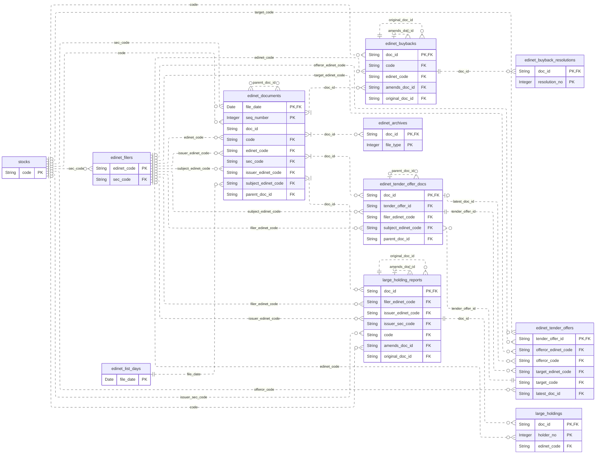

# スキーマ: EDINET・大量保有

正は `app/models.py`。全体は [SCHEMA.md](../SCHEMA.md)。

図は主キーと参照の列だけ。実線は外部キー、点線はモデルで宣言しただけの参照（DB の制約は無い）。親の側が `}|` の線は、親の列が一意でない（同じ値の行が親に何行もある）。ほかの機能の表は主キーと指される列だけ出す。

## テーブル

見出しの下の文と「説明」の列は、モデルの `comment`（DB には出ない）。型の列は DDL の型で、括弧の中はモデルの型。

`JstDateTime`: 日本時間をタイムゾーンなしで持つ。

### edinet_archives

EDINET の書類取得 API の ZIP を残した記録。中身は data/edinet → OneDrive

読み書きするバッチ・API: [データの流れ](../dataflow/edinet.md#edinet_archives)

| 列 | 型 | NULL | キー | 値 | 既定 | 説明 |
|---|---|---|---|---|---|---|
| `doc_id` | VARCHAR(8) |  | PK / → `edinet_documents.doc_id`（制約なし） |  |  |  |
| `file_type` | INTEGER |  | PK |  |  | 書類取得 API の type（1 / 5） |
| `doc_type_code` | VARCHAR(3) | 可 |  |  |  |  |
| `rel_path` | TEXT |  |  |  |  | data/edinet からの相対パス |
| `status` | VARCHAR(8) |  |  | `saved` data/edinet に書いた。翌朝 backup_data が OneDrive へ move する `gone` 取り直しのとき EDINET が 404。残っていない |  |  |
| `bytes` | INTEGER | 可 |  |  |  |  |
| `sha256` | VARCHAR(64) | 可 |  |  |  |  |
| `saved_at` | DATETIME（`JstDateTime`） |  |  |  |  |  |

### edinet_buyback_resolutions

自己株券買付状況報告書の 1 書類 × 決議 1 件（取締役会・株主総会・投資法人の役員会）

読み書きするバッチ・API: [データの流れ](../dataflow/edinet.md#edinet_buyback_resolutions)

| 列 | 型 | NULL | キー | 値 | 既定 | 説明 |
|---|---|---|---|---|---|---|
| `doc_id` | VARCHAR(8) |  | PK / → `edinet_buybacks.doc_id`（制約なし） |  |  |  |
| `resolution_no` | INTEGER |  | PK |  |  | 書類の中の順番（1 始まり） |
| `kind` | VARCHAR |  |  | `board` / `shareholders` |  |  |
| `body` | VARCHAR | 可 |  |  |  | 決議した機関（取締役会・定時株主総会・役員会） |
| `resolution_date` | DATE | 可 |  |  |  | 決議日 |
| `acquire_from` | DATE | 可 |  |  |  | 取得期間 |
| `acquire_to` | DATE | 可 |  |  |  |  |
| `limit_shares` | BIGINT | 可 |  |  |  | 決議の枠（株数）。無ければ NULL |
| `limit_amount` | BIGINT | 可 |  |  |  | 決議の枠（価額の総額・円） |
| `month_shares` | BIGINT | 可 |  |  |  | 報告月の取得（「－」は 0） |
| `month_amount` | BIGINT | 可 |  |  |  |  |
| `cumulative_shares` | BIGINT | 可 |  |  |  | 報告月末までの累計 |
| `cumulative_amount` | BIGINT | 可 |  |  |  |  |
| `progress_shares` | FLOAT | 可 |  |  |  | 進捗（書類の値。0.5297 = 52.97%） |
| `progress_amount` | FLOAT | 可 |  |  |  |  |
| `label` | TEXT | 可 |  |  |  | 決議状況の行の見出し（そのまま） |

### edinet_buybacks

自己株券買付状況報告書・訂正（EDINET 書類種別 220 / 230）の 1 書類。中身は書類取得 API type=1（XBRL）のテキストブロックの表

読み書きするバッチ・API: [データの流れ](../dataflow/edinet.md#edinet_buybacks)

| 列 | 型 | NULL | キー | 値 | 既定 | 説明 |
|---|---|---|---|---|---|---|
| `doc_id` | VARCHAR(8) |  | PK / → `edinet_documents.doc_id`（制約なし） |  |  |  |
| `file_date` | DATE |  |  |  |  |  |
| `submit_datetime` | DATETIME（`JstDateTime`） | 可 |  |  |  |  |
| `doc_type_code` | VARCHAR(3) |  |  |  |  | 220 報告書 / 230 訂正 |
| `form_code` | VARCHAR(6) | 可 |  |  |  | 170000 株式会社 / 253000 投資法人 |
| `code` | VARCHAR(5) | 可 | → `stocks.code`（制約なし） |  |  | 上場していなければ NULL |
| `edinet_code` | VARCHAR(6) | 可 | → `edinet_filers.edinet_code`（制約なし） |  |  |  |
| `filer_name` | VARCHAR | 可 |  |  |  |  |
| `report_month` | VARCHAR(7) | 可 |  |  |  | 報告月 YYYY-MM（報告期間の末日の月） |
| `period_start` | DATE | 可 |  |  |  | 報告期間 |
| `period_end` | DATE | 可 |  |  |  |  |
| `issued_shares` | BIGINT | 可 |  |  |  | 報告月末の発行済株式総数（投資法人は投資口） |
| `treasury_shares` | BIGINT | 可 |  |  |  | 報告月末の保有自己株式数 |
| `resolution_count` | INTEGER | 可 |  |  |  | 決議の数（edinet_buyback_resolutions の行数） |
| `month_shares` | BIGINT | 可 |  |  |  | 報告月に取得した株数（決議の合計） |
| `month_amount` | BIGINT | 可 |  |  |  | 報告月に取得した価額の総額（円） |
| `is_amendment` | BOOLEAN |  |  |  | `False` |  |
| `amends_doc_id` | VARCHAR(8) | 可 | → `edinet_buybacks.doc_id`（制約なし） |  |  |  |
| `original_doc_id` | VARCHAR(8) |  | → `edinet_buybacks.doc_id`（制約なし） |  |  |  |
| `is_latest` | BOOLEAN |  |  |  | `False` | 大元ごとの最新の 1 件 |
| `withdrawn` | BOOLEAN |  |  |  | `False` |  |
| `parse_status` | VARCHAR |  |  | `parsed` `meta` 取得状況が対象外の訂正 `failed` |  |  |
| `parse_error` | TEXT | 可 |  |  |  |  |
| `fetched_at` | DATETIME（`JstDateTime`） |  |  |  |  |  |

| 索引・一意 | 列 | 一意 |
|---|---|---|
| `ix_edinet_buybacks_code` | code, report_month |  |
| `ix_edinet_buybacks_edinet_code` | edinet_code |  |
| `ix_edinet_buybacks_original_doc_id` | original_doc_id |  |

### edinet_documents

EDINET 書類一覧 API（type=2）の 1 行。docID は一意でない（修正・不開示・取下げが別レコードで出る）

読み書きするバッチ・API: [データの流れ](../dataflow/edinet.md#edinet_documents)

| 列 | 型 | NULL | キー | 値 | 既定 | 説明 |
|---|---|---|---|---|---|---|
| `file_date` | DATE |  | PK / → `edinet_list_days.file_date`（制約なし） |  |  |  |
| `seq_number` | INTEGER |  | PK |  |  |  |
| `doc_id` | VARCHAR(8) |  |  |  |  |  |
| `code` | VARCHAR(5) | 可 | → `stocks.code`（制約なし） |  |  | secCode か edinet_filers から引く |
| `edinet_code` | VARCHAR(6) | 可 | → `edinet_filers.edinet_code`（制約なし） |  |  |  |
| `sec_code` | VARCHAR(5) | 可 | → `stocks.code`（制約なし） |  |  |  |
| `jcn` | VARCHAR(13) | 可 |  |  |  |  |
| `filer_name` | VARCHAR | 可 |  |  |  |  |
| `fund_code` | VARCHAR(6) | 可 |  |  |  |  |
| `ordinance_code` | VARCHAR(3) | 可 |  |  |  |  |
| `form_code` | VARCHAR(6) | 可 |  |  |  |  |
| `doc_type_code` | VARCHAR(3) | 可 |  |  |  |  |
| `period_start` | DATE | 可 |  |  |  |  |
| `period_end` | DATE | 可 |  |  |  |  |
| `submit_datetime` | DATETIME（`JstDateTime`） | 可 |  |  |  |  |
| `doc_description` | TEXT | 可 |  |  |  |  |
| `issuer_edinet_code` | VARCHAR(6) | 可 | → `edinet_filers.edinet_code`（制約なし） |  |  |  |
| `subject_edinet_code` | VARCHAR(6) | 可 | → `edinet_filers.edinet_code`（制約なし） |  |  |  |
| `subsidiary_edinet_codes` | TEXT | 可 |  |  |  | カンマ区切り |
| `current_report_reasons` | TEXT | 可 |  |  |  | カンマ区切り |
| `parent_doc_id` | VARCHAR(8) | 可 | → `edinet_documents.doc_id`（制約なし） |  |  |  |
| `ope_datetime` | DATETIME（`JstDateTime`） | 可 |  |  |  |  |
| `withdrawal_status` | VARCHAR(1) |  |  |  |  |  |
| `doc_info_edit_status` | VARCHAR(1) |  |  |  |  |  |
| `disclosure_status` | VARCHAR(1) |  |  |  |  |  |
| `xbrl_flag` | BOOLEAN |  |  |  |  |  |
| `pdf_flag` | BOOLEAN |  |  |  |  |  |
| `attach_doc_flag` | BOOLEAN |  |  |  |  |  |
| `english_doc_flag` | BOOLEAN |  |  |  |  |  |
| `csv_flag` | BOOLEAN |  |  |  |  |  |
| `legal_status` | VARCHAR(1) |  |  |  |  |  |
| `fetched_at` | DATETIME（`JstDateTime`） |  |  |  |  |  |

| 索引・一意 | 列 | 一意 |
|---|---|---|
| `ix_edinet_documents_code` | code |  |
| `ix_edinet_documents_code_type` | code, doc_type_code, submit_datetime |  |
| `ix_edinet_documents_doc_id` | doc_id |  |
| `ix_edinet_documents_doc_type_code` | doc_type_code |  |
| `ix_edinet_documents_edinet_code` | edinet_code |  |
| `ix_edinet_documents_issuer_edinet_code` | issuer_edinet_code |  |
| `ix_edinet_documents_subject_edinet_code` | subject_edinet_code |  |

### edinet_filers

EDINET コードリスト（提出者）の写し。上場していない提出者（大量保有の保有者など）も持つ。リストから消えた提出者も残す

読み書きするバッチ・API: [データの流れ](../dataflow/edinet.md#edinet_filers)

| 列 | 型 | NULL | キー | 値 | 既定 | 説明 |
|---|---|---|---|---|---|---|
| `edinet_code` | VARCHAR(6) |  | PK |  |  |  |
| `sec_code` | VARCHAR(5) | 可 | → `stocks.code`（制約なし） |  |  | 証券コード 5 桁 |
| `filer_name` | VARCHAR | 可 |  |  |  |  |
| `filer_name_en` | VARCHAR | 可 |  |  |  |  |
| `filer_type` | VARCHAR | 可 |  |  |  | 提出者種別（内国法人・組合 / 外国法人・組合 / 個人 など） |
| `listed` | VARCHAR | 可 |  |  |  | 上場区分（上場 / 非上場） |
| `is_consolidated` | VARCHAR | 可 |  |  |  | 連結の有無（有 / 無） |
| `capital` | VARCHAR | 可 |  |  |  | 資本金（百万円）。リストの文字列のまま |
| `fiscal_year_end` | VARCHAR | 可 |  |  |  | 決算日（例 3月31日） |
| `industry` | VARCHAR | 可 |  |  |  | 提出者業種 |
| `jcn` | VARCHAR(13) | 可 |  |  |  | 提出者法人番号 |
| `list_date` | DATE | 可 |  |  |  | リストのダウンロード実行日 |
| `updated_at` | DATETIME（`JstDateTime`） |  |  |  |  |  |

| 索引・一意 | 列 | 一意 |
|---|---|---|
| `ix_edinet_filers_sec_code` | sec_code |  |

### edinet_list_days

書類一覧を取った日ごとの記録

読み書きするバッチ・API: [データの流れ](../dataflow/edinet.md#edinet_list_days)

| 列 | 型 | NULL | キー | 値 | 既定 | 説明 |
|---|---|---|---|---|---|---|
| `file_date` | DATE |  | PK |  |  |  |
| `count` | INTEGER |  |  |  |  | metadata.resultset.count |
| `max_seq` | INTEGER | 可 |  |  |  |  |
| `process_datetime` | DATETIME（`JstDateTime`） | 可 |  |  |  | EDINET 側の一覧作成時刻 |
| `finalized` | BOOLEAN |  |  |  |  | file_date より後に取った = その日の一覧は確定 |
| `fetched_at` | DATETIME（`JstDateTime`） |  |  |  |  |  |

### edinet_tender_offer_docs

公開買付けの書類 1 件（240〜340）。届出・訂正・撤回・報告書・意見表明・対質問回答など

読み書きするバッチ・API: [データの流れ](../dataflow/edinet.md#edinet_tender_offer_docs)

| 列 | 型 | NULL | キー | 値 | 既定 | 説明 |
|---|---|---|---|---|---|---|
| `doc_id` | VARCHAR(8) |  | PK / → `edinet_documents.doc_id`（制約なし） |  |  |  |
| `tender_offer_id` | VARCHAR(8) |  | → `edinet_tender_offers.tender_offer_id`（制約なし） |  |  | 大元（parent_doc_id をたどる） |
| `file_date` | DATE |  |  |  |  |  |
| `submit_datetime` | DATETIME（`JstDateTime`） | 可 |  |  |  |  |
| `doc_type_code` | VARCHAR(3) |  |  |  |  |  |
| `ordinance_code` | VARCHAR(3) | 可 |  |  |  | 040 他社株 / 050 発行者（自社株） |
| `form_code` | VARCHAR(6) | 可 |  |  |  |  |
| `title` | TEXT | 可 |  |  |  |  |
| `filer_edinet_code` | VARCHAR(6) | 可 | → `edinet_filers.edinet_code`（制約なし） |  |  |  |
| `filer_name` | VARCHAR | 可 |  |  |  |  |
| `subject_edinet_code` | VARCHAR(6) | 可 | → `edinet_filers.edinet_code`（制約なし） |  |  | 届出書・報告書は対象者、意見表明は買付者 |
| `parent_doc_id` | VARCHAR(8) | 可 | → `edinet_tender_offer_docs.doc_id`（制約なし） |  |  |  |
| `withdrawn` | BOOLEAN |  |  |  | `False` | 取下げ・不開示 |
| `period_start` | DATE | 可 |  |  |  |  |
| `period_end` | DATE | 可 |  |  |  |  |
| `price` | FLOAT | 可 |  |  |  |  |
| `planned_shares` | BIGINT | 可 |  |  |  |  |
| `min_shares` | BIGINT | 可 |  |  |  |  |
| `max_shares` | BIGINT | 可 |  |  |  |  |
| `holding_ratio_after` | FLOAT | 可 |  |  |  |  |
| `target_name` | VARCHAR | 可 |  |  |  |  |
| `opinion` | VARCHAR | 可 |  | `support` / `oppose` / `neutral` / `reserved` |  |  |
| `recommendation` | VARCHAR | 可 |  | `recommend` / `leave` / `not_recommend` |  |  |
| `opinion_text` | TEXT | 可 |  |  |  | 意見の内容（最初の段落） |
| `success` | BOOLEAN | 可 |  |  |  | 公開買付けの成否（報告書） |
| `tendered_shares` | BIGINT | 可 |  |  |  |  |
| `purchased_shares` | BIGINT | 可 |  |  |  |  |
| `parse_status` | VARCHAR |  |  | `parsed` `meta` 中身を読まない書類 `failed` |  |  |
| `parse_error` | TEXT | 可 |  |  |  |  |
| `fetched_at` | DATETIME（`JstDateTime`） |  |  |  |  |  |

| 索引・一意 | 列 | 一意 |
|---|---|---|
| `ix_edinet_tender_offer_docs_tender_offer_id` | tender_offer_id |  |

### edinet_tender_offers

公開買付け 1 件。届出書（240）を大元に、訂正・撤回・意見表明・報告書から決め直す

読み書きするバッチ・API: [データの流れ](../dataflow/edinet.md#edinet_tender_offers)

| 列 | 型 | NULL | キー | 値 | 既定 | 説明 |
|---|---|---|---|---|---|---|
| `tender_offer_id` | VARCHAR(8) |  | PK / → `edinet_tender_offer_docs.doc_id`（制約なし） |  |  | 大元の docID（ふつうは公開買付届出書） |
| `is_issuer` | BOOLEAN |  |  |  | `False` | 発行者による公開買付け（自社株 TOB） |
| `offeror_edinet_code` | VARCHAR(6) | 可 | → `edinet_filers.edinet_code`（制約なし） |  |  |  |
| `offeror_name` | VARCHAR | 可 |  |  |  |  |
| `offeror_code` | VARCHAR(5) | 可 | → `stocks.code`（制約なし） |  |  | 買付者が上場していれば |
| `target_edinet_code` | VARCHAR(6) | 可 | → `edinet_filers.edinet_code`（制約なし） |  |  |  |
| `target_name` | VARCHAR | 可 |  |  |  |  |
| `target_code` | VARCHAR(5) | 可 | → `stocks.code`（制約なし） |  |  | 対象者 |
| `announced_date` | DATE | 可 |  |  |  | 届出書の提出日 |
| `period_start` | DATE | 可 |  |  |  | 買付け等の期間 |
| `period_end` | DATE | 可 |  |  |  |  |
| `price` | FLOAT | 可 |  |  |  | 普通株式 1 株の買付価格（円） |
| `price_initial` | FLOAT | 可 |  |  |  | 届出書の当初の価格 |
| `planned_shares` | BIGINT | 可 |  |  |  | 買付予定数 |
| `min_shares` | BIGINT | 可 |  |  |  | 買付予定数の下限（無ければ NULL） |
| `max_shares` | BIGINT | 可 |  |  |  | 買付予定数の上限（無ければ NULL） |
| `holding_ratio_after` | FLOAT | 可 |  |  |  | 買付け後の株券等所有割合（届出書は予定、報告書は結果） |
| `opinion` | VARCHAR | 可 |  | `support` / `oppose` / `neutral` / `reserved` |  | 対象者の意見 |
| `recommendation` | VARCHAR | 可 |  | `recommend` / `leave` / `not_recommend` |  | 応募 |
| `status` | VARCHAR |  |  | `open` / `succeeded` / `failed` / `withdrawn` |  |  |
| `tendered_shares` | BIGINT | 可 |  |  |  | 応募数（株式換算） |
| `purchased_shares` | BIGINT | 可 |  |  |  | 買付数 |
| `result_date` | DATE | 可 |  |  |  | 公開買付報告書の提出日 |
| `latest_doc_id` | VARCHAR(8) | 可 | → `edinet_tender_offer_docs.doc_id`（制約なし） |  |  | いちばん新しい書類 |
| `doc_count` | INTEGER | 可 |  |  |  |  |
| `updated_at` | DATETIME（`JstDateTime`） |  |  |  |  |  |

| 索引・一意 | 列 | 一意 |
|---|---|---|
| `ix_edinet_tender_offers_offeror_edinet_code` | offeror_edinet_code |  |
| `ix_edinet_tender_offers_target_code` | target_code |  |
| `ix_edinet_tender_offers_target_edinet_code` | target_edinet_code |  |

### large_holding_reports

大量保有報告書・変更報告書・訂正（EDINET 書類種別 350 / 360）の 1 書類。中身は書類取得 API type=5（XBRL→CSV）

読み書きするバッチ・API: [データの流れ](../dataflow/edinet.md#large_holding_reports)

| 列 | 型 | NULL | キー | 値 | 既定 | 説明 |
|---|---|---|---|---|---|---|
| `doc_id` | VARCHAR(8) |  | PK / → `edinet_documents.doc_id`（制約なし） |  |  |  |
| `file_date` | DATE |  |  |  |  |  |
| `submit_datetime` | DATETIME（`JstDateTime`） | 可 |  |  |  |  |
| `doc_type_code` | VARCHAR(3) |  |  |  |  | 350 大量保有・変更報告書 / 360 訂正 |
| `form_code` | VARCHAR(6) | 可 |  |  |  | 010000 大量保有 / 010002 変更 / 020002 短期大量譲渡 / 03xxxx 特例 など |
| `title` | TEXT | 可 |  |  |  | 表紙の書類名（変更報告書ＮＯ．3 など） |
| `filer_edinet_code` | VARCHAR(6) | 可 | → `edinet_filers.edinet_code`（制約なし） |  |  |  |
| `filer_name` | VARCHAR | 可 |  |  |  |  |
| `issuer_edinet_code` | VARCHAR(6) | 可 | → `edinet_filers.edinet_code`（制約なし） |  |  |  |
| `issuer_sec_code` | VARCHAR(5) | 可 | → `stocks.code`（制約なし） |  |  | 発行者の証券コード（CSV の 4 桁に 0 を付けた 5 桁） |
| `issuer_name` | VARCHAR | 可 |  |  |  |  |
| `code` | VARCHAR(5) | 可 | → `stocks.code`（制約なし） |  |  | 上場していなければ NULL |
| `obligation_date` | DATE | 可 |  |  |  | 報告義務発生日 |
| `filing_date` | DATE | 可 |  |  |  | 表紙の提出日 |
| `reason` | TEXT | 可 |  |  |  | 提出事由（変更報告書だけ） |
| `arrangement` | VARCHAR | 可 |  |  |  | 提出形態（連名 / その他） |
| `holder_count` | INTEGER | 可 |  |  |  | 提出者及び共同保有者の総数 |
| `shares_held` | BIGINT | 可 |  |  |  | 保有株券等の数（合計） |
| `outstanding_shares` | BIGINT | 可 |  |  |  | 発行済株式等総数 |
| `holding_ratio` | FLOAT | 可 |  |  |  | 株券等保有割合（0.0507 = 5.07%） |
| `holding_ratio_prev` | FLOAT | 可 |  |  |  | 直前の報告書の保有割合。大量保有報告書は NULL |
| `joint_holders_text` | TEXT | 可 |  |  |  | 第3 共同保有者に関する事項（該当なしは NULL） |
| `is_amendment` | BOOLEAN |  |  |  | `False` |  |
| `amends_doc_id` | VARCHAR(8) | 可 | → `large_holding_reports.doc_id`（制約なし） |  |  | 訂正の対象（DEI の IdentificationOfDocumentSubjectToAmendment） |
| `original_doc_id` | VARCHAR(8) |  | → `large_holding_reports.doc_id`（制約なし） |  |  | 訂正をたどった大元。訂正でなければ自分 |
| `is_latest` | BOOLEAN |  |  |  | `False` | 大元ごとに取下げでない最新の 1 件 |
| `withdrawn` | BOOLEAN |  |  |  | `False` | 取下げ・不開示（edinet_documents から） |
| `parse_status` | VARCHAR |  |  | `parsed` / `failed` |  |  |
| `parse_error` | TEXT | 可 |  |  |  |  |
| `fetched_at` | DATETIME（`JstDateTime`） |  |  |  |  |  |

| 索引・一意 | 列 | 一意 |
|---|---|---|
| `ix_large_holding_reports_code` | code, obligation_date |  |
| `ix_large_holding_reports_file_date` | file_date |  |
| `ix_large_holding_reports_filer_edinet_code` | filer_edinet_code |  |
| `ix_large_holding_reports_latest_file` | is_latest, file_date |  |
| `ix_large_holding_reports_original_doc_id` | original_doc_id |  |

### large_holdings

大量保有の 1 書類 × 提出者・共同保有者 1 人（CSV の FilerLargeVolumeHolder<N>Member）

読み書きするバッチ・API: [データの流れ](../dataflow/edinet.md#large_holdings)

| 列 | 型 | NULL | キー | 値 | 既定 | 説明 |
|---|---|---|---|---|---|---|
| `doc_id` | VARCHAR(8) |  | PK / → `large_holding_reports.doc_id`（制約なし） |  |  |  |
| `holder_no` | INTEGER |  | PK |  |  | 書類の中の番号（1 始まり） |
| `edinet_code` | VARCHAR(6) | 可 | → `edinet_filers.edinet_code`（制約なし） |  |  |  |
| `name` | VARCHAR | 可 |  |  |  |  |
| `holder_type` | VARCHAR | 可 |  |  |  | 個人・法人の別（法人（株式会社）など） |
| `shares_held` | BIGINT | 可 |  |  |  |  |
| `outstanding_shares` | BIGINT | 可 |  |  |  |  |
| `holding_ratio` | FLOAT | 可 |  |  |  |  |
| `holding_ratio_prev` | FLOAT | 可 |  |  |  |  |
| `base_date` | DATE | 可 |  |  |  | 保有の基準日 |
| `purpose` | TEXT | 可 |  |  |  | 保有目的 |
| `important_proposal` | TEXT | 可 |  |  |  | 重要提案行為等（該当なしは NULL） |
| `own_funds` | BIGINT | 可 |  |  |  | 取得資金: 自己資金額（円） |
| `borrowings` | BIGINT | 可 |  |  |  | 借入金額計 |
| `other_funds` | BIGINT | 可 |  |  |  | その他金額計 |
| `total_funds` | BIGINT | 可 |  |  |  | 取得資金合計 |

| 索引・一意 | 列 | 一意 |
|---|---|---|
| `ix_large_holdings_edinet_code` | edinet_code |  |
