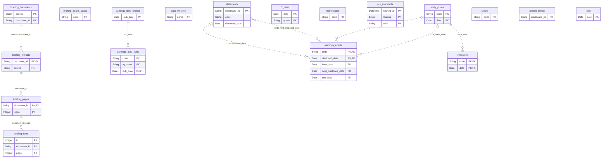

# スキーマ: 株価・決算

**自動生成。手で直さない。** 正は `app/models.py`。作り直しは `python -m tools.schema.render`。全体は [SCHEMA.md](../SCHEMA.md)。

図は主キーと参照の列だけ。実線は外部キー、点線はモデルで宣言しただけの参照（DB の制約は無い）。`stocks` と `edinet_filers` への参照は線にしない（表には出す）。親の側が `}|` の線は、親の列が一意でない（同じ値の行が親に何行もある）。ほかの機能の表は主キーと指される列だけ出す。

## テーブル

### briefing_documents

| 列 | 型 | NULL | キー | 値 | 既定 |
|---|---|---|---|---|---|
| `source` | VARCHAR(16) |  | PK | `tdnet` / `irbank` / `homepage` |  |
| `document_id` | VARCHAR(80) |  | PK |  |  |
| `code` | VARCHAR(5) |  | → `stocks.code`（制約なし） |  |  |
| `company_name` | VARCHAR | 可 |  |  |  |
| `pubdate` | VARCHAR(32) |  |  |  |  |
| `title` | TEXT |  |  |  |  |
| `rel_path` | TEXT |  |  |  |  |
| `url` | TEXT | 可 |  |  |  |
| `sha256` | VARCHAR(64) | 可 |  |  |  |
| `size` | INTEGER | 可 |  |  |  |
| `status` | VARCHAR(16) |  |  |  |  |
| `storage` | VARCHAR(16) |  |  |  | `local`（DB） |
| `saved_at` | DATETIME |  |  |  |  |

| 索引・一意 | 列 | 一意 |
|---|---|---|
| `ix_briefing_documents_code_pubdate` | code, pubdate |  |

### briefing_extracts

| 列 | 型 | NULL | キー | 値 | 既定 |
|---|---|---|---|---|---|
| `document_id` | VARCHAR(80) |  | PK / → `briefing_documents.(source, document_id)`（制約なし） |  |  |
| `source` | VARCHAR(16) |  | → `briefing_documents.(source, document_id)`（制約なし） |  |  |
| `code` | VARCHAR(5) |  | → `stocks.code`（制約なし） |  |  |
| `status` | VARCHAR(16) |  |  | `submitted` / `done` / `failed` |  |
| `batch_id` | VARCHAR(80) | 可 |  |  |  |
| `request_key` | VARCHAR(24) |  |  |  |  |
| `model` | VARCHAR(40) |  |  |  |  |
| `prompt_version` | VARCHAR(16) |  |  |  |  |
| `pages` | INTEGER | 可 |  |  |  |
| `llm_pages` | INTEGER | 可 |  |  |  |
| `error_pages` | INTEGER | 可 |  |  |  |
| `facts` | INTEGER | 可 |  |  |  |
| `verified` | INTEGER | 可 |  |  |  |
| `sum_checks` | INTEGER | 可 |  |  |  |
| `sum_mismatch` | INTEGER | 可 |  |  |  |
| `input_tokens` | INTEGER | 可 |  |  |  |
| `output_tokens` | INTEGER | 可 |  |  |  |
| `error` | TEXT | 可 |  |  |  |
| `submitted_at` | DATETIME |  |  |  |  |
| `extracted_at` | DATETIME | 可 |  |  |  |

| 索引・一意 | 列 | 一意 |
|---|---|---|
| `ix_briefing_extracts_batch` | batch_id |  |
| `ix_briefing_extracts_code` | code |  |

### briefing_facts

| 列 | 型 | NULL | キー | 値 | 既定 |
|---|---|---|---|---|---|
| `id` | INTEGER |  | PK |  |  |
| `document_id` | VARCHAR(80) |  | → `briefing_pages.(document_id, page)`（制約なし） |  |  |
| `page` | INTEGER |  | → `briefing_pages.(document_id, page)`（制約なし） |  |  |
| `metric` | TEXT |  |  |  |  |
| `segment` | TEXT | 可 |  |  |  |
| `period` | TEXT | 可 |  |  |  |
| `period_kind` | VARCHAR(24) | 可 |  |  |  |
| `value` | TEXT |  |  |  |  |
| `value_num` | FLOAT | 可 |  |  |  |
| `unit` | VARCHAR(24) | 可 |  |  |  |
| `part_of` | TEXT | 可 |  |  |  |
| `verified` | BOOLEAN |  |  |  |  |
| `sum_status` | VARCHAR(12) | 可 |  | `ok` / `split` / `paren` / `partial` / `mismatch` |  |

| 索引・一意 | 列 | 一意 |
|---|---|---|
| `ix_briefing_facts_doc` | document_id, page |  |

### briefing_irbank_scans

| 列 | 型 | NULL | キー | 値 | 既定 |
|---|---|---|---|---|---|
| `code` | VARCHAR(5) |  | PK / → `stocks.code`（制約なし） |  |  |
| `scanned_at` | DATETIME |  |  |  |  |
| `listed` | INTEGER |  |  |  |  |
| `saved` | INTEGER |  |  |  |  |
| `skipped` | INTEGER |  |  |  |  |
| `reindexed` | INTEGER |  |  |  |  |
| `missing` | INTEGER |  |  |  |  |
| `failed` | INTEGER |  |  |  |  |

### briefing_pages

| 列 | 型 | NULL | キー | 値 | 既定 |
|---|---|---|---|---|---|
| `document_id` | VARCHAR(80) |  | PK / → `briefing_extracts.document_id`（制約なし） |  |  |
| `page` | INTEGER |  | PK |  |  |
| `kind` | VARCHAR(24) |  |  | `divider` / `disclaimer` / `chart_or_table` / `table_or_text` / `text` |  |
| `title` | TEXT | 可 |  |  |  |
| `summary` | TEXT | 可 |  |  |  |
| `tables_json` | TEXT | 可 |  |  |  |
| `error` | TEXT | 可 |  |  |  |
| `raw_text` | TEXT | 可 |  |  |  |

### daily_prices

`WITHOUT ROWID`

| 列 | 型 | NULL | キー | 値 | 既定 |
|---|---|---|---|---|---|
| `code` | VARCHAR(5) |  | PK / → `stocks.code`（制約なし） |  |  |
| `date` | DATE |  | PK |  |  |
| `open` | FLOAT | 可 |  |  |  |
| `high` | FLOAT | 可 |  |  |  |
| `low` | FLOAT | 可 |  |  |  |
| `close` | FLOAT | 可 |  |  |  |
| `volume` | FLOAT | 可 |  |  |  |
| `turnover` | FLOAT | 可 |  |  |  |
| `adj_factor` | FLOAT | 可 |  |  | `1.0` |
| `adj_open` | FLOAT | 可 |  |  |  |
| `adj_high` | FLOAT | 可 |  |  |  |
| `adj_low` | FLOAT | 可 |  |  |  |
| `adj_close` | FLOAT | 可 |  |  |  |
| `adj_volume` | FLOAT | 可 |  |  |  |
| `market_cap` | FLOAT | 可 |  |  |  |
| `upper_limit` | INTEGER | 可 |  |  |  |
| `lower_limit` | INTEGER | 可 |  |  |  |
| `ex_rt` | VARCHAR | 可 |  |  |  |

| 索引・一意 | 列 | 一意 |
|---|---|---|
| `ix_prices_date` | date |  |

### data_versions

| 列 | 型 | NULL | キー | 値 | 既定 |
|---|---|---|---|---|---|
| `name` | VARCHAR |  | PK |  |  |
| `version` | INTEGER |  |  |  | `0`（DB） |

### earnings_date_fetches

| 列 | 型 | NULL | キー | 値 | 既定 |
|---|---|---|---|---|---|
| `pub_date` | DATE |  | PK |  |  |
| `n` | INTEGER |  |  |  |  |

### earnings_date_pubs

| 列 | 型 | NULL | キー | 値 | 既定 |
|---|---|---|---|---|---|
| `code` | VARCHAR(5) |  | PK / → `stocks.code`（制約なし） |  |  |
| `fq_name` | VARCHAR(8) |  | PK |  |  |
| `pub_date` | DATE |  | PK / → `earnings_date_fetches.pub_date`（制約なし） |  |  |
| `sch_date` | DATE | 可 |  |  |  |
| `fye` | VARCHAR(4) |  |  |  |  |
| `co_name` | VARCHAR |  |  |  |  |

| 索引・一意 | 列 | 一意 |
|---|---|---|
| `ix_earnings_date_pubs_sch_date` | sch_date |  |

### earnings_events

| 列 | 型 | NULL | キー | 値 | 既定 |
|---|---|---|---|---|---|
| `code` | VARCHAR(5) |  | PK / → `statements.(code, disclosed_date)`（制約なし） / → `daily_prices.(code, date)`（制約なし） |  |  |
| `disclosed_date` | DATE |  | PK / → `statements.(code, disclosed_date)`（制約なし） |  |  |
| `base_date` | DATE | 可 | → `daily_prices.(code, date)`（制約なし） |  |  |
| `base_price` | FLOAT | 可 |  |  |  |
| `return_1d` | FLOAT | 可 |  |  |  |
| `return_5d` | FLOAT | 可 |  |  |  |
| `return_20d` | FLOAT | 可 |  |  |  |
| `return_60d` | FLOAT | 可 |  |  |  |
| `return_to_date` | FLOAT | 可 |  |  |  |
| `alpha_1d` | FLOAT | 可 |  |  |  |
| `alpha_5d` | FLOAT | 可 |  |  |  |
| `alpha_20d` | FLOAT | 可 |  |  |  |
| `alpha_60d` | FLOAT | 可 |  |  |  |
| `alpha_to_date` | FLOAT | 可 |  |  |  |
| `disclosed_time` | VARCHAR | 可 |  |  |  |
| `is_first` | BOOLEAN | 可 |  |  |  |
| `next_disclosed_date` | DATE | 可 | → `statements.(code, disclosed_date)`（制約なし） |  |  |
| `end_date` | DATE | 可 | → `daily_prices.(code, date)`（制約なし） |  |  |
| `return_to_next` | FLOAT | 可 |  |  |  |
| `alpha_to_next` | FLOAT | 可 |  |  |  |

### fx_rates

| 列 | 型 | NULL | キー | 値 | 既定 |
|---|---|---|---|---|---|
| `date` | DATE |  | PK |  |  |
| `quote` | VARCHAR(3) |  | PK |  |  |
| `rate` | FLOAT |  |  |  |  |

| 索引・一意 | 列 | 一意 |
|---|---|---|
| `ix_fx_rates_quote_date` | quote, date |  |

### homepages

| 列 | 型 | NULL | キー | 値 | 既定 |
|---|---|---|---|---|---|
| `code` | VARCHAR(5) |  | PK / → `stocks.code`（制約なし） |  |  |
| `url` | TEXT |  |  |  |  |
| `host` | VARCHAR(255) |  |  |  |  |
| `source` | VARCHAR(32) |  |  | `manual` / `xbrl_url` / `tanshin_html` |  |
| `origin` | TEXT |  |  |  |  |
| `changed_at` | DATETIME |  |  |  |  |
| `checked_at` | DATETIME |  |  |  |  |

### indicators

| 列 | 型 | NULL | キー | 値 | 既定 |
|---|---|---|---|---|---|
| `code` | VARCHAR(5) |  | PK / → `daily_prices.(code, date)`（制約なし） |  |  |
| `date` | DATE |  | PK / → `daily_prices.(code, date)`（制約なし） |  |  |
| `close` | FLOAT | 可 |  |  |  |
| `ma50` | FLOAT | 可 |  |  |  |
| `ma150` | FLOAT | 可 |  |  |  |
| `ma200` | FLOAT | 可 |  |  |  |
| `ma200_slope_1m` | FLOAT | 可 |  |  |  |
| `high_52w` | FLOAT | 可 |  |  |  |
| `low_52w` | FLOAT | 可 |  |  |  |
| `rs_raw` | FLOAT | 可 |  |  |  |
| `rs_rank` | INTEGER | 可 |  |  |  |
| `stage` | INTEGER | 可 |  |  |  |
| `avg_volume_50` | FLOAT | 可 |  |  |  |

| 索引・一意 | 列 | 一意 |
|---|---|---|
| `ix_ind_date_stage` | date, stage |  |

### pts_snapshots

| 列 | 型 | NULL | キー | 値 | 既定 |
|---|---|---|---|---|---|
| `fetched_at` | DATETIME |  | PK |  |  |
| `ranking` | VARCHAR |  | PK | `night_up` / `night_down` / `night_volume` |  |
| `code` | VARCHAR(5) |  | PK / → `stocks.code`（制約なし） |  |  |
| `session_date` | DATE |  |  |  |  |
| `as_of` | VARCHAR(5) | 可 |  |  |  |
| `rank` | INTEGER |  |  |  |  |
| `name` | VARCHAR | 可 |  |  |  |
| `market` | VARCHAR | 可 |  |  |  |
| `base_close` | FLOAT | 可 |  |  |  |
| `pts_price` | FLOAT | 可 |  |  |  |
| `pts_chg_pct` | FLOAT | 可 |  |  |  |
| `volume` | INTEGER | 可 |  |  |  |

| 索引・一意 | 列 | 一意 |
|---|---|---|
| `ix_pts_session_ranking` | session_date, ranking |  |

### statements

| 列 | 型 | NULL | キー | 値 | 既定 |
|---|---|---|---|---|---|
| `disclosure_no` | VARCHAR |  | PK |  |  |
| `code` | VARCHAR(5) | 可 | → `stocks.code`（制約なし） |  |  |
| `disclosed_date` | DATE | 可 |  |  |  |
| `disclosed_time` | VARCHAR | 可 |  |  |  |
| `type_of_period` | VARCHAR | 可 |  |  |  |
| `type_of_document` | VARCHAR | 可 |  |  |  |
| `period_start` | DATE | 可 |  |  |  |
| `period_end` | DATE | 可 |  |  |  |
| `fiscal_year_start` | DATE | 可 |  |  |  |
| `fiscal_year_end` | DATE | 可 |  |  |  |
| `net_sales` | FLOAT | 可 |  |  |  |
| `operating_profit` | FLOAT | 可 |  |  |  |
| `ordinary_profit` | FLOAT | 可 |  |  |  |
| `profit` | FLOAT | 可 |  |  |  |
| `eps` | FLOAT | 可 |  |  |  |
| `f2_net_sales` | FLOAT | 可 |  |  |  |
| `f2_operating_profit` | FLOAT | 可 |  |  |  |
| `f2_ordinary_profit` | FLOAT | 可 |  |  |  |
| `f2_profit` | FLOAT | 可 |  |  |  |
| `f2_eps` | FLOAT | 可 |  |  |  |
| `fy_net_sales` | FLOAT | 可 |  |  |  |
| `fy_operating_profit` | FLOAT | 可 |  |  |  |
| `fy_ordinary_profit` | FLOAT | 可 |  |  |  |
| `fy_profit` | FLOAT | 可 |  |  |  |
| `fy_eps` | FLOAT | 可 |  |  |  |
| `is_revision` | BOOLEAN | 可 |  |  | `False` |
| `raw_json` | TEXT | 可 |  |  |  |
| `source` | VARCHAR(16) | 可 |  |  |  |

| 索引・一意 | 列 | 一意 |
|---|---|---|
| `ix_statements_code` | code |  |
| `ix_statements_disclosed_date` | disclosed_date |  |
| `ix_statements_earnings_cover` | code, disclosed_date, disclosure_no, disclosed_time, type_of_period, type_of_document, period_start, period_end, fiscal_year_start, fiscal_year_end, net_sales, operating_profit, ordinary_profit, profit, eps, f2_net_sales, f2_operating_profit, f2_ordinary_profit, f2_profit, f2_eps, fy_net_sales, fy_operating_profit, fy_ordinary_profit, fy_profit, fy_eps, is_revision |  |

### stocks

| 列 | 型 | NULL | キー | 値 | 既定 |
|---|---|---|---|---|---|
| `code` | VARCHAR(5) |  | PK |  |  |
| `name` | VARCHAR | 可 |  |  |  |
| `sector17` | VARCHAR | 可 |  |  |  |
| `sector33` | VARCHAR | 可 |  |  |  |
| `market` | VARCHAR | 可 |  |  |  |
| `scale_category` | VARCHAR | 可 |  |  |  |
| `margin_type` | VARCHAR | 可 |  |  |  |
| `product_category` | VARCHAR | 可 |  |  |  |
| `edinet_code` | VARCHAR(6) | 可 | → `edinet_filers.edinet_code`（制約なし） |  |  |

### tanshin_covers

| 列 | 型 | NULL | キー | 値 | 既定 |
|---|---|---|---|---|---|
| `disclosure_no` | VARCHAR(32) |  | PK |  |  |
| `code` | VARCHAR(5) |  | → `stocks.code`（制約なし） |  |  |
| `disclosed_at` | DATETIME | 可 |  |  |  |
| `title` | TEXT | 可 |  |  |  |
| `source` | VARCHAR(16) |  |  | `xbrl_summary` / `tdnet_pdf` |  |
| `has_material` | BOOLEAN | 可 |  |  |  |
| `material_note` | VARCHAR(80) | 可 |  |  |  |
| `has_briefing` | BOOLEAN | 可 |  |  |  |
| `briefing_note` | VARCHAR(80) | 可 |  |  |  |
| `checked_at` | DATETIME |  |  |  |  |

| 索引・一意 | 列 | 一意 |
|---|---|---|
| `ix_tanshin_covers_code` | code |  |

### topix

| 列 | 型 | NULL | キー | 値 | 既定 |
|---|---|---|---|---|---|
| `date` | DATE |  | PK |  |  |
| `open` | FLOAT | 可 |  |  |  |
| `high` | FLOAT | 可 |  |  |  |
| `low` | FLOAT | 可 |  |  |  |
| `close` | FLOAT | 可 |  |  |  |
