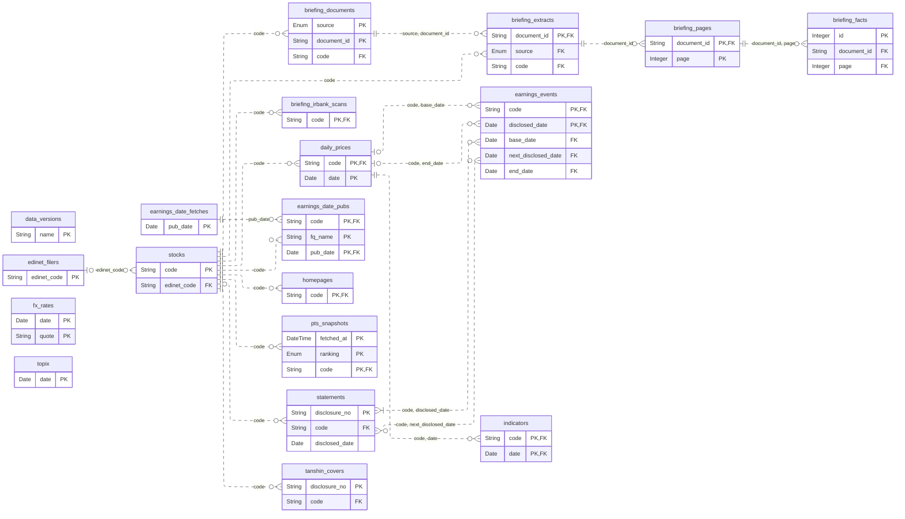

# スキーマ: 株価・決算

正は `app/models.py`。全体は [SCHEMA.md](../SCHEMA.md)。

図は主キーと参照の列だけ。実線は外部キー、点線はモデルで宣言しただけの参照（DB の制約は無い）。親の側が `}|` の線は、親の列が一意でない（同じ値の行が親に何行もある）。ほかの機能の表は主キーと指される列だけ出す。

## テーブル

見出しの下の文と「説明」の列は、モデルの `comment`（DB には出ない）。型の列は DDL の型で、括弧の中はモデルの型。

`JstDateTime`: 日本時間をタイムゾーンなしで持つ。

### briefing_documents

決算説明資料 PDF の索引

読み書きするバッチ・API: [データの流れ](../dataflow/market.md#briefing_documents)

| 列 | 型 | NULL | キー | 値 | 既定 | 説明 |
|---|---|---|---|---|---|---|
| `source` | VARCHAR(16) |  | PK | `tdnet` / `irbank` / `homepage` |  |  |
| `document_id` | VARCHAR(80) |  | PK |  |  |  |
| `code` | VARCHAR(5) |  | → `stocks.code`（制約なし） |  |  | 普通株の 5 桁 |
| `company_name` | VARCHAR | 可 |  |  |  |  |
| `pubdate` | VARCHAR(32) |  |  |  |  | 開示日時 YYYY-MM-DD HH:MM:SS |
| `title` | TEXT |  |  |  |  |  |
| `rel_path` | TEXT |  |  |  |  | data/briefing からの相対パス |
| `url` | TEXT | 可 |  |  |  |  |
| `sha256` | VARCHAR(64) | 可 |  |  |  |  |
| `size` | INTEGER | 可 |  |  |  |  |
| `status` | VARCHAR(16) |  |  |  |  | saved |
| `storage` | VARCHAR(16) |  |  | `local` / `onedrive` | `local`（DB） |  |
| `saved_at` | DATETIME（`JstDateTime`） |  |  |  |  |  |

| 索引・一意 | 列 | 一意 |
|---|---|---|
| `ix_briefing_documents_code_pubdate` | code, pubdate |  |

### briefing_extracts

決算説明資料の読み取り。資料 1 つに 1 行

読み書きするバッチ・API: [データの流れ](../dataflow/market.md#briefing_extracts)

| 列 | 型 | NULL | キー | 値 | 既定 | 説明 |
|---|---|---|---|---|---|---|
| `document_id` | VARCHAR(80) |  | PK / → `briefing_documents.(source, document_id)`（制約なし） |  |  | 出所をまたいで同じ開示番号 |
| `source` | VARCHAR(16) |  | → `briefing_documents.(source, document_id)`（制約なし） | `tdnet` / `irbank` / `homepage` |  | どの出所の PDF を読んだか |
| `code` | VARCHAR(5) |  | → `stocks.code`（制約なし） |  |  |  |
| `status` | VARCHAR(16) |  |  | `submitted` `done` 1 ページでも読めた `failed` |  | 結果を受け取ったら done か failed |
| `batch_id` | VARCHAR(80) | 可 |  |  |  |  |
| `request_key` | VARCHAR(24) |  |  |  |  | Batch の custom_id の頭。document_id は custom_id に使えない文字を含みうる |
| `model` | VARCHAR(40) |  |  |  |  |  |
| `prompt_version` | VARCHAR(16) |  |  |  |  |  |
| `pages` | INTEGER | 可 |  |  |  | PDF のページ数 |
| `llm_pages` | INTEGER | 可 |  |  |  | Claude に回したページ数 |
| `error_pages` | INTEGER | 可 |  |  |  |  |
| `facts` | INTEGER | 可 |  |  |  |  |
| `verified` | INTEGER | 可 |  |  |  | 文字データにある数字 |
| `sum_checks` | INTEGER | 可 |  |  |  |  |
| `sum_mismatch` | INTEGER | 可 |  |  |  |  |
| `input_tokens` | INTEGER | 可 |  |  |  | キャッシュの読み書きを含む |
| `output_tokens` | INTEGER | 可 |  |  |  |  |
| `error` | TEXT | 可 |  |  |  |  |
| `submitted_at` | DATETIME（`JstDateTime`） |  |  |  |  |  |
| `extracted_at` | DATETIME（`JstDateTime`） | 可 |  |  |  |  |

| 索引・一意 | 列 | 一意 |
|---|---|---|
| `ix_briefing_extracts_batch` | batch_id |  |
| `ix_briefing_extracts_code` | code |  |

### briefing_facts

読み取った数値。briefing_pages の表を 1 セル 1 行に展開したもの

読み書きするバッチ・API: [データの流れ](../dataflow/market.md#briefing_facts)

| 列 | 型 | NULL | キー | 値 | 既定 | 説明 |
|---|---|---|---|---|---|---|
| `id` | INTEGER |  | PK |  |  |  |
| `document_id` | VARCHAR(80) |  | → `briefing_pages.(document_id, page)`（制約なし） |  |  |  |
| `page` | INTEGER |  | → `briefing_pages.(document_id, page)`（制約なし） |  |  |  |
| `metric` | TEXT |  |  |  |  |  |
| `segment` | TEXT | 可 |  |  |  |  |
| `period` | TEXT | 可 |  |  |  |  |
| `period_kind` | VARCHAR(24) | 可 |  |  |  | actual / forecast / previous_forecast / plan / change |
| `value` | TEXT |  |  |  |  | 資料の表記（符号は - にそろえる） |
| `value_num` | FLOAT | 可 |  |  |  |  |
| `unit` | VARCHAR(24) | 可 |  |  |  |  |
| `part_of` | TEXT | 可 |  |  |  | 内訳の親（metric\|segment） |
| `verified` | BOOLEAN |  |  |  |  | 文字データにある |
| `sum_status` | VARCHAR(12) | 可 |  | `ok` / `split` / `paren` / `partial` / `mismatch` |  | 親の行だけ |

| 索引・一意 | 列 | 一意 |
|---|---|---|
| `ix_briefing_facts_doc` | document_id, page |  |

### briefing_irbank_scans

IR BANK の開示一覧を読み終えた銘柄

読み書きするバッチ・API: テストでは観測されていない

| 列 | 型 | NULL | キー | 値 | 既定 | 説明 |
|---|---|---|---|---|---|---|
| `code` | VARCHAR(5) |  | PK / → `stocks.code`（制約なし） |  |  | 代表の 5 桁（末尾 0 を優先） |
| `scanned_at` | DATETIME（`JstDateTime`） |  |  |  |  |  |
| `listed` | INTEGER |  |  |  |  | 説明資料と判定した件数 |
| `saved` | INTEGER |  |  |  |  |  |
| `skipped` | INTEGER |  |  |  |  | 開示番号が索引済み |
| `reindexed` | INTEGER |  |  |  |  | PDF は既にあり索引だけ足した |
| `missing` | INTEGER |  |  |  |  | PDF が 404 |
| `failed` | INTEGER |  |  |  |  |  |

### briefing_pages

読み取った説明資料のページ。表紙・注意事項など Claude に回さないページも kind だけ残す

読み書きするバッチ・API: [データの流れ](../dataflow/market.md#briefing_pages)

| 列 | 型 | NULL | キー | 値 | 既定 | 説明 |
|---|---|---|---|---|---|---|
| `document_id` | VARCHAR(80) |  | PK / → `briefing_extracts.document_id`（制約なし） |  |  |  |
| `page` | INTEGER |  | PK |  |  |  |
| `kind` | VARCHAR(24) |  |  | `divider` / `disclaimer` / `chart_or_table` / `table_or_text` / `text` |  |  |
| `title` | TEXT | 可 |  |  |  |  |
| `summary` | TEXT | 可 |  |  |  |  |
| `tables_json` | TEXT | 可 |  |  |  | Claude が返した表（列 × 行、行の of）をそのまま |
| `error` | TEXT | 可 |  |  |  |  |
| `raw_text` | TEXT | 可 |  |  |  | JSON が読めなかったページだけ、Claude の応答をそのまま残す。Batch の結果は 29 日で消える |

### daily_prices

日足

読み書きするバッチ・API: [データの流れ](../dataflow/market.md#daily_prices)

`WITHOUT ROWID`

| 列 | 型 | NULL | キー | 値 | 既定 | 説明 |
|---|---|---|---|---|---|---|
| `code` | VARCHAR(5) |  | PK / → `stocks.code`（制約なし） |  |  |  |
| `date` | DATE |  | PK |  |  |  |
| `open` | FLOAT | 可 |  |  |  | 調整前 |
| `high` | FLOAT | 可 |  |  |  | 調整前 |
| `low` | FLOAT | 可 |  |  |  | 調整前 |
| `close` | FLOAT | 可 |  |  |  | 調整前 |
| `volume` | FLOAT | 可 |  |  |  | 調整前 |
| `turnover` | FLOAT | 可 |  |  |  | 調整前 |
| `adj_factor` | FLOAT | 可 |  |  | `1.0` |  |
| `adj_open` | FLOAT | 可 |  |  |  | 調整済 |
| `adj_high` | FLOAT | 可 |  |  |  | 調整済 |
| `adj_low` | FLOAT | 可 |  |  |  | 調整済 |
| `adj_close` | FLOAT | 可 |  |  |  | 調整済 |
| `adj_volume` | FLOAT | 可 |  |  |  | 調整済 |
| `market_cap` | FLOAT | 可 |  |  |  | 時価総額(百万円) |
| `upper_limit` | INTEGER | 可 |  |  |  | J-Quants UL。その日にストップ高を付けたら 1。取込前の行は NULL |
| `lower_limit` | INTEGER | 可 |  |  |  | J-Quants LL。ストップ安 |
| `ex_rt` | VARCHAR | 可 |  |  |  | J-Quants ExRT。権利落ち日だけ 1=分割（無償割当を含む）/ 2=併合 / 3=ライツイシュー |

| 索引・一意 | 列 | 一意 |
|---|---|---|
| `ix_prices_date` | date |  |

### data_versions

読み取り結果を使い回すための版。対象表のトリガーが version を +1 する

読み書きするバッチ・API: [データの流れ](../dataflow/market.md#data_versions)

| 列 | 型 | NULL | キー | 値 | 既定 | 説明 |
|---|---|---|---|---|---|---|
| `name` | VARCHAR |  | PK |  |  | 使い回す結果の名前。monthly_list は月次一覧（/monthly、/api/v1/tables、/sitemap.xml） |
| `version` | INTEGER |  |  |  | `0`（DB） |  |

### earnings_date_fetches

取り終えた発表日。空の応答も n=0 で残す。pubs の写しではない

読み書きするバッチ・API: [データの流れ](../dataflow/market.md#earnings_date_fetches)

| 列 | 型 | NULL | キー | 値 | 既定 | 説明 |
|---|---|---|---|---|---|---|
| `pub_date` | DATE |  | PK |  |  |  |
| `n` | INTEGER |  |  |  |  |  |

### earnings_date_pubs

決算発表予定の発表履歴。発表のたびに 1 行。現在の予定は (code, fq_name) で pub_date が最新の行。移動前の日が残っている

読み書きするバッチ・API: [データの流れ](../dataflow/market.md#earnings_date_pubs)

| 列 | 型 | NULL | キー | 値 | 既定 | 説明 |
|---|---|---|---|---|---|---|
| `code` | VARCHAR(5) |  | PK / → `stocks.code`（制約なし） |  |  |  |
| `fq_name` | VARCHAR(8) |  | PK |  |  | 1Q \| 2Q \| 3Q \| FY |
| `pub_date` | DATE |  | PK / → `earnings_date_fetches.pub_date`（制約なし） |  |  |  |
| `sch_date` | DATE | 可 |  |  |  | NULL は未定。欠測ではない |
| `fye` | VARCHAR(4) |  |  |  |  | MMDD。0299 は 2月末 |
| `co_name` | VARCHAR |  |  |  |  |  |

| 索引・一意 | 列 | 一意 |
|---|---|---|
| `ix_earnings_date_pubs_sch_date` | sch_date |  |

### earnings_events

決算発表イベントと発表後パフォーマンス

読み書きするバッチ・API: [データの流れ](../dataflow/market.md#earnings_events)

| 列 | 型 | NULL | キー | 値 | 既定 | 説明 |
|---|---|---|---|---|---|---|
| `code` | VARCHAR(5) |  | PK / → `statements.(code, disclosed_date)`（制約なし） / → `daily_prices.(code, date)`（制約なし） |  |  |  |
| `disclosed_date` | DATE |  | PK / → `statements.(code, disclosed_date)`（制約なし） |  |  |  |
| `base_date` | DATE | 可 | → `daily_prices.(code, date)`（制約なし） |  |  | 決算後に買えた最初の値 |
| `base_price` | FLOAT | 可 |  |  |  | 決算後に買えた最初の値 |
| `return_1d` | FLOAT | 可 |  |  |  |  |
| `return_5d` | FLOAT | 可 |  |  |  |  |
| `return_20d` | FLOAT | 可 |  |  |  |  |
| `return_60d` | FLOAT | 可 |  |  |  |  |
| `return_to_date` | FLOAT | 可 |  |  |  |  |
| `alpha_1d` | FLOAT | 可 |  |  |  | 対TOPIX超過リターン |
| `alpha_5d` | FLOAT | 可 |  |  |  | 対TOPIX超過リターン |
| `alpha_20d` | FLOAT | 可 |  |  |  | 対TOPIX超過リターン |
| `alpha_60d` | FLOAT | 可 |  |  |  | 対TOPIX超過リターン |
| `alpha_to_date` | FLOAT | 可 |  |  |  | 対TOPIX超過リターン |
| `disclosed_time` | VARCHAR | 可 |  |  |  | その日の決算短信のうち一番早い発表時刻 |
| `is_first` | BOOLEAN | 可 |  |  |  | その期（決算期 × 四半期）の最初の決算短信。訂正・予想修正だけは偽 |
| `next_disclosed_date` | DATE | 可 | → `statements.(code, disclosed_date)`（制約なし） |  |  | 同じ銘柄の次の期の最初の決算短信の日。まだ無ければ NULL |
| `end_date` | DATE | 可 | → `daily_prices.(code, date)`（制約なし） |  |  | return_to_next の終点（次の決算の前営業日。無ければ株価の最終日） |
| `return_to_next` | FLOAT | 可 |  |  |  | 次の決算の前日終値まで（%） |
| `alpha_to_next` | FLOAT | 可 |  |  |  | 対TOPIX超過リターン |

### fx_rates

ECB 対EUR 日次レート。EUR 自身は持たない

読み書きするバッチ・API: [データの流れ](../dataflow/market.md#fx_rates)

| 列 | 型 | NULL | キー | 値 | 既定 | 説明 |
|---|---|---|---|---|---|---|
| `date` | DATE |  | PK |  |  |  |
| `quote` | VARCHAR(3) |  | PK |  |  | ISO 4217（USD / JPY 等） |
| `rate` | FLOAT |  |  |  |  | 1 EUR = rate 単位の quote |

| 索引・一意 | 列 | 一意 |
|---|---|---|
| `ix_fx_rates_quote_date` | quote, date |  |

### homepages

上場会社のホームページ URL

読み書きするバッチ・API: [データの流れ](../dataflow/market.md#homepages)

| 列 | 型 | NULL | キー | 値 | 既定 | 説明 |
|---|---|---|---|---|---|---|
| `code` | VARCHAR(5) |  | PK / → `stocks.code`（制約なし） |  |  | 普通株（末尾 0） |
| `url` | TEXT |  |  |  |  | 選んだ 1 本（会社ホームページ） |
| `host` | VARCHAR(255) |  |  |  |  | 小文字。先頭 www. を除く |
| `source` | VARCHAR(32) |  |  | `manual` / `xbrl_url` / `tanshin_html` |  |  |
| `origin` | TEXT |  |  |  |  | manual / xbrl:{doc_id} / tanshin:{disclosure_no} |
| `changed_at` | DATETIME（`JstDateTime`） |  |  |  |  | url / source / origin / host が変わった時刻 |
| `checked_at` | DATETIME（`JstDateTime`） |  |  |  |  | 最後に確認した時刻。値が同じでも進む |

### indicators

日次算出テクニカル

読み書きするバッチ・API: [データの流れ](../dataflow/market.md#indicators)

| 列 | 型 | NULL | キー | 値 | 既定 | 説明 |
|---|---|---|---|---|---|---|
| `code` | VARCHAR(5) |  | PK / → `daily_prices.(code, date)`（制約なし） |  |  |  |
| `date` | DATE |  | PK / → `daily_prices.(code, date)`（制約なし） |  |  |  |
| `close` | FLOAT | 可 |  |  |  |  |
| `ma50` | FLOAT | 可 |  |  |  |  |
| `ma150` | FLOAT | 可 |  |  |  |  |
| `ma200` | FLOAT | 可 |  |  |  |  |
| `ma200_slope_1m` | FLOAT | 可 |  |  |  | 200日線の1ヶ月変化率 |
| `high_52w` | FLOAT | 可 |  |  |  |  |
| `low_52w` | FLOAT | 可 |  |  |  |  |
| `rs_raw` | FLOAT | 可 |  |  |  | RS生値 |
| `rs_rank` | INTEGER | 可 |  |  |  | 1-99ランク |
| `stage` | INTEGER | 可 |  |  |  | 1/2/3/4 (判定不能はNULL) |
| `avg_volume_50` | FLOAT | 可 |  |  |  |  |

| 索引・一意 | 列 | 一意 |
|---|---|---|
| `ix_ind_date_stage` | date, stage |  |

### pts_snapshots

株探の PTS ナイトタイムセッションのランキング。取得 1 回ごとにランキング全行を残す

読み書きするバッチ・API: [データの流れ](../dataflow/market.md#pts_snapshots)

| 列 | 型 | NULL | キー | 値 | 既定 | 説明 |
|---|---|---|---|---|---|---|
| `fetched_at` | DATETIME（`JstDateTime`） |  | PK |  |  | 取得時刻 |
| `ranking` | VARCHAR |  | PK | `night_up` / `night_down` / `night_volume` |  |  |
| `code` | VARCHAR(5) |  | PK / → `stocks.code`（制約なし） |  |  |  |
| `session_date` | DATE |  |  |  |  | 比べている通常取引の終値の日（株探の見出し「D日終値」から。取得日ではない） |
| `as_of` | VARCHAR(5) | 可 |  |  |  | 株探の「HH:MM現在」（15 分ディレイ） |
| `rank` | INTEGER |  |  |  |  |  |
| `name` | VARCHAR | 可 |  |  |  |  |
| `market` | VARCHAR | 可 |  |  |  |  |
| `base_close` | FLOAT | 可 |  |  |  |  |
| `pts_price` | FLOAT | 可 |  |  |  |  |
| `pts_chg_pct` | FLOAT | 可 |  |  |  |  |
| `volume` | INTEGER | 可 |  |  |  |  |

| 索引・一意 | 列 | 一意 |
|---|---|---|
| `ix_pts_session_ranking` | session_date, ranking |  |

### statements

決算短信 (J-Quants /fins/summary ほぼ生保存。短信 XBRL から作った行も入る)

読み書きするバッチ・API: [データの流れ](../dataflow/market.md#statements)

| 列 | 型 | NULL | キー | 値 | 既定 | 説明 |
|---|---|---|---|---|---|---|
| `disclosure_no` | VARCHAR |  | PK |  |  |  |
| `code` | VARCHAR(5) | 可 | → `stocks.code`（制約なし） |  |  |  |
| `disclosed_date` | DATE | 可 |  |  |  |  |
| `disclosed_time` | VARCHAR | 可 |  |  |  |  |
| `type_of_period` | VARCHAR | 可 |  |  |  | 1Q/2Q/3Q/4Q/5Q/FY |
| `type_of_document` | VARCHAR | 可 |  |  |  |  |
| `period_start` | DATE | 可 |  |  |  |  |
| `period_end` | DATE | 可 |  |  |  |  |
| `fiscal_year_start` | DATE | 可 |  |  |  |  |
| `fiscal_year_end` | DATE | 可 |  |  |  |  |
| `net_sales` | FLOAT | 可 |  |  |  | 累計実績 |
| `operating_profit` | FLOAT | 可 |  |  |  | 累計実績 |
| `ordinary_profit` | FLOAT | 可 |  |  |  | 累計実績 |
| `profit` | FLOAT | 可 |  |  |  | 累計実績 |
| `eps` | FLOAT | 可 |  |  |  | 累計実績 |
| `f2_net_sales` | FLOAT | 可 |  |  |  | 半期(2Q)会社予想 |
| `f2_operating_profit` | FLOAT | 可 |  |  |  | 半期(2Q)会社予想 |
| `f2_ordinary_profit` | FLOAT | 可 |  |  |  | 半期(2Q)会社予想 |
| `f2_profit` | FLOAT | 可 |  |  |  | 半期(2Q)会社予想 |
| `f2_eps` | FLOAT | 可 |  |  |  | 半期(2Q)会社予想 |
| `fy_net_sales` | FLOAT | 可 |  |  |  | 通期会社予想 |
| `fy_operating_profit` | FLOAT | 可 |  |  |  | 通期会社予想 |
| `fy_ordinary_profit` | FLOAT | 可 |  |  |  | 通期会社予想 |
| `fy_profit` | FLOAT | 可 |  |  |  | 通期会社予想 |
| `fy_eps` | FLOAT | 可 |  |  |  | 通期会社予想 |
| `is_revision` | BOOLEAN | 可 |  |  | `False` | 予想修正開示フラグ |
| `raw_json` | TEXT | 可 |  |  |  | 元データ全項目 |
| `source` | VARCHAR(16) | 可 |  | `jquants` / `xbrl` |  | NULL は J-Quants |

| 索引・一意 | 列 | 一意 |
|---|---|---|
| `ix_statements_code` | code |  |
| `ix_statements_disclosed_date` | disclosed_date |  |
| `ix_statements_earnings_cover` | code, disclosed_date, disclosure_no, disclosed_time, type_of_period, type_of_document, period_start, period_end, fiscal_year_start, fiscal_year_end, net_sales, operating_profit, ordinary_profit, profit, eps, f2_net_sales, f2_operating_profit, f2_ordinary_profit, f2_profit, f2_eps, fy_net_sales, fy_operating_profit, fy_ordinary_profit, fy_profit, fy_eps, is_revision |  |

### stocks

銘柄マスタ

読み書きするバッチ・API: [データの流れ](../dataflow/market.md#stocks)

| 列 | 型 | NULL | キー | 値 | 既定 | 説明 |
|---|---|---|---|---|---|---|
| `code` | VARCHAR(5) |  | PK |  |  | 5桁コード (例 "72030", "262A0")。先頭・末尾は数字、途中は 0-9A-Z |
| `name` | VARCHAR | 可 |  |  |  |  |
| `sector17` | VARCHAR | 可 |  |  |  |  |
| `sector33` | VARCHAR | 可 |  |  |  |  |
| `market` | VARCHAR | 可 |  |  |  |  |
| `scale_category` | VARCHAR | 可 |  |  |  |  |
| `margin_type` | VARCHAR | 可 |  |  |  |  |
| `product_category` | VARCHAR | 可 |  |  |  | J-Quants ProdCat。011=内国株券, 013=REIT, 014=ETF 等 |
| `edinet_code` | VARCHAR(6) | 可 | → `edinet_filers.edinet_code`（制約なし） |  |  | EDINET コードリストの証券コードで付ける。無い銘柄は NULL |

### tanshin_covers

決算短信の表紙。短信ごとに1行

読み書きするバッチ・API: [データの流れ](../dataflow/market.md#tanshin_covers)

| 列 | 型 | NULL | キー | 値 | 既定 | 説明 |
|---|---|---|---|---|---|---|
| `disclosure_no` | VARCHAR(32) |  | PK |  |  | TDnet の書類 ID（PDF/ZIP の stem） |
| `code` | VARCHAR(5) |  | → `stocks.code`（制約なし） |  |  | 普通株の 5 桁 |
| `disclosed_at` | DATETIME（`JstDateTime`） | 可 |  |  |  |  |
| `title` | TEXT | 可 |  |  |  |  |
| `source` | VARCHAR(16) |  |  | `xbrl_summary` / `tdnet_pdf` |  |  |
| `has_material` | BOOLEAN | 可 |  |  |  | 決算補足説明資料作成の有無。表紙から読めなければ NULL |
| `material_note` | VARCHAR(80) | 可 |  |  |  |  |
| `has_briefing` | BOOLEAN | 可 |  |  |  | 決算説明会開催の有無。表紙から読めなければ NULL |
| `briefing_note` | VARCHAR(80) | 可 |  |  |  |  |
| `checked_at` | DATETIME（`JstDateTime`） |  |  |  |  |  |

| 索引・一意 | 列 | 一意 |
|---|---|---|
| `ix_tanshin_covers_code` | code |  |

### topix

TOPIX日足

読み書きするバッチ・API: [データの流れ](../dataflow/market.md#topix)

| 列 | 型 | NULL | キー | 値 | 既定 | 説明 |
|---|---|---|---|---|---|---|
| `date` | DATE |  | PK |  |  |  |
| `open` | FLOAT | 可 |  |  |  |  |
| `high` | FLOAT | 可 |  |  |  |  |
| `low` | FLOAT | 可 |  |  |  |  |
| `close` | FLOAT | 可 |  |  |  |  |
