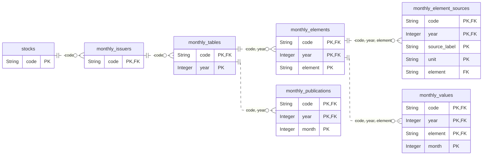

# スキーマ: 月次

正は `app/models.py`。全体は [SCHEMA.md](../SCHEMA.md)。

図は主キーと参照の列だけ。実線は外部キー、点線はモデルで宣言しただけの参照（DB の制約は無い）。親の側が `}|` の線は、親の列が一意でない（同じ値の行が親に何行もある）。ほかの機能の表は主キーと指される列だけ出す。

## テーブル

見出しの下の文と「説明」の列は、モデルの `comment`（DB には出ない）。型の列は DDL の型で、括弧の中はモデルの型。

`JstDateTime`: 日本時間をタイムゾーンなしで持つ。

### monthly_element_sources

送られてきたままの行名 → 今の保存名。正規化の差分スナップショットの入力

読み書きするバッチ・API: [データの流れ](../dataflow/monthly.md#monthly_element_sources)

| 列 | 型 | NULL | キー | 値 | 既定 | 説明 |
|---|---|---|---|---|---|---|
| `code` | VARCHAR(5) |  | PK / → `monthly_elements.(code, year, element)`（制約なし） |  |  |  |
| `year` | INTEGER |  | PK / → `monthly_elements.(code, year, element)`（制約なし） |  |  |  |
| `source_label` | VARCHAR(50) |  | PK |  |  | 受け取ったまま（正規化前）。前後の空白だけ落とす |
| `unit` | VARCHAR(16) |  | PK |  |  | 受け取ったまま（正規化前）。yoy_pct 可 |
| `element` | VARCHAR(50) |  | → `monthly_elements.(code, year, element)`（制約なし） |  |  | 今の保存名 |
| `via` | VARCHAR(16) |  |  | `api` `doc` `ir_html` `ir_json` `ir_xls` `legacy` 記録前からある行。保存名そのものを入れる |  | 経路 |
| `first_seen_at` | DATETIME（`JstDateTime`） |  |  |  |  |  |
| `last_seen_at` | DATETIME（`JstDateTime`） |  |  |  |  |  |

| 索引・一意 | 列 | 一意 |
|---|---|---|
| `ix_monthly_element_sources_element` | element |  |

### monthly_elements

月次表の行

読み書きするバッチ・API: [データの流れ](../dataflow/monthly.md#monthly_elements)

| 列 | 型 | NULL | キー | 値 | 既定 | 説明 |
|---|---|---|---|---|---|---|
| `code` | VARCHAR(5) |  | PK / → `monthly_tables.(code, year)`（制約なし） |  |  |  |
| `year` | INTEGER |  | PK / → `monthly_tables.(code, year)`（制約なし） |  |  |  |
| `element` | VARCHAR(50) |  | PK |  |  | 登録時の正規名 |
| `sort_order` | INTEGER |  |  |  |  | 登録順 |
| `unit` | VARCHAR(16) |  |  | `number` / `yoy_index` | `number`（DB） | number \| yoy_index |

### monthly_issuers

発行体ごとの月次属性

読み書きするバッチ・API: [データの流れ](../dataflow/monthly.md#monthly_issuers)

| 列 | 型 | NULL | キー | 値 | 既定 | 説明 |
|---|---|---|---|---|---|---|
| `code` | VARCHAR(5) |  | PK / → `stocks.code`（制約なし） |  |  |  |
| `industry` | VARCHAR(50) |  |  |  | `その他`（DB） | 月次業種。stocks.sector33 とは別 |
| `last_ingested_at` | DATETIME（`JstDateTime`） | 可 |  |  |  | ingest でセルが変わったときだけ更新。NULL は新着ではない |

### monthly_publications

銘柄×暦年×月の最初の公表。セルごとでも開示の履歴でもない

読み書きするバッチ・API: [データの流れ](../dataflow/monthly.md#monthly_publications)

| 列 | 型 | NULL | キー | 値 | 既定 | 説明 |
|---|---|---|---|---|---|---|
| `code` | VARCHAR(5) |  | PK / → `monthly_tables.(code, year)`（制約なし） |  |  |  |
| `year` | INTEGER |  | PK / → `monthly_tables.(code, year)`（制約なし） |  |  | 暦年 |
| `month` | INTEGER |  | PK |  |  | 1〜12 |
| `published_on` | DATE | 可 |  |  |  | JST の公表日。分からないときは NULL で、月末や取込日を入れない |
| `published_time` | VARCHAR(8) | 可 |  |  |  | HH:MM:SS。TDnet の開示時刻があるときだけ。無ければ NULL |
| `basis` | VARCHAR(16) |  |  | `tdnet` TDnet の開示日。時刻があれば published_time。いちばん確か `ir_page` IR のページ・表計算・JSON に書いてある暦日。時刻は無い `first_seen` ページに公表日が無く、バッチがその月を最初に見た日。観測の上限 `unknown` 公表日は分からない。published_on は NULL。unknown_reason がある |  | 日付の出どころ。同じ日なら tdnet、ir_page、first_seen の順に確か |
| `confidence` | VARCHAR(16) |  |  | `exact` 題名の年月かページの暦日から、その月だと特定できた `estimated` 題名から月が読めない。月末から45日以内の開示、または取得日という上限 `unknown` 公表日は分からない。published_on は NULL |  | exact は題名かページの暦日。estimated は45日以内の推定か取得日。unknown は日付なし |
| `unknown_reason` | VARCHAR(32) | 可 |  |  |  | basis が unknown のときだけ。carried_history / manual / no_source / no_page_date / unspecified。日付がある行は NULL |
| `source_ref` | TEXT | 可 |  |  |  | ファイル名、開示番号、URL。日付そのものではない |
| `recorded_at` | DATETIME（`JstDateTime`） |  |  |  |  | この行を書いた、またはより確かだと入れ替えた時刻 |

### monthly_tables

銘柄×年度の月次表 (暦月1〜12。会計月ではない)

読み書きするバッチ・API: [データの流れ](../dataflow/monthly.md#monthly_tables)

| 列 | 型 | NULL | キー | 値 | 既定 | 説明 |
|---|---|---|---|---|---|---|
| `code` | VARCHAR(5) |  | PK / → `monthly_issuers.code`（制約なし） |  |  |  |
| `year` | INTEGER |  | PK |  |  | 西暦4桁 |

### monthly_values

月次セル

読み書きするバッチ・API: [データの流れ](../dataflow/monthly.md#monthly_values)

| 列 | 型 | NULL | キー | 値 | 既定 | 説明 |
|---|---|---|---|---|---|---|
| `code` | VARCHAR(5) |  | PK / → `monthly_elements.(code, year, element)`（制約なし） |  |  |  |
| `year` | INTEGER |  | PK / → `monthly_elements.(code, year, element)`（制約なし） |  |  |  |
| `element` | VARCHAR(50) |  | PK / → `monthly_elements.(code, year, element)`（制約なし） |  |  |  |
| `month` | INTEGER |  | PK |  |  |  |
| `value` | FLOAT |  |  |  |  | 数値のみ (単位・カンマ付き文字列は拒否) |
