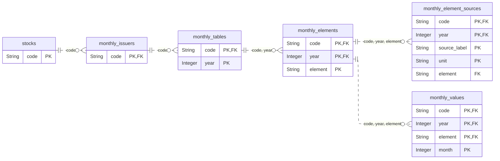

# スキーマ: 月次

**自動生成。手で直さない。** 正は `app/models.py`。作り直しは `python -m tools.schema.render`。全体は [SCHEMA.md](../SCHEMA.md)。

図は主キーと参照の列だけ。実線は外部キー、点線はモデルで宣言しただけの参照（DB の制約は無い）。親の側が `}|` の線は、親の列が一意でない（同じ値の行が親に何行もある）。ほかの機能の表は主キーと指される列だけ出す。

## テーブル

### monthly_element_sources

| 列 | 型 | NULL | キー | 値 | 既定 |
|---|---|---|---|---|---|
| `code` | VARCHAR(5) |  | PK / → `monthly_elements.(code, year, element)`（制約なし） |  |  |
| `year` | INTEGER |  | PK / → `monthly_elements.(code, year, element)`（制約なし） |  |  |
| `source_label` | VARCHAR(50) |  | PK |  |  |
| `unit` | VARCHAR(16) |  | PK |  |  |
| `element` | VARCHAR(50) |  | → `monthly_elements.(code, year, element)`（制約なし） |  |  |
| `via` | VARCHAR(16) |  |  |  |  |
| `first_seen_at` | DATETIME |  |  |  |  |
| `last_seen_at` | DATETIME |  |  |  |  |

| 索引・一意 | 列 | 一意 |
|---|---|---|
| `ix_monthly_element_sources_element` | element |  |

### monthly_elements

| 列 | 型 | NULL | キー | 値 | 既定 |
|---|---|---|---|---|---|
| `code` | VARCHAR(5) |  | PK / → `monthly_tables.(code, year)`（制約なし） |  |  |
| `year` | INTEGER |  | PK / → `monthly_tables.(code, year)`（制約なし） |  |  |
| `element` | VARCHAR(50) |  | PK |  |  |
| `sort_order` | INTEGER |  |  |  |  |
| `unit` | VARCHAR(16) |  |  |  | `number`（DB） |

### monthly_issuers

| 列 | 型 | NULL | キー | 値 | 既定 |
|---|---|---|---|---|---|
| `code` | VARCHAR(5) |  | PK / → `stocks.code`（制約なし） |  |  |
| `industry` | VARCHAR(50) |  |  |  | `その他`（DB） |
| `last_ingested_at` | DATETIME | 可 |  |  |  |

### monthly_tables

| 列 | 型 | NULL | キー | 値 | 既定 |
|---|---|---|---|---|---|
| `code` | VARCHAR(5) |  | PK / → `monthly_issuers.code`（制約なし） |  |  |
| `year` | INTEGER |  | PK |  |  |

### monthly_values

| 列 | 型 | NULL | キー | 値 | 既定 |
|---|---|---|---|---|---|
| `code` | VARCHAR(5) |  | PK / → `monthly_elements.(code, year, element)`（制約なし） |  |  |
| `year` | INTEGER |  | PK / → `monthly_elements.(code, year, element)`（制約なし） |  |  |
| `element` | VARCHAR(50) |  | PK / → `monthly_elements.(code, year, element)`（制約なし） |  |  |
| `month` | INTEGER |  | PK |  |  |
| `value` | FLOAT |  |  |  |  |
