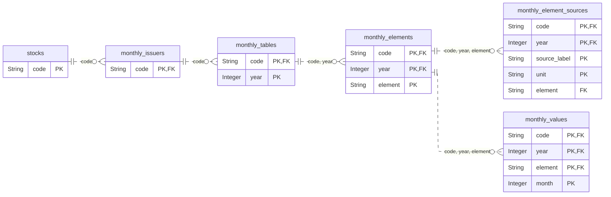

# スキーマ: 月次

**自動生成。手で直さない。** 正は `app/models.py`。作り直しは `python -m tools.schema.render`。全体は [SCHEMA.md](../SCHEMA.md)。

図は主キーと参照の列だけ。実線は外部キー、点線はモデルで宣言しただけの参照（DB の制約は無い）。親の側が `}|` の線は、親の列が一意でない（同じ値の行が親に何行もある）。ほかの機能の表は主キーと指される列だけ出す。

## テーブル

見出しの下の文と「説明」の列は、モデルの `comment`（DB には出ない）。型の列は DDL の型で、括弧の中はモデルの型。

`JstDateTime`: 日本時間をタイムゾーンなしで持つ。

### monthly_element_sources

送られてきたままの行名 → 今の保存名。正規化の差分スナップショットの入力

| 列 | 型 | NULL | キー | 値 | 既定 | 説明 |
|---|---|---|---|---|---|---|
| `code` | VARCHAR(5) |  | PK / → `monthly_elements.(code, year, element)`（制約なし） |  |  |  |
| `year` | INTEGER |  | PK / → `monthly_elements.(code, year, element)`（制約なし） |  |  |  |
| `source_label` | VARCHAR(50) |  | PK |  |  | 受け取ったまま（正規化前）。前後の空白だけ落とす |
| `unit` | VARCHAR(16) |  | PK |  |  | 受け取ったまま（正規化前）。yoy_pct 可 |
| `element` | VARCHAR(50) |  | → `monthly_elements.(code, year, element)`（制約なし） |  |  | 今の保存名 |
| `via` | VARCHAR(16) |  |  |  |  | 経路（api / doc / ir_html / ir_json / ir_xls / legacy）。記録前からある行は保存名そのものを legacy で入れる |
| `first_seen_at` | DATETIME（`JstDateTime`） |  |  |  |  |  |
| `last_seen_at` | DATETIME（`JstDateTime`） |  |  |  |  |  |

| 索引・一意 | 列 | 一意 |
|---|---|---|
| `ix_monthly_element_sources_element` | element |  |

### monthly_elements

月次表の行

| 列 | 型 | NULL | キー | 値 | 既定 | 説明 |
|---|---|---|---|---|---|---|
| `code` | VARCHAR(5) |  | PK / → `monthly_tables.(code, year)`（制約なし） |  |  |  |
| `year` | INTEGER |  | PK / → `monthly_tables.(code, year)`（制約なし） |  |  |  |
| `element` | VARCHAR(50) |  | PK |  |  | 登録時の正規名 |
| `sort_order` | INTEGER |  |  |  |  | 登録順 |
| `unit` | VARCHAR(16) |  |  |  | `number`（DB） | number \| yoy_index |

### monthly_issuers

発行体ごとの月次属性

| 列 | 型 | NULL | キー | 値 | 既定 | 説明 |
|---|---|---|---|---|---|---|
| `code` | VARCHAR(5) |  | PK / → `stocks.code`（制約なし） |  |  |  |
| `industry` | VARCHAR(50) |  |  |  | `その他`（DB） | 月次業種。stocks.sector33 とは別 |
| `last_ingested_at` | DATETIME（`JstDateTime`） | 可 |  |  |  | ingest でセルが変わったときだけ更新。NULL は新着ではない |

### monthly_tables

銘柄×年度の月次表 (暦月1〜12。会計月ではない)

| 列 | 型 | NULL | キー | 値 | 既定 | 説明 |
|---|---|---|---|---|---|---|
| `code` | VARCHAR(5) |  | PK / → `monthly_issuers.code`（制約なし） |  |  |  |
| `year` | INTEGER |  | PK |  |  | 西暦4桁 |

### monthly_values

月次セル

| 列 | 型 | NULL | キー | 値 | 既定 | 説明 |
|---|---|---|---|---|---|---|
| `code` | VARCHAR(5) |  | PK / → `monthly_elements.(code, year, element)`（制約なし） |  |  |  |
| `year` | INTEGER |  | PK / → `monthly_elements.(code, year, element)`（制約なし） |  |  |  |
| `element` | VARCHAR(50) |  | PK / → `monthly_elements.(code, year, element)`（制約なし） |  |  |  |
| `month` | INTEGER |  | PK |  |  |  |
| `value` | FLOAT |  |  |  |  | 数値のみ (単位・カンマ付き文字列は拒否) |
