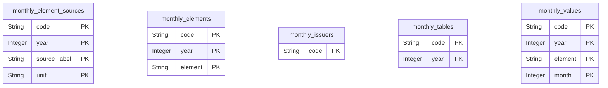

# スキーマ: 月次

**自動生成。手で直さない。** 正は `app/models.py`。作り直しは `python -m tools.schema.render`。全体は [SCHEMA.md](../SCHEMA.md)。

図は主キーと外部キーの列だけ。線は外部キー（列名つき）。ほかの機能の表は主キーだけ出す。

## テーブル

### monthly_element_sources

| 列 | 型 | NULL | キー | 既定 |
|---|---|---|---|---|
| `code` | VARCHAR(5) |  | PK |  |
| `year` | INTEGER |  | PK |  |
| `source_label` | VARCHAR(50) |  | PK |  |
| `unit` | VARCHAR(16) |  | PK |  |
| `element` | VARCHAR(50) |  |  |  |
| `via` | VARCHAR(16) |  |  |  |
| `first_seen_at` | DATETIME |  |  |  |
| `last_seen_at` | DATETIME |  |  |  |

| 索引・一意 | 列 | 一意 |
|---|---|---|
| `ix_monthly_element_sources_element` | element |  |

### monthly_elements

| 列 | 型 | NULL | キー | 既定 |
|---|---|---|---|---|
| `code` | VARCHAR(5) |  | PK |  |
| `year` | INTEGER |  | PK |  |
| `element` | VARCHAR(50) |  | PK |  |
| `sort_order` | INTEGER |  |  |  |
| `unit` | VARCHAR(16) |  |  | `number`（DB） |

### monthly_issuers

| 列 | 型 | NULL | キー | 既定 |
|---|---|---|---|---|
| `code` | VARCHAR(5) |  | PK |  |
| `industry` | VARCHAR(50) |  |  | `その他`（DB） |
| `last_ingested_at` | DATETIME | 可 |  |  |

### monthly_tables

| 列 | 型 | NULL | キー | 既定 |
|---|---|---|---|---|
| `code` | VARCHAR(5) |  | PK |  |
| `year` | INTEGER |  | PK |  |

### monthly_values

| 列 | 型 | NULL | キー | 既定 |
|---|---|---|---|---|
| `code` | VARCHAR(5) |  | PK |  |
| `year` | INTEGER |  | PK |  |
| `element` | VARCHAR(50) |  | PK |  |
| `month` | INTEGER |  | PK |  |
| `value` | FLOAT |  |  |  |
