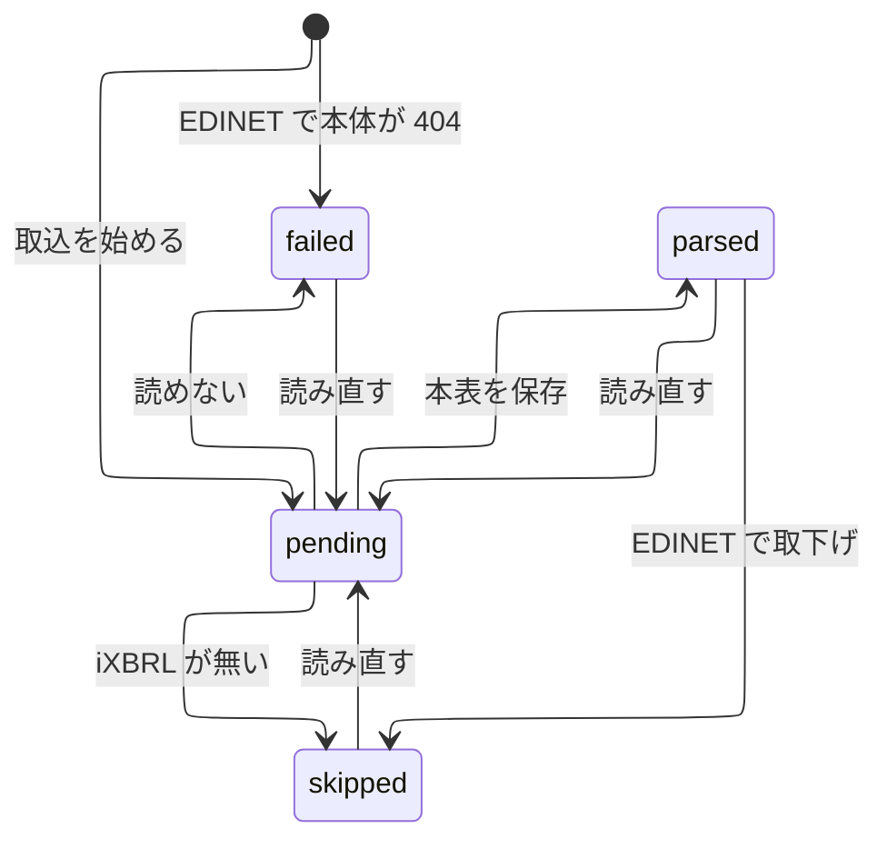
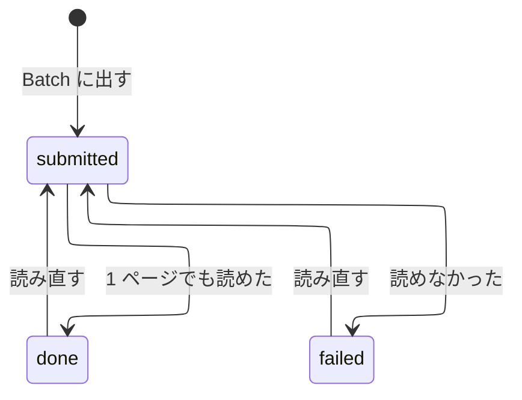
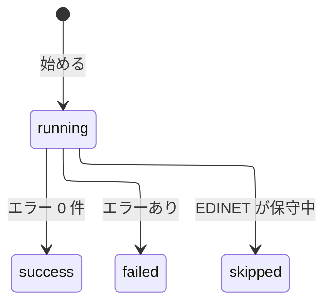

# 状態遷移（行の状態を持つ列）

**手書き。生成物ではない。** 値の一覧と意味は [xbrl.md](xbrl.md) など機能ごとのページ（`app/models.py` から自動生成）。ここには、コードが列に値を入れている所を読んで、根拠のある遷移だけを描く。

- 図の状態名は列の Enum の値と同じ綴り。`[*]` は行がまだ無い（作られる）こと。値が足りない・余る、表の根拠のファイルや関数が無いときは `tests/nonfunctional/test_state_diagrams.py` が落ちる
- 遷移の条件は図の字より表を正とする。表の「根拠」は値を入れる（または入れる条件を決める）ファイルと関数
- コードから機械的には拾えないので、値を入れる所を変えたらここも手で直す。描いていない遷移がある可能性は残る

## xbrl_filings.parse_status

開示 1 件の取込の進み具合。TDnet の ZIP・EDINET・TDnet の PDF の 3 つの入口が同じ列を使う。

| 元 | 先 | 条件 | 根拠 |
|---|---|---|---|
| `[*]` | `pending` | 新しい開示の取込を始める。既にある行は取込のたびにここへ戻る | `app/xbrl/store.py` `parse_zip_into_filing` `app/xbrl/pdf/__init__.py` `_upsert` |
| `[*]` | `failed` | EDINET の書類本体（type=1）が 404 のとき、行を新しく作って failed で残す | `app/edinet/xbrl.py` `store_missing` |
| `pending` | `parsed` | fact を保存し終えた（ZIP も PDF も同じ保存の関数） | `app/xbrl/store.py` `store_package` |
| `pending` | `skipped` | ZIP に iXBRL が無い（`no-ixbrl`） | `app/xbrl/store.py` `parse_zip_into_filing` |
| `pending` | `failed` | fact が 0 件（`no-facts`）、取込中の例外、PDF の版式が読めない | `app/xbrl/store.py` `parse_zip_into_filing` `app/xbrl/store.py` `mark_failed` `app/xbrl/pdf/__init__.py` `_sync` |
| `parsed` | `pending` | `--reparse`、または ZIP の sha が変わったとき（TDnet）。PDF は指紋が変わったか `reparse` のとき | `app/xbrl/jobs.py` `_plan_row` `app/edinet/xbrl.py` `pending_documents` `app/xbrl/pdf/__init__.py` `_sync` |
| `failed` | `pending` | `--retry-failed` か `--reparse`。PDF は指紋が変わったか `reparse` のとき | `app/xbrl/jobs.py` `_plan_row` `app/edinet/xbrl.py` `pending_documents` `app/xbrl/pdf/__init__.py` `_sync` |
| `skipped` | `pending` | `--reparse`、または ZIP の sha が変わったとき | `app/xbrl/jobs.py` `_plan_row` `app/edinet/xbrl.py` `pending_documents` |
| `parsed` | `skipped` | EDINET で取下げ・不開示になった書類を正規化層から外す（`parse_error` は `withdrawn`） | `app/edinet/xbrl.py` `retract` |

行そのものが消える場合（TDnet の PDF 由来の行を、短信の ZIP が取り込めたあとに片づける）は状態ではないので描かない（`app/xbrl/pdf/__init__.py` の `_sync` が `delete_filing` を呼ぶ）。

## briefing_extracts.status

決算説明資料 1 冊を Claude の Batch に出して読み取る進み具合。

| 元 | 先 | 条件 | 根拠 |
|---|---|---|---|
| `[*]` | `submitted` | Batch に出して、行を `submitted` で書く | `app/market/briefing_batch.py` `submit` |
| `submitted` | `done` | 結果を受け取り、全ページがエラーではない | `app/market/briefing_batch.py` `store_document` |
| `submitted` | `failed` | 全ページがエラー、または PDF が読めない | `app/market/briefing_batch.py` `store_document` `app/market/briefing_batch.py` `collect` |
| `done` | `submitted` | `redo` で読み直す（`submitted` のままの資料は対象外） | `app/market/briefing_batch.py` `pending_documents` `app/market/briefing_batch.py` `submit` |
| `failed` | `submitted` | `redo` で読み直す | `app/market/briefing_batch.py` `pending_documents` `app/market/briefing_batch.py` `submit` |

## xbrl_job_runs.status

XBRL のバッチ（`parse`・`normalize`・`edinet_xbrl`）の 1 回の実行。

| 元 | 先 | 条件 | 根拠 |
|---|---|---|---|
| `[*]` | `running` | バッチの頭で行を作る | `app/xbrl/jobs.py` `start_run` |
| `running` | `success` | エラー 0 件で終わる | `app/xbrl/jobs.py` `run_parse` `app/xbrl/jobs.py` `run_normalize` `jobs/edinet/edinet_xbrl.py` `main` |
| `running` | `failed` | エラーが 1 件以上 | `app/xbrl/jobs.py` `run_parse` `app/xbrl/jobs.py` `run_normalize` `jobs/edinet/edinet_xbrl.py` `main` |
| `running` | `skipped` | EDINET が保守中でバッチを飛ばす | `jobs/edinet/edinet_xbrl.py` `main` |

`running` のまま残る行は、バッチが途中で落ちたもの（`finish_run` まで届かなかった）。そこから先へ進める処理は無い。

## 描かなかった列

根拠を追い切れなかった、または状態の列ではないもの。

- `edinet_tender_offers.status`（`open` / `succeeded` / `failed` / `withdrawn`）: 取込のたびに最新の書類から計算し直す値で、前の値から進む形ではない（`app/edinet/tender_offers.py` の `offer_row`）
- `xbrl_filings.documents_status`・`presentation_status`: 値を入れる所が複数のジョブに散っていて、元の値による条件を追い切れていない
- `tdnet_pdf_documents.status`（`ok` / `missing` / `failed`）: 同上。取り直しの条件を読んでいない
