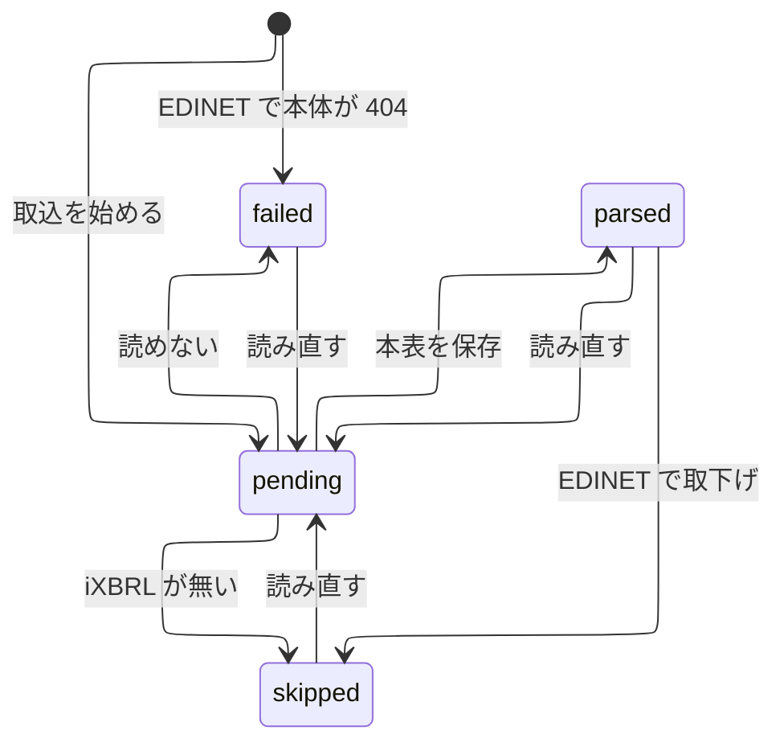
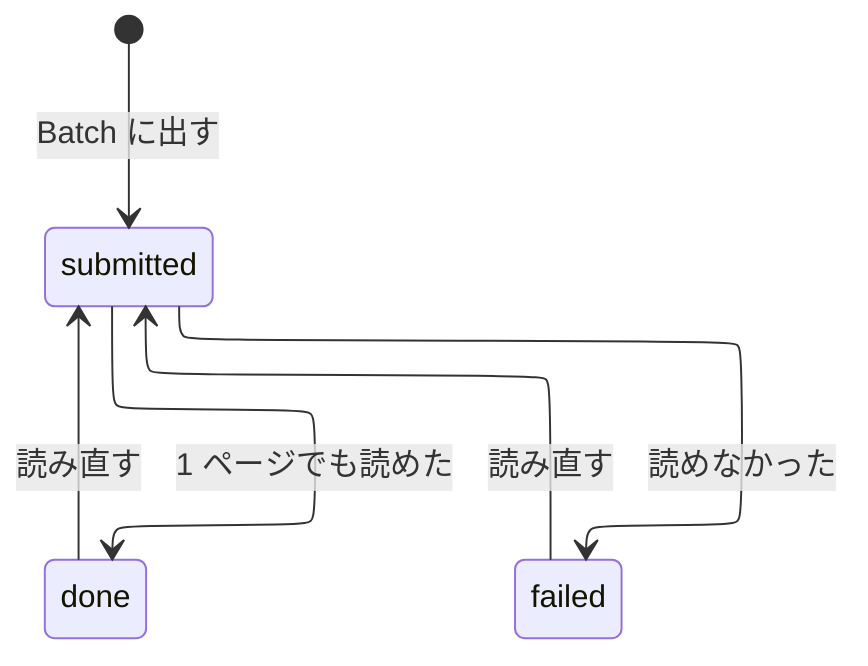
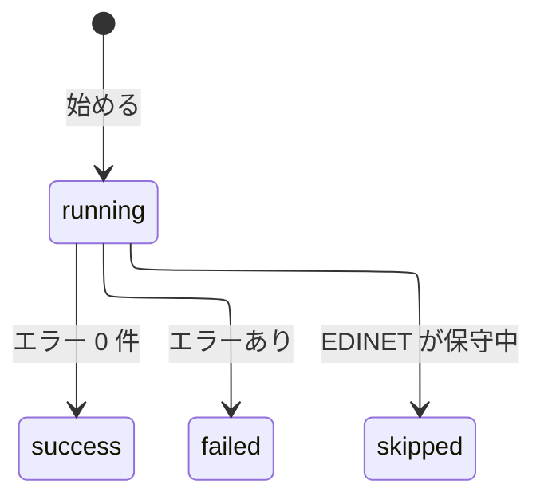
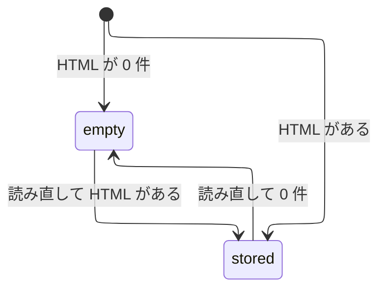
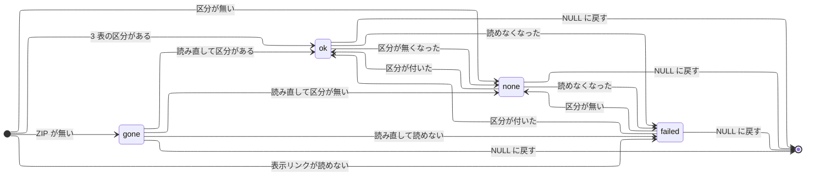
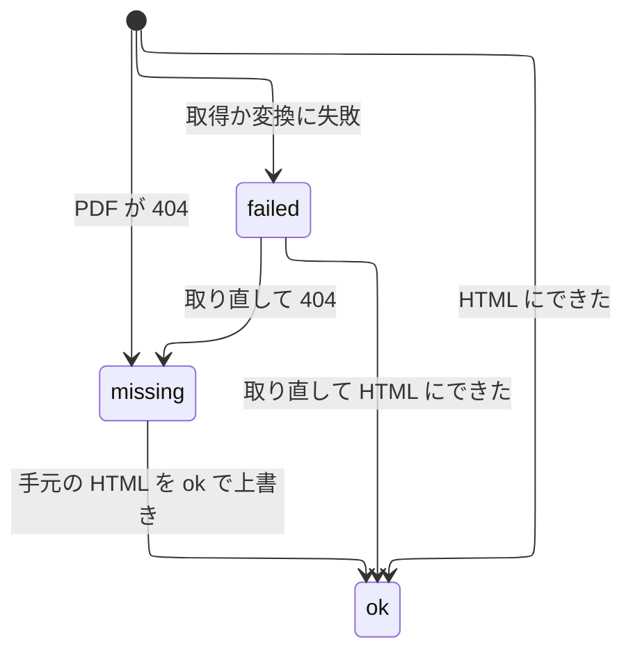
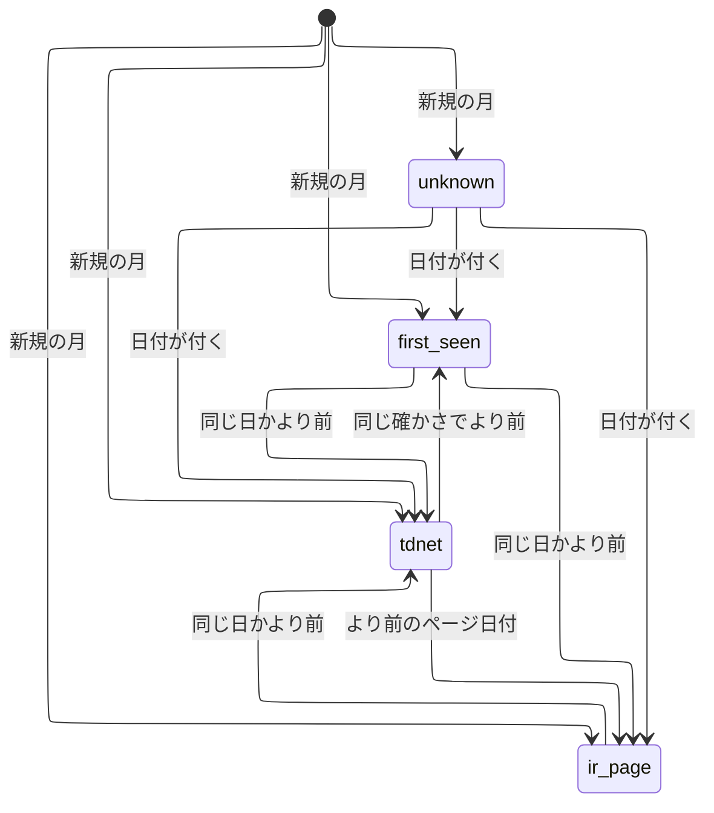
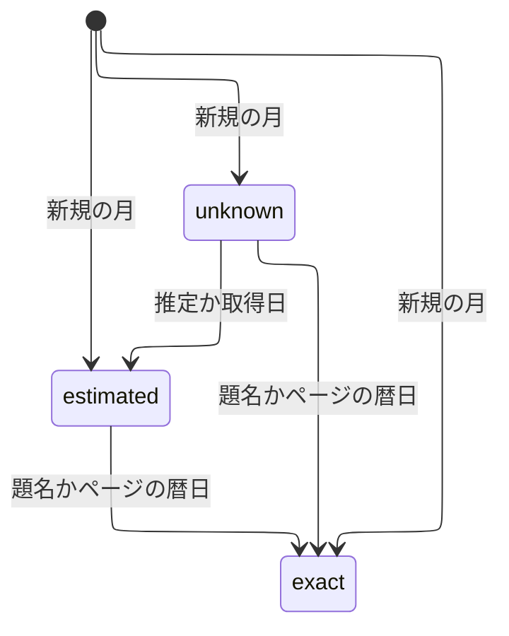

# 状態遷移（行の状態を持つ列）

このページは手書きの設計書であり、自動生成物ではない。各列が取り得る値の一覧と列定義は [XBRL スキーマ](xbrl.md) など機能別のスキーマページ（`app/models.py` から自動生成）を参照し、ここでは実装コード上で実際に状態値を書き換えている根拠がある遷移だけを示す。

このページは以下の規則で保守する。

- 状態遷移図のノード名は SQLAlchemy `Enum` の定義値と完全一致させ、行の新規作成と、列を NULL に戻す先は `[*]` で表す。NULL に戻す矢印は行を消さない。状態の過不足や根拠欄のファイル・関数名の不一致があると `tests/nonfunctional/test_state_diagrams.py` が失敗する。
- 遷移条件は図中の短いラベルではなく直下の表を正とし、「根拠」列にはその値を書き込む（または遷移条件を判定する）ファイルと関数名を列挙する。
- 状態遷移自体はコードから自動抽出できないため、状態を更新する実装を変更した際はこのページも手動で更新する。

## xbrl_filings.parse_status

開示書類 1 件ごとのパース進捗を表す列であり、TDnet の短信 ZIP・EDINET の報告書・TDnet の短信 PDF の 3 経路が共通で使用する。

| 元 | 先 | 条件 | 根拠 |
|---|---|---|---|
| `[*]` | `pending` | 新規開示の取り込みを開始する（既存行を再取り込みするときも一旦 `pending` に戻す） | `app/xbrl/store.py` `parse_zip_into_filing` `app/xbrl/pdf/__init__.py` `_upsert` |
| `[*]` | `failed` | EDINET の書類本体（`type=1`）が `404` を返したとき、新規行を `failed` で記録する | `app/edinet/xbrl.py` `store_missing` |
| `pending` | `parsed` | fact の保存が完了したとき（ZIP 経路も PDF 経路も同じ保存関数を通る） | `app/xbrl/store.py` `store_package` |
| `pending` | `skipped` | ZIP 内に iXBRL ファイルが含まれないとき（`no-ixbrl`） | `app/xbrl/store.py` `parse_zip_into_filing` |
| `pending` | `failed` | 抽出できた fact が 0 件（`no-facts`）、取り込み中に例外が発生、または PDF の版式を解釈できないとき | `app/xbrl/store.py` `parse_zip_into_filing` `app/xbrl/store.py` `mark_failed` `app/xbrl/pdf/__init__.py` `_sync` |
| `parsed` | `pending` | `--reparse` 指定時、TDnet ZIP の SHA-256 が変化したとき、または PDF の指紋変化・再パース指定時 | `app/xbrl/jobs.py` `_plan_row` `app/edinet/xbrl.py` `pending_documents` `app/xbrl/pdf/__init__.py` `_sync` |
| `failed` | `pending` | `--retry-failed` または `--reparse` 指定時（PDF は指紋変化・再パース指定時） | `app/xbrl/jobs.py` `_plan_row` `app/edinet/xbrl.py` `pending_documents` `app/xbrl/pdf/__init__.py` `_sync` |
| `skipped` | `pending` | `--reparse` 指定時、または ZIP の SHA-256 が変化したとき | `app/xbrl/jobs.py` `_plan_row` `app/edinet/xbrl.py` `pending_documents` |
| `parsed` | `skipped` | EDINET で取下げ・不開示になった書類を正規化層から外すとき（`parse_error` に `withdrawn` を記録） | `app/edinet/xbrl.py` `retract` |

なお、同一開示の短信 ZIP が `parsed` になった後に `tdnet_pdf` 由来の行を削除する処理（`app/xbrl/pdf/__init__.py` の `_sync` が `delete_filing` を呼ぶ）は、状態遷移ではなく行の削除であるため上図には含めない。

## briefing_extracts.status

決算説明資料 1 冊を Anthropic Batch API に投入してページ要約・数値表を抽出する進捗を表す。

| 元 | 先 | 条件 | 根拠 |
|---|---|---|---|
| `[*]` | `submitted` | Batch API へリクエストを送信し、`submitted` で行を作成する | `app/market/briefing_batch.py` `submit` |
| `submitted` | `done` | バッチ結果を取得し、少なくとも 1 ページがエラーなく読み取れたとき | `app/market/briefing_batch.py` `store_document` |
| `submitted` | `failed` | 全ページがエラーになったとき、または元の PDF を読み取れないとき | `app/market/briefing_batch.py` `store_document` `app/market/briefing_batch.py` `collect` |
| `done` | `submitted` | `redo` 指定で再抽出に回すとき（現在 `submitted` のまま結果待ちの資料は対象外） | `app/market/briefing_batch.py` `pending_documents` `app/market/briefing_batch.py` `submit` |
| `failed` | `submitted` | `redo` 指定で再抽出に回すとき | `app/market/briefing_batch.py` `pending_documents` `app/market/briefing_batch.py` `submit` |

## xbrl_job_runs.status

XBRL 系バッチ（`xbrl_parse`・`xbrl_normalize`・`edinet_xbrl`）の 1 回ごとの実行結果を表す。

| 元 | 先 | 条件 | 根拠 |
|---|---|---|---|
| `[*]` | `running` | バッチ開始時に実行記録行を作成する | `app/xbrl/jobs.py` `start_run` |
| `running` | `success` | エラー 0 件で最後まで完了したとき | `app/xbrl/jobs.py` `run_parse` `app/xbrl/jobs.py` `run_normalize` `jobs/edinet/edinet_xbrl.py` `main` |
| `running` | `failed` | 処理中にエラーが 1 件以上発生したとき | `app/xbrl/jobs.py` `run_parse` `app/xbrl/jobs.py` `run_normalize` `jobs/edinet/edinet_xbrl.py` `main` |
| `running` | `skipped` | EDINET API がメンテナンス中のため実行を見送ったとき | `jobs/edinet/edinet_xbrl.py` `main` |

プロセス異常終了などで `finish_run` に到達しなかった行は `running` のまま残る（後から別状態へ進める回収処理は設けていない）。

## xbrl_filings.documents_status

短信 ZIP の原文 HTML を `xbrl_documents` に入れたかを表す。行を作った時点では NULL（まだ読んでいない）。値を書く関数は `store_documents` だけで、直前の値は見ずに、HTML があれば `stored`、0 件なら `empty` にする。同じ値への上書き（`stored` のまま、`empty` のまま）は矢印にしない。例外で rollback したときは列を変えない。NULL に戻す代入は無い。

| 元 | 先 | 条件 | 根拠 |
|---|---|---|---|
| `[*]` | `stored` | パース直後（`parse_status` が `skipped` でも）か、原文がまだ無く `empty` でもない filing を埋め直したとき、ZIP に表示用 HTML がある | `app/xbrl/documents.py` `store_documents` `app/xbrl/jobs.py` `_store_documents_logged` `app/xbrl/documents.py` `fill_missing_documents` |
| `[*]` | `empty` | 同じ呼び出しで、表示用 HTML が 0 件（毎時の埋め直しは `empty` を対象にしない） | `app/xbrl/documents.py` `store_documents` `app/xbrl/jobs.py` `_store_documents_logged` `app/xbrl/documents.py` `fill_missing_documents` |
| `stored` | `empty` | パースをやり直して `store_documents` が再び 0 件だったとき。埋め直しは `xbrl_documents` が残っている行を選ばない | `app/xbrl/documents.py` `store_documents` `app/xbrl/jobs.py` `_store_documents_logged` |
| `empty` | `stored` | パースをやり直して HTML が見つかったとき。埋め直しは `empty` を選ばないので、この矢印はパース経路だけ | `app/xbrl/documents.py` `store_documents` `app/xbrl/jobs.py` `_store_documents_logged` |

## xbrl_filings.presentation_status

財務 3 表に当たる表示リンクを読めたかを表す。行を作った時点では NULL。`[*]` は「列が NULL」（行は先にある）。右向きの `[*]` は commit された NULL 戻しで、行は残る。同じ値への上書きは矢印にしない。`delete_filing_payload` は payload を消すときに列を NULL にするが、そのあと `store_package` まで同じトランザクションで commit するときは、観測できる遷移は NULL ではなく書き終えた値である。

`store_presentation` の戻りは、引数が `None`（表示リンクの読み取りが例外）なら `failed`、3 表の区分があれば `ok`、リストだが区分が無ければ `none`。PDF 経路の `_kept` は `presentation` を渡さないので、成功時は空リストになり `none` だけになる。`gone` は backfill が ZIP を入手できないときに、NULL の行へだけ書く。

| 元 | 先 | 条件 | 根拠 |
|---|---|---|---|
| `[*]` | `ok` | ZIP のパース成功、または backfill が NULL の `parsed` を読んだとき、表示リンクに 3 表の区分がある。PDF の成功はここを通らない | `app/xbrl/store.py` `store_package` `app/xbrl/store.py` `store_presentation` `app/xbrl/presentation_backfill.py` `fill_one` |
| `[*]` | `none` | 表示リンクは読めたが 3 表の区分が無い。PDF の成功は `_kept` が `presentation` を落とすので常にここ。backfill が空の区分を書いたときもここ | `app/xbrl/store.py` `store_package` `app/xbrl/store.py` `store_presentation` `app/xbrl/pdf/__init__.py` `_sync` `app/xbrl/presentation_backfill.py` `fill_one` |
| `[*]` | `failed` | ZIP の表示リンク読み取りが例外で `None` になったとき、または backfill が ZIP バイトを読めず `redo` ではないとき（`_mark` は一旦空リストで `store_presentation` してから `failed` を上書きする。commit されるのは `failed`） | `app/xbrl/store.py` `store_package` `app/xbrl/store.py` `store_presentation` `app/xbrl/parser.py` `_read_presentation` `app/xbrl/presentation_backfill.py` `_mark` `app/xbrl/presentation_backfill.py` `fill_one` |
| `[*]` | `gone` | backfill が ZIP を入手できず（ファイルが無い、EDINET が 404 で退避も無い）、`redo` ではないとき。`ok` のやり直しでは印を変えない | `app/xbrl/presentation_backfill.py` `_mark` `app/xbrl/presentation_backfill.py` `fill_one` |
| `ok` | `none` | ZIP を読み直し、区分が無くなった。直前の値は見ない。PDF の成功も `none` を書くが、PDF 行が `ok` になる経路は無い | `app/xbrl/store.py` `store_package` `app/xbrl/jobs.py` `parse_manifest_row` |
| `ok` | `failed` | ZIP を読み直し、表示リンクが読めなかった | `app/xbrl/store.py` `store_package` `app/xbrl/parser.py` `_read_presentation` `app/xbrl/jobs.py` `parse_manifest_row` |
| `ok` | `[*]` | `store_package` まで行かずに commit した。iXBRL が無い、fact が 0 件、パースが例外、PDF の版式を解釈できない、EDINET の取下げ | `app/xbrl/store.py` `delete_filing_payload` `app/xbrl/store.py` `parse_zip_into_filing` `app/xbrl/store.py` `mark_failed` `app/xbrl/pdf/__init__.py` `_sync` `app/edinet/xbrl.py` `retract` |
| `none` | `ok` | ZIP を読み直し、3 表の区分が付いた。backfill は `none` を選び直さない | `app/xbrl/store.py` `store_package` `app/xbrl/jobs.py` `parse_manifest_row` |
| `none` | `failed` | ZIP を読み直し、表示リンクが読めなかった | `app/xbrl/store.py` `store_package` `app/xbrl/parser.py` `_read_presentation` `app/xbrl/jobs.py` `parse_manifest_row` |
| `none` | `[*]` | `ok` と同じく、`store_package` の前で commit した | `app/xbrl/store.py` `delete_filing_payload` `app/xbrl/store.py` `parse_zip_into_filing` `app/xbrl/store.py` `mark_failed` `app/xbrl/pdf/__init__.py` `_sync` `app/edinet/xbrl.py` `retract` |
| `failed` | `ok` | ZIP を読み直し、3 表の区分が付いた。backfill は `failed` を選び直さない | `app/xbrl/store.py` `store_package` `app/xbrl/jobs.py` `parse_manifest_row` |
| `failed` | `none` | ZIP を読み直し、区分が無い | `app/xbrl/store.py` `store_package` `app/xbrl/jobs.py` `parse_manifest_row` |
| `failed` | `[*]` | `ok` と同じく、`store_package` の前で commit した | `app/xbrl/store.py` `delete_filing_payload` `app/xbrl/store.py` `parse_zip_into_filing` `app/xbrl/store.py` `mark_failed` `app/xbrl/pdf/__init__.py` `_sync` `app/edinet/xbrl.py` `retract` |
| `gone` | `ok` | ZIP を読み直し、3 表の区分が付いた。backfill の `redo` は `ok` だけを選び、`gone` は対象外 | `app/xbrl/store.py` `store_package` `app/xbrl/jobs.py` `parse_manifest_row` |
| `gone` | `none` | ZIP を読み直し、区分が無い | `app/xbrl/store.py` `store_package` `app/xbrl/jobs.py` `parse_manifest_row` |
| `gone` | `failed` | ZIP を読み直し、表示リンクが読めなかった | `app/xbrl/store.py` `store_package` `app/xbrl/parser.py` `_read_presentation` `app/xbrl/jobs.py` `parse_manifest_row` |
| `gone` | `[*]` | `ok` と同じく、`store_package` の前で commit した。PDF の `_sync` は `source='tdnet_pdf'` だけなので、backfill が `gone` にした `tdnet` / `edinet` の行は通らない | `app/xbrl/store.py` `delete_filing_payload` `app/xbrl/store.py` `parse_zip_into_filing` `app/xbrl/store.py` `mark_failed` `app/edinet/xbrl.py` `retract` |

backfill の `redo` は `ok` のうち要素に深さが無い行だけを読む。ZIP が無い・読めない・3 表の区分が無いときは印を残す（`ok` のまま）。区分があれば `store_presentation` が再び `ok` を書く。取得の 5xx・タイムアウト・書き込み失敗は印を付けない。行の削除（`delete_filing`）は遷移ではない。

## tdnet_pdf_documents.status

IR BANK の TDnet PDF を HTML にできたかを表す。`ok` と `missing` は取り込み（`targets`）の対象に戻らない。`failed` だけ `--retry-failed` で再び対象になる。同じ値への上書き（取り直してまた `failed`、既に `ok` の行へもう一度 `ok` を書く）は矢印にしない。429 / 503 は行を書かずに止める。

| 元 | 先 | 条件 | 根拠 |
|---|---|---|---|
| `[*]` | `ok` | 新規の開示で PDF を HTML にできたとき。検証用の `put_html` とゴールデンの投入も、行が無ければ `ok` で作る | `jobs/xbrl/tdnet_pdf_ingest.py` `ingest_one` `tools/tdnet_pdf/verify_financials.py` `put_html` `tools/tdnet_pdf/golden_check.py` `_seed_and_sync` |
| `[*]` | `missing` | 新規の開示で IR BANK が 404 のとき | `jobs/xbrl/tdnet_pdf_ingest.py` `_mark` `jobs/xbrl/tdnet_pdf_ingest.py` `run` |
| `[*]` | `failed` | 新規の開示で PDF ではない、途中までの PDF、変換例外のとき | `jobs/xbrl/tdnet_pdf_ingest.py` `_mark` `jobs/xbrl/tdnet_pdf_ingest.py` `run` |
| `failed` | `ok` | `--retry-failed` で再び取りに行き HTML にできたとき。`put_html` とゴールデンの投入は、`failed` の行を `ok` で上書きする | `jobs/xbrl/tdnet_pdf_ingest.py` `ingest_one` `jobs/xbrl/tdnet_pdf_ingest.py` `targets` `tools/tdnet_pdf/verify_financials.py` `put_html` `tools/tdnet_pdf/golden_check.py` `_seed_and_sync` |
| `failed` | `missing` | `--retry-failed` で再び取りに行き 404 のとき | `jobs/xbrl/tdnet_pdf_ingest.py` `_mark` `jobs/xbrl/tdnet_pdf_ingest.py` `targets` |
| `missing` | `ok` | 取り込みは `missing` を取り直さない。`put_html` とゴールデンの投入だけが、既存行を `ok` で上書きする | `tools/tdnet_pdf/verify_financials.py` `put_html` `tools/tdnet_pdf/golden_check.py` `_seed_and_sync` |

## monthly_publications.basis

銘柄 × 暦年 × 月の最初の公表日が、どの出どころの日付かを表す。同じ月をあとから訂正しても、より遅い日付では置き換えない。日付がある行を `unknown` に戻すことはない。値が全部消えて行を消すのは状態遷移ではない（`app/monthly/publications.py` の `drop`）。

| 元 | 先 | 条件 | 根拠 |
|---|---|---|---|
| `[*]` | `tdnet` | その月の最初の行を TDnet の開示日で作る | `app/monthly/publications.py` `note` |
| `[*]` | `ir_page` | その月の最初の行をページ・URL・表計算・JSON の暦日で作る | `app/monthly/publications.py` `note` |
| `[*]` | `first_seen` | その月の最初の行を、バッチが月を最初に見た日で作る | `app/monthly/publications.py` `note` |
| `[*]` | `unknown` | その月の最初の行を、日付が無い理由付きで作る | `app/monthly/publications.py` `note` |
| `unknown` | `tdnet` | 日付の無い行に、TDnet の開示日が来る | `app/monthly/publications.py` `note` `app/monthly/publications.py` `better` |
| `unknown` | `ir_page` | 日付の無い行に、ページ上の暦日が来る | `app/monthly/publications.py` `note` `app/monthly/publications.py` `better` |
| `unknown` | `first_seen` | 日付の無い行に、最初に見た日が来る | `app/monthly/publications.py` `note` `app/monthly/publications.py` `better` |
| `first_seen` | `tdnet` | より確かな開示日、または同じ確かさで同じ日かより前の開示日が来る | `app/monthly/publications.py` `note` `app/monthly/publications.py` `better` |
| `first_seen` | `ir_page` | より確かなページの暦日、または同じ確かさで同じ日かより前の暦日が来る | `app/monthly/publications.py` `note` `app/monthly/publications.py` `better` |
| `ir_page` | `tdnet` | 同じ確かさで、同じ日かより前の TDnet 開示日が来る | `app/monthly/publications.py` `note` `app/monthly/publications.py` `better` |
| `tdnet` | `ir_page` | 同じ確かさで、開示日より前のページ上の暦日が来る | `app/monthly/publications.py` `note` `app/monthly/publications.py` `better` |
| `tdnet` | `first_seen` | 同じ確かさで、開示日より前の観測日が来る | `app/monthly/publications.py` `note` `app/monthly/publications.py` `better` |

`exact` を `estimated` に戻す矢印は無い。取得日（`first_seen` は `estimated`）は、題名から特定した `exact` の開示日が後でも置き換わらない。`assign` は、既に `exact` の行を `override` が真のときだけ、渡された公表日で上書きする。

## monthly_publications.confidence

その日付を、どの確かさでその月に結び付けたかを表す。`exact` は題名の年月かページの暦日、`estimated` は月末から 45 日以内の開示か取得日、`unknown` は日付が無い。より低い確かさへは戻さない。

| 元 | 先 | 条件 | 根拠 |
|---|---|---|---|
| `[*]` | `exact` | 題名の年月かページの暦日で行を作る | `app/monthly/publications.py` `note` |
| `[*]` | `estimated` | 45 日以内の開示、または取得日で行を作る | `app/monthly/publications.py` `note` |
| `[*]` | `unknown` | 日付の無い行を作る | `app/monthly/publications.py` `note` |
| `unknown` | `exact` | 日付の無い行に、題名かページの暦日が来る | `app/monthly/publications.py` `note` `app/monthly/publications.py` `better` |
| `unknown` | `estimated` | 日付の無い行に、推定か取得日が来る | `app/monthly/publications.py` `note` `app/monthly/publications.py` `better` |
| `estimated` | `exact` | 推定や取得日の行に、題名かページの暦日が来る。推定の方が早くても `exact` が勝つ | `app/monthly/publications.py` `note` `app/monthly/publications.py` `better` |

## 状態遷移図に含めない列

以下の列は、取り込みのたびに計算し直す値で、前回の状態から遷移する列ではない。

| 列 | 理由 |
|---|---|
| `edinet_tender_offers.status`（`open`・`succeeded`・`failed`・`withdrawn`） | 取り込みのたびに最新の提出書類から毎回再計算する値であり、前回の状態から遷移する列ではないため（`app/edinet/tender_offers.py` の `offer_row`） |
