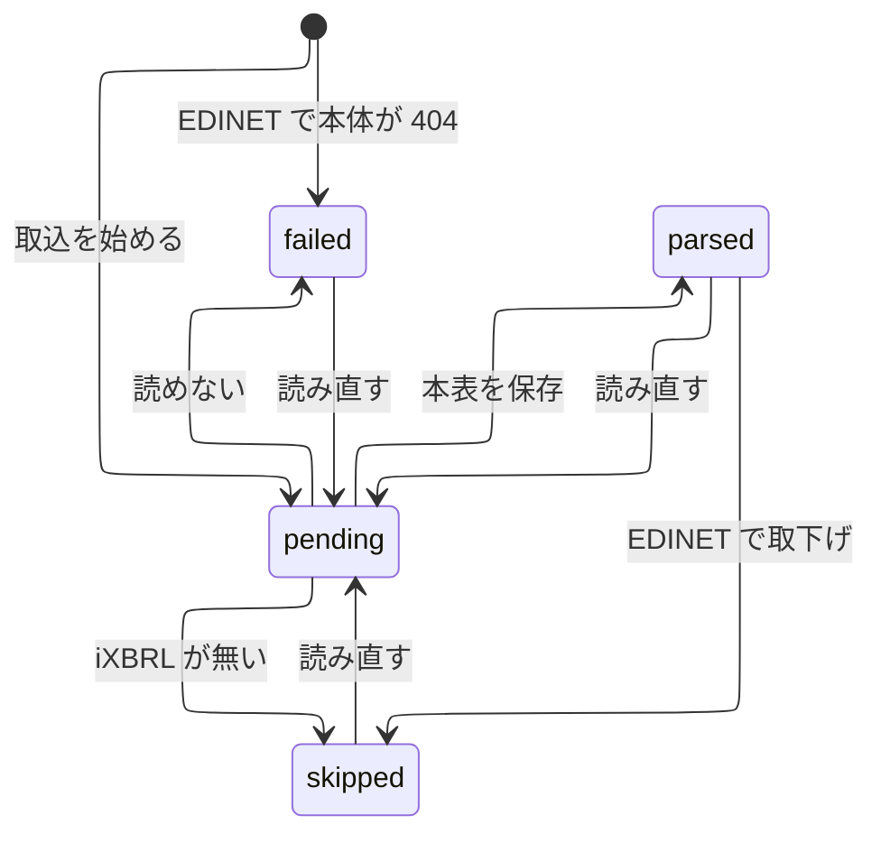
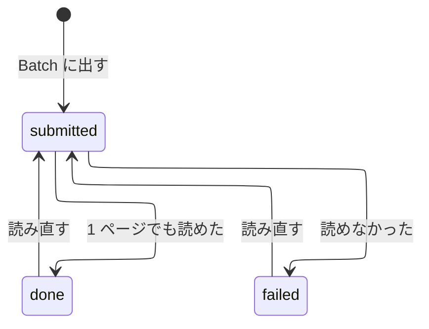
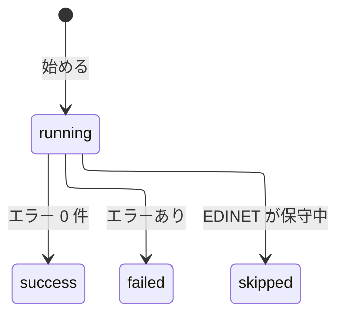

# 状態遷移（行の状態を持つ列）

このページは手書きの設計書であり、自動生成物ではない。各列が取り得る値の一覧と列定義は [XBRL スキーマ](xbrl.md) など機能別のスキーマページ（`app/models.py` から自動生成）を参照し、ここでは実装コード上で実際に状態値を書き換えている根拠がある遷移だけを示す。

このページは以下の規則で保守する。

- 状態遷移図のノード名は SQLAlchemy `Enum` の定義値と完全一致させ、行の新規作成は `[*]` で表す。状態の過不足や根拠欄のファイル・関数名の不一致があると `tests/nonfunctional/test_state_diagrams.py` が失敗する。
- 遷移条件は図中の短いラベルではなく直下の表を正とし、「根拠」列にはその値を書き込む（または遷移条件を判定する）ファイルと関数名を列挙する。
- 状態遷移自体はコードから自動抽出できないため、状態を更新する実装を変更した際はこのページも手動で更新する。

## xbrl_filings.parse_status

開示書類 1 件ごとのパース進捗を表す列であり、TDnet の短信 ZIP・EDINET の報告書・TDnet の短信 PDF の 3 経路が共通で使用する。

| 元 | 先 | 条件 | 根拠 |
|---|---|---|---|
| `[*]` | `pending` | 新規開示の取り込みを開始する（既存行を再取り込みするときも一旦 `pending` に戻す） | `app/xbrl/store.py` `parse_zip_into_filing` `app/xbrl/pdf/__init__.py` `_upsert` |
| `[*]` | `failed` | EDINET の書類本体（`type=1`）が `404` を返したとき、新規行を `failed` で記録する | `app/edinet/xbrl.py` `store_missing` |
| `pending` | `parsed` | fact の保存が完了したとき（ZIP 経路も PDF 経路も同じ保存関数を通る） | `app/xbrl/store.py` `store_package` |
| `pending` | `skipped` | ZIP 内に iXBRL ファイルが含まれないとき（`no-ixbrl`） | `app/xbrl/store.py` `parse_zip_into_filing` |
| `pending` | `failed` | 抽出できた fact が 0 件（`no-facts`）、取り込み中に例外が発生、または PDF の版式を解釈できないとき | `app/xbrl/store.py` `parse_zip_into_filing` `app/xbrl/store.py` `mark_failed` `app/xbrl/pdf/__init__.py` `_sync` |
| `parsed` | `pending` | `--reparse` 指定時、TDnet ZIP の SHA-256 が変化したとき、または PDF の指紋変化・再パース指定時 | `app/xbrl/jobs.py` `_plan_row` `app/edinet/xbrl.py` `pending_documents` `app/xbrl/pdf/__init__.py` `_sync` |
| `failed` | `pending` | `--retry-failed` または `--reparse` 指定時（PDF は指紋変化・再パース指定時） | `app/xbrl/jobs.py` `_plan_row` `app/edinet/xbrl.py` `pending_documents` `app/xbrl/pdf/__init__.py` `_sync` |
| `skipped` | `pending` | `--reparse` 指定時、または ZIP の SHA-256 が変化したとき | `app/xbrl/jobs.py` `_plan_row` `app/edinet/xbrl.py` `pending_documents` |
| `parsed` | `skipped` | EDINET で取下げ・不開示になった書類を正規化層から外すとき（`parse_error` に `withdrawn` を記録） | `app/edinet/xbrl.py` `retract` |

なお、同一開示の短信 ZIP が `parsed` になった後に `tdnet_pdf` 由来の行を削除する処理（`app/xbrl/pdf/__init__.py` の `_sync` が `delete_filing` を呼ぶ）は、状態遷移ではなく行の削除であるため上図には含めない。

## briefing_extracts.status

決算説明資料 1 冊を Anthropic Batch API に投入してページ要約・数値表を抽出する進捗を表す。

| 元 | 先 | 条件 | 根拠 |
|---|---|---|---|
| `[*]` | `submitted` | Batch API へリクエストを送信し、`submitted` で行を作成する | `app/market/briefing_batch.py` `submit` |
| `submitted` | `done` | バッチ結果を取得し、少なくとも 1 ページがエラーなく読み取れたとき | `app/market/briefing_batch.py` `store_document` |
| `submitted` | `failed` | 全ページがエラーになったとき、または元の PDF を読み取れないとき | `app/market/briefing_batch.py` `store_document` `app/market/briefing_batch.py` `collect` |
| `done` | `submitted` | `redo` 指定で再抽出に回すとき（現在 `submitted` のまま結果待ちの資料は対象外） | `app/market/briefing_batch.py` `pending_documents` `app/market/briefing_batch.py` `submit` |
| `failed` | `submitted` | `redo` 指定で再抽出に回すとき | `app/market/briefing_batch.py` `pending_documents` `app/market/briefing_batch.py` `submit` |

## xbrl_job_runs.status

XBRL 系バッチ（`xbrl_parse`・`xbrl_normalize`・`edinet_xbrl`）の 1 回ごとの実行結果を表す。

| 元 | 先 | 条件 | 根拠 |
|---|---|---|---|
| `[*]` | `running` | バッチ開始時に実行記録行を作成する | `app/xbrl/jobs.py` `start_run` |
| `running` | `success` | エラー 0 件で最後まで完了したとき | `app/xbrl/jobs.py` `run_parse` `app/xbrl/jobs.py` `run_normalize` `jobs/edinet/edinet_xbrl.py` `main` |
| `running` | `failed` | 処理中にエラーが 1 件以上発生したとき | `app/xbrl/jobs.py` `run_parse` `app/xbrl/jobs.py` `run_normalize` `jobs/edinet/edinet_xbrl.py` `main` |
| `running` | `skipped` | EDINET API がメンテナンス中のため実行を見送ったとき | `jobs/edinet/edinet_xbrl.py` `main` |

プロセス異常終了などで `finish_run` に到達しなかった行は `running` のまま残る（後から別状態へ進める回収処理は設けていない）。

## 状態遷移図に含めない列

以下の列は状態機械としての遷移を持たないか、複数ジョブにまたがり前状態ごとの遷移条件が一意に定まらないため対象外としている。

| 列 | 理由 |
|---|---|
| `edinet_tender_offers.status`（`open`・`succeeded`・`failed`・`withdrawn`） | 取り込みのたびに最新の提出書類から毎回再計算する値であり、前回の状態から遷移する列ではないため（`app/edinet/tender_offers.py` の `offer_row`） |
| `xbrl_filings.documents_status`、`xbrl_filings.presentation_status` | 複数のバッチから上書きされ、直前の値に依存しない再設定が多く状態遷移図に適さないため |
| `tdnet_pdf_documents.status`（`ok`・`missing`・`failed`） | 取得・再試行の経路が複数に分かれており、直前の状態による遷移制約を持たないため |
