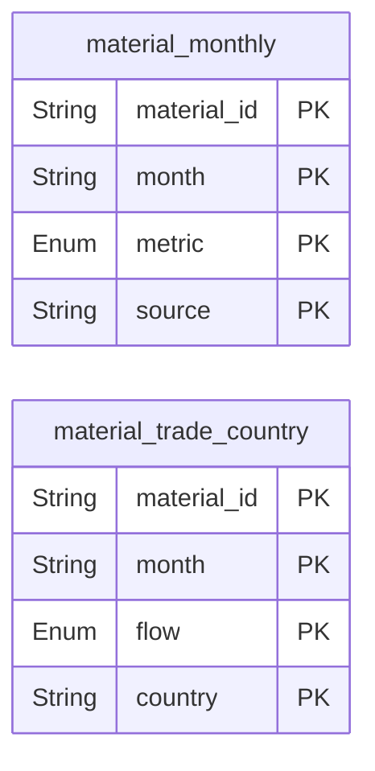

# スキーマ: サプライ

**自動生成。手で直さない。** 正は `app/models.py`。作り直しは `python -m tools.schema.render`。全体は [SCHEMA.md](../SCHEMA.md)。

図は主キーと参照の列だけ。実線は外部キー、点線はモデルで宣言しただけの参照（DB の制約は無い）。親の側が `}|` の線は、親の列が一意でない（同じ値の行が親に何行もある）。ほかの機能の表は主キーと指される列だけ出す。

## テーブル

見出しの下の文と「説明」の列は、モデルの `comment`（DB には出ない）。型の列は DDL の型で、括弧の中はモデルの型。

`UtcDateTime`: UTC をタイムゾーンなしで持つ。

### material_monthly

サプライタブの素材ごとの月次量

| 列 | 型 | NULL | キー | 値 | 既定 | 説明 |
|---|---|---|---|---|---|---|
| `material_id` | VARCHAR |  | PK |  |  | config/supply/supply_chain.json の id（FK なし） |
| `month` | VARCHAR(7) |  | PK |  |  | YYYY-MM |
| `metric` | VARCHAR |  | PK | `production` `shipment` `inventory` `import` `export` `processing` 原油処理 `domestic_sales` 国内向販売 |  |  |
| `source` | VARCHAR |  | PK |  |  | seidou:<報告番号>（生産動態）/ sekiyu（石油統計）/ trade（貿易） |
| `value` | FLOAT |  |  |  |  |  |
| `unit` | VARCHAR |  |  |  |  | t / kl / 本 など。換算しない |
| `revision` | INTEGER |  |  |  |  | 1 速報 / 2 確報 / 3 年報（年間補正後） |
| `origin` | VARCHAR | 可 |  |  |  | 取り込んだ e-Stat の表 ID か Excel のファイル名 |
| `is_estimate` | BOOLEAN |  |  |  | `False` | 按分の推計値 |
| `updated_at` | DATETIME（`UtcDateTime`） | 可 |  |  |  |  |

### material_trade_country

素材の輸出入の相手国別の月次量（普通貿易統計の品別国別表）。material_monthly の trade の国別内訳。国合計を material_monthly に書かない素材も国別だけはここに持つ

| 列 | 型 | NULL | キー | 値 | 既定 | 説明 |
|---|---|---|---|---|---|---|
| `material_id` | VARCHAR |  | PK |  |  |  |
| `month` | VARCHAR(7) |  | PK |  |  |  |
| `flow` | VARCHAR |  | PK | `import` / `export` |  |  |
| `country` | VARCHAR(3) |  | PK |  |  | 貿易統計の国コード（137 = サウジアラビア） |
| `country_name` | VARCHAR |  |  |  |  |  |
| `value` | FLOAT |  |  |  |  |  |
| `unit` | VARCHAR |  |  |  |  |  |
| `revision` | INTEGER |  |  |  |  | 1 速報 / 2 確報 |
| `origin` | VARCHAR | 可 |  |  |  |  |
| `updated_at` | DATETIME（`UtcDateTime`） | 可 |  |  |  |  |
