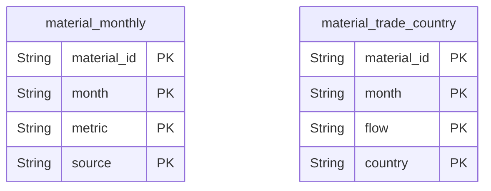

# スキーマ: サプライ

**自動生成。手で直さない。** 正は `app/models.py`。作り直しは `python -m tools.schema.render`。全体は [SCHEMA.md](../SCHEMA.md)。

図は主キーと外部キーの列だけ。線は外部キー（列名つき）。ほかの機能の表は主キーだけ出す。

## テーブル

### material_monthly

| 列 | 型 | NULL | キー | 既定 |
|---|---|---|---|---|
| `material_id` | VARCHAR |  | PK |  |
| `month` | VARCHAR(7) |  | PK |  |
| `metric` | VARCHAR |  | PK |  |
| `source` | VARCHAR |  | PK |  |
| `value` | FLOAT |  |  |  |
| `unit` | VARCHAR |  |  |  |
| `revision` | INTEGER |  |  |  |
| `origin` | VARCHAR | 可 |  |  |
| `is_estimate` | BOOLEAN |  |  | `False` |
| `updated_at` | DATETIME | 可 |  |  |

### material_trade_country

| 列 | 型 | NULL | キー | 既定 |
|---|---|---|---|---|
| `material_id` | VARCHAR |  | PK |  |
| `month` | VARCHAR(7) |  | PK |  |
| `flow` | VARCHAR |  | PK |  |
| `country` | VARCHAR(3) |  | PK |  |
| `country_name` | VARCHAR |  |  |  |
| `value` | FLOAT |  |  |  |
| `unit` | VARCHAR |  |  |  |
| `revision` | INTEGER |  |  |  |
| `origin` | VARCHAR | 可 |  |  |
| `updated_at` | DATETIME | 可 |  |  |
