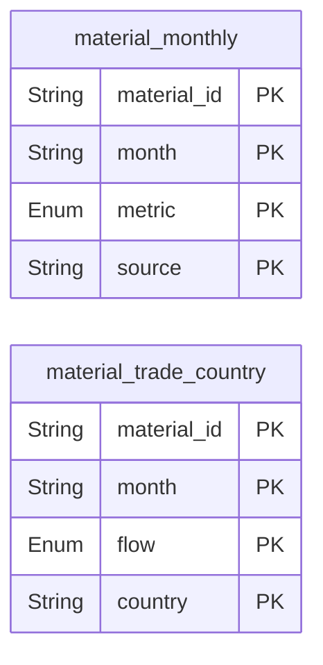

# スキーマ: サプライ

**自動生成。手で直さない。** 正は `app/models.py`。作り直しは `python -m tools.schema.render`。全体は [SCHEMA.md](../SCHEMA.md)。

図は主キーと参照の列だけ。実線は外部キー、点線はモデルで宣言しただけの参照（DB の制約は無い）。親の側が `}|` の線は、親の列が一意でない（同じ値の行が親に何行もある）。ほかの機能の表は主キーと指される列だけ出す。

## テーブル

### material_monthly

| 列 | 型 | NULL | キー | 値 | 既定 |
|---|---|---|---|---|---|
| `material_id` | VARCHAR |  | PK |  |  |
| `month` | VARCHAR(7) |  | PK |  |  |
| `metric` | VARCHAR |  | PK | `production` / `shipment` / `inventory` / `import` / `export` / `processing` / `domestic_sales` |  |
| `source` | VARCHAR |  | PK |  |  |
| `value` | FLOAT |  |  |  |  |
| `unit` | VARCHAR |  |  |  |  |
| `revision` | INTEGER |  |  |  |  |
| `origin` | VARCHAR | 可 |  |  |  |
| `is_estimate` | BOOLEAN |  |  |  | `False` |
| `updated_at` | DATETIME | 可 |  |  |  |

### material_trade_country

| 列 | 型 | NULL | キー | 値 | 既定 |
|---|---|---|---|---|---|
| `material_id` | VARCHAR |  | PK |  |  |
| `month` | VARCHAR(7) |  | PK |  |  |
| `flow` | VARCHAR |  | PK | `import` / `export` |  |
| `country` | VARCHAR(3) |  | PK |  |  |
| `country_name` | VARCHAR |  |  |  |  |
| `value` | FLOAT |  |  |  |  |
| `unit` | VARCHAR |  |  |  |  |
| `revision` | INTEGER |  |  |  |  |
| `origin` | VARCHAR | 可 |  |  |  |
| `updated_at` | DATETIME | 可 |  |  |  |
