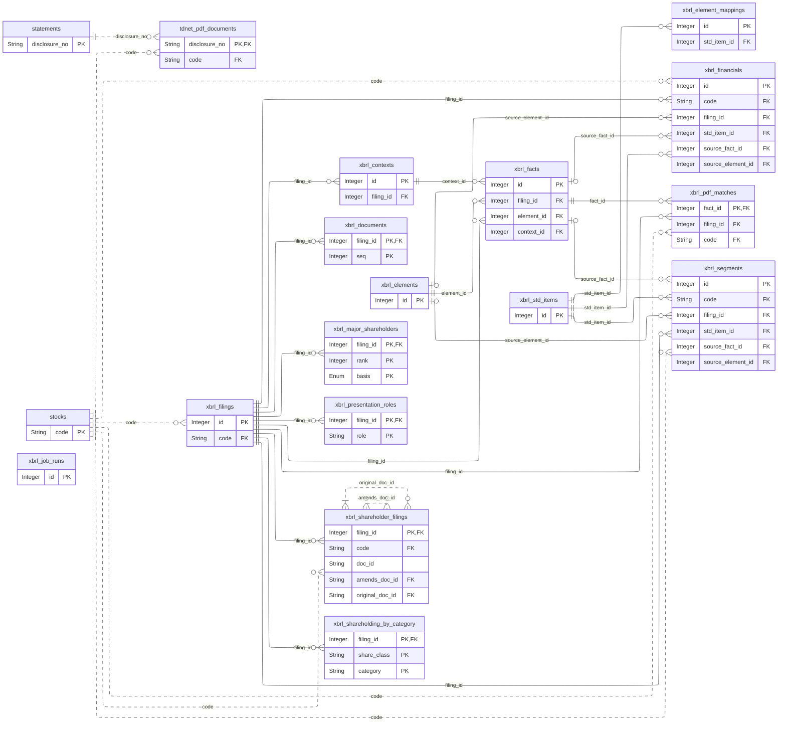

# スキーマ: XBRL・決算書類

正は `app/models.py`。全体は [SCHEMA.md](../SCHEMA.md)。

図は主キーと参照の列だけ。実線は外部キー、点線はモデルで宣言しただけの参照（DB の制約は無い）。親の側が `}|` の線は、親の列が一意でない（同じ値の行が親に何行もある）。ほかの機能の表は主キーと指される列だけ出す。

## テーブル

見出しの下の文と「説明」の列は、モデルの `comment`（DB には出ない）。型の列は DDL の型で、括弧の中はモデルの型。

`JstDateTime`: 日本時間をタイムゾーンなしで持つ。 `UtcDateTime`: UTC をタイムゾーンなしで持つ。

### tdnet_pdf_documents

TDnet の開示 PDF（IR BANK の保管分）を HTML に変換したもの

読み書きするバッチ・API: [データの流れ](../dataflow/xbrl.md#tdnet_pdf_documents)

| 列 | 型 | NULL | キー | 値 | 既定 | 説明 |
|---|---|---|---|---|---|---|
| `disclosure_no` | VARCHAR(14) |  | PK / → `statements.disclosure_no`（制約なし） |  |  | TDnet の docID（= XBRL ZIP 名の後ろ 14 桁） |
| `code` | VARCHAR(5) |  | → `stocks.code`（制約なし） |  |  | statements から |
| `disclosed_date` | DATE | 可 |  |  |  | statements から |
| `disclosed_time` | VARCHAR(8) | 可 |  |  |  | statements から |
| `title` | TEXT | 可 |  |  |  | 1 ページ目の題名。取れなければ statements.type_of_document |
| `status` | VARCHAR(16) |  |  | `ok` html あり `missing` PDF が 404 `failed` 取得・変換の失敗 |  |  |
| `error` | TEXT | 可 |  |  |  | status が failed のときの理由 |
| `html_gz` | BLOB | 可 |  |  |  | 変換後の HTML を gzip |
| `bytes` | INTEGER | 可 |  |  |  | 変換後 HTML（圧縮前） |
| `sha256` | VARCHAR(64) | 可 |  |  |  | 変換後 HTML（圧縮前） |
| `pages` | INTEGER | 可 |  |  |  | 元の PDF |
| `pdf_bytes` | INTEGER | 可 |  |  |  | 元の PDF |
| `pdf_sha256` | VARCHAR(64) | 可 |  |  |  | 元の PDF |
| `converter` | VARCHAR(16) | 可 |  |  |  | 変換器の版（app/xbrl/pdf/convert.py CONVERTER） |
| `created_at` | DATETIME（`UtcDateTime`） |  |  |  |  |  |

| 索引・一意 | 列 | 一意 |
|---|---|---|
| `ix_tdnet_pdf_documents_code` | code |  |

### xbrl_contexts

開示ごとのコンテキスト（期間・連結か個別か・次元）

読み書きするバッチ・API: [データの流れ](../dataflow/xbrl.md#xbrl_contexts)

| 列 | 型 | NULL | キー | 値 | 既定 | 説明 |
|---|---|---|---|---|---|---|
| `id` | INTEGER |  | PK |  |  |  |
| `filing_id` | INTEGER |  | FK → `xbrl_filings.id` |  |  |  |
| `context_ref` | VARCHAR(255) |  |  |  |  |  |
| `period_type` | VARCHAR(16) |  |  | `instant` / `duration` |  |  |
| `start_date` | DATE | 可 |  |  |  |  |
| `end_date` | DATE |  |  |  |  |  |
| `is_consolidated` | INTEGER |  |  |  | `1` | 1=連結 / 0=単体。判定不能は 1 |
| `relative_period` | VARCHAR(16) | 可 |  | `current` / `prior1` / `prior2` |  |  |
| `dimensions_json` | TEXT |  |  |  | `'{}'` |  |
| `has_dimensions` | BOOLEAN |  |  |  | `False` |  |
| `member_labels_json` | TEXT | 可 |  |  |  | 次元メンバー → その書類のラベル（日本語）。標準メンバーも会社が名前を付け替える |

| 索引・一意 | 列 | 一意 |
|---|---|---|
| `uq_xbrl_contexts_filing_ref` | filing_id, context_ref | 一意 |
| `idx_xbrl_contexts_filing` | filing_id |  |

### xbrl_documents

短信 ZIP の表示用 HTML。書類ごとに表示順で並べる

読み書きするバッチ・API: [データの流れ](../dataflow/xbrl.md#xbrl_documents)

| 列 | 型 | NULL | キー | 値 | 既定 | 説明 |
|---|---|---|---|---|---|---|
| `filing_id` | INTEGER |  | PK / FK → `xbrl_filings.id` |  |  |  |
| `seq` | INTEGER |  | PK |  |  | 表示順。0 から |
| `part` | VARCHAR(16) |  |  | `summary` サマリー `qualitative` 添付資料まるごと `attachment` qualitative.htm が無い書類の本表 iXBRL |  |  |
| `file_name` | TEXT |  |  |  |  | ZIP の中のファイル名（パスなし） |
| `html_gz` | BLOB |  |  |  |  | 元の HTML を gzip。script などの除去は表示のとき |
| `bytes` | INTEGER |  |  |  |  | 圧縮前 |
| `sha256` | VARCHAR(64) |  |  |  |  | 圧縮前 |
| `created_at` | DATETIME（`UtcDateTime`） |  |  |  |  |  |

### xbrl_element_mappings

XBRL の要素 → 標準科目の対応

読み書きするバッチ・API: [データの流れ](../dataflow/xbrl.md#xbrl_element_mappings)

| 列 | 型 | NULL | キー | 値 | 既定 | 説明 |
|---|---|---|---|---|---|---|
| `id` | INTEGER |  | PK |  |  |  |
| `std_item_id` | INTEGER |  | FK → `xbrl_std_items.id` |  |  |  |
| `namespace_key` | VARCHAR(64) |  |  |  |  |  |
| `local_name` | VARCHAR(255) |  |  |  |  |  |
| `priority` | INTEGER |  |  |  | `100` |  |
| `accounting_standard` | VARCHAR(16) | 可 |  |  |  | NULL=全共通 |
| `note` | TEXT | 可 |  |  |  |  |
| `part` | VARCHAR(16) | 可 |  | `months` 同じ科目・context の値に 月÷12 を足す（有報の「40歳3ヶ月」は年と月が別の要素） |  | NULL は値そのもの |

| 索引・一意 | 列 | 一意 |
|---|---|---|
| `uq_xbrl_element_mappings` | std_item_id, namespace_key, local_name, accounting_standard | 一意 |
| `idx_xbrl_mappings_elem` | namespace_key, local_name |  |

### xbrl_elements

XBRL の要素。名前空間 × 名前で 1 行

読み書きするバッチ・API: [データの流れ](../dataflow/xbrl.md#xbrl_elements)

| 列 | 型 | NULL | キー | 値 | 既定 | 説明 |
|---|---|---|---|---|---|---|
| `id` | INTEGER |  | PK |  |  |  |
| `namespace_uri` | TEXT |  |  |  |  |  |
| `namespace_key` | VARCHAR(64) |  |  |  |  | 'jppfs_cor' / 'tse-ed-t' / 'jpigp_cor' / 'custom' 等 |
| `local_name` | VARCHAR(255) |  |  |  |  |  |
| `label_ja` | TEXT | 可 |  |  |  |  |
| `label_en` | TEXT | 可 |  |  |  |  |
| `item_type` | VARCHAR(16) | 可 |  |  |  |  |
| `is_custom` | BOOLEAN |  |  |  | `False` |  |
| `first_seen_at` | DATETIME（`UtcDateTime`） |  |  |  |  |  |

| 索引・一意 | 列 | 一意 |
|---|---|---|
| `uq_xbrl_elements_ns_local` | namespace_uri, local_name | 一意 |
| `idx_xbrl_elements_ext_key` | 'ext:' || xbrl_elements.local_name |  |
| `idx_xbrl_elements_key` | namespace_key, local_name |  |
| `idx_xbrl_elements_local` | local_name |  |

### xbrl_facts

開示の値（生データ層）。開示 × 要素 × コンテキスト

読み書きするバッチ・API: [データの流れ](../dataflow/xbrl.md#xbrl_facts)

| 列 | 型 | NULL | キー | 値 | 既定 | 説明 |
|---|---|---|---|---|---|---|
| `id` | INTEGER |  | PK |  |  |  |
| `filing_id` | INTEGER |  | FK → `xbrl_filings.id` |  |  |  |
| `element_id` | INTEGER |  | FK → `xbrl_elements.id` |  |  |  |
| `context_id` | INTEGER |  | FK → `xbrl_contexts.id` |  |  |  |
| `unit` | VARCHAR(64) | 可 |  |  |  |  |
| `decimals` | INTEGER | 可 |  |  |  |  |
| `scale` | INTEGER | 可 |  |  |  |  |
| `value_num` | NUMERIC(30, 4) | 可 |  |  |  | scale/sign 適用後 |
| `value_text` | TEXT | 可 |  |  |  |  |
| `is_nil` | BOOLEAN |  |  |  | `False` |  |

| 索引・一意 | 列 | 一意 |
|---|---|---|
| `uq_xbrl_facts_key` | filing_id, element_id, context_id, unit | 一意 |
| `idx_xbrl_facts_element` | element_id |  |
| `idx_xbrl_facts_filing` | filing_id |  |

### xbrl_filings

開示 1 件（1 ZIP = 1 filing）

読み書きするバッチ・API: [データの流れ](../dataflow/xbrl.md#xbrl_filings)

| 列 | 型 | NULL | キー | 値 | 既定 | 説明 |
|---|---|---|---|---|---|---|
| `id` | INTEGER |  | PK |  |  |  |
| `code` | VARCHAR(5) |  | → `stocks.code`（制約なし） |  |  |  |
| `source` | VARCHAR(16) |  |  | `tdnet` / `edinet` / `tdnet_pdf` | `'tdnet'` |  |
| `doc_id` | VARCHAR(64) |  |  |  |  | tdnet は TDnet xbrl_id（ZIP 名）、edinet は EDINET の docID、tdnet_pdf は開示番号 14 桁 |
| `doc_type` | VARCHAR(32) |  |  | `annual` / `quarterly` / `semiannual` / `forecast_revision` / `dividend_revision` / `other` | `'other'` |  |
| `period_type` | VARCHAR(8) | 可 |  | `FY` / `Q1` / `Q2` / `Q3` |  |  |
| `fiscal_year_end` | DATE | 可 |  |  |  |  |
| `submitted_at` | DATETIME（`JstDateTime`） |  |  |  |  |  |
| `title` | TEXT | 可 |  |  |  |  |
| `accounting_standard` | VARCHAR(16) | 可 |  | `JPGAAP` / `IFRS` / `USGAAP` |  |  |
| `is_amendment` | BOOLEAN |  |  |  | `False` |  |
| `raw_path` | TEXT |  |  |  |  | tdnet は data/xbrl からの相対パス（manifest.path）。edinet は edinet:<doc_id>、tdnet_pdf は tdnet_pdf:<開示番号> |
| `raw_sha256` | VARCHAR(64) | 可 |  |  |  | manifest.sha256 |
| `parse_status` | VARCHAR(16) |  |  | `pending` / `parsed` / `failed` / `skipped` | `'pending'` |  |
| `parse_error` | TEXT | 可 |  |  |  |  |
| `parsed_at` | DATETIME（`UtcDateTime`） | 可 |  |  |  |  |
| `documents_status` | VARCHAR(16) | 可 |  | `stored` `empty` 選べる HTML が 0 件 |  | 原文。NULL=まだ |
| `presentation_status` | VARCHAR(8) | 可 |  | `ok` / `none` / `gone` / `failed` |  | 表示リンク |
| `created_at` | DATETIME（`UtcDateTime`） |  |  |  |  |  |

| 索引・一意 | 列 | 一意 |
|---|---|---|
| `uq_xbrl_filings_source_doc` | source, doc_id | 一意 |
| `idx_xbrl_filings_code_submitted` | code, submitted_at |  |
| `idx_xbrl_filings_id_cover` | id, parse_status, source, doc_id, submitted_at |  |
| `idx_xbrl_filings_parse_status` | parse_status |  |
| `ix_xbrl_filings_code` | code |  |

### xbrl_financials

標準科目ごとの値（正規化層）。xbrl_facts から再生成できる

読み書きするバッチ・API: [データの流れ](../dataflow/xbrl.md#xbrl_financials)

| 列 | 型 | NULL | キー | 値 | 既定 | 説明 |
|---|---|---|---|---|---|---|
| `id` | INTEGER |  | PK |  |  |  |
| `code` | VARCHAR(5) |  | → `stocks.code`（制約なし） |  |  |  |
| `filing_id` | INTEGER |  | FK → `xbrl_filings.id` |  |  |  |
| `std_item_id` | INTEGER |  | FK → `xbrl_std_items.id` |  |  |  |
| `is_consolidated` | BOOLEAN |  |  |  |  |  |
| `period_type` | VARCHAR(8) |  |  | `FY` / `Q1` / `Q2` / `Q3` |  |  |
| `period_start` | DATE | 可 |  |  |  |  |
| `period_end` | DATE |  |  |  |  |  |
| `value` | NUMERIC(30, 4) |  |  |  |  |  |
| `unit` | VARCHAR(32) |  |  |  | `'JPY'` |  |
| `value_kind` | VARCHAR(24) |  |  | `actual` `forecast` `forecast_previous` 前回予想（EarnForecastRevision の PreviousMember） | `actual`（DB） |  |
| `range_side` | VARCHAR(16) |  |  | `point` 点予想 `lower` `upper` | `point`（DB） | レンジ予想 |
| `target_period` | VARCHAR(16) |  |  | `FY` / `H1` / `Q1` / `Q2` / `Q3` / `year_end` / `annual` | `FY`（DB） | 数値が指す期間 |
| `source_fact_id` | INTEGER | 可 | FK → `xbrl_facts.id` |  |  |  |
| `source_element_id` | INTEGER | 可 | FK → `xbrl_elements.id` |  |  |  |
| `source_layer` | VARCHAR(16) | 可 |  | `primary` 本表 `summary` 短信サマリー（tse-ed-t / tse-re-t / pdf-sum） |  |  |
| `generated_at` | DATETIME（`UtcDateTime`） |  |  |  |  |  |

| 索引・一意 | 列 | 一意 |
|---|---|---|
| `uq_xbrl_financials_key` | filing_id, std_item_id, is_consolidated, period_end, value_kind, range_side, target_period | 一意 |
| `idx_xbrl_financials_gp_cover` | code, std_item_id, value_kind, is_consolidated, period_start, period_end, value, filing_id |  |

### xbrl_job_runs

XBRL のバッチの実行記録

読み書きするバッチ・API: [データの流れ](../dataflow/xbrl.md#xbrl_job_runs)

| 列 | 型 | NULL | キー | 値 | 既定 | 説明 |
|---|---|---|---|---|---|---|
| `id` | INTEGER |  | PK |  |  |  |
| `job_name` | VARCHAR(32) |  |  | `parse` / `normalize` / `edinet_xbrl` |  |  |
| `status` | VARCHAR(16) |  |  | `running` / `success` / `failed` / `skipped` |  |  |
| `processed_count` | INTEGER | 可 |  |  | `0` |  |
| `error_count` | INTEGER | 可 |  |  | `0` |  |
| `message` | TEXT | 可 |  |  |  |  |
| `started_at` | DATETIME（`UtcDateTime`） |  |  |  |  |  |
| `finished_at` | DATETIME（`UtcDateTime`） | 可 |  |  |  |  |

### xbrl_major_shareholders

大株主の状況 1 行（順位 × 株式ベース / 議決権ベース）

読み書きするバッチ・API: [データの流れ](../dataflow/xbrl.md#xbrl_major_shareholders)

| 列 | 型 | NULL | キー | 値 | 既定 | 説明 |
|---|---|---|---|---|---|---|
| `filing_id` | INTEGER |  | PK / FK → `xbrl_filings.id` |  |  |  |
| `rank` | INTEGER |  | PK |  |  | NoNMajorShareholdersMember の N |
| `basis` | VARCHAR(16) |  | PK | `shares` / `voting_rights` |  |  |
| `name` | TEXT | 可 |  |  |  |  |
| `address` | TEXT | 可 |  |  |  |  |
| `shares_held` | NUMERIC(30, 4) | 可 |  |  |  | 所有株式数。議決権ベースの表は NULL |
| `shareholding_ratio` | NUMERIC(18, 6) | 可 |  |  |  | 0.1650 = 16.50% |
| `voting_rights` | NUMERIC(30, 4) | 可 |  |  |  | 所有議決権数（個） |
| `voting_rights_ratio` | NUMERIC(18, 6) | 可 |  |  |  |  |

| 索引・一意 | 列 | 一意 |
|---|---|---|
| `idx_xbrl_major_shareholders_filing` | filing_id |  |

### xbrl_pdf_matches

短信 PDF の行 → XBRL の要素。PDF だけの期の本表の当期 fact 1 つに 1 行。値は持たない

読み書きするバッチ・API: [データの流れ](../dataflow/xbrl.md#xbrl_pdf_matches)

| 列 | 型 | NULL | キー | 値 | 既定 | 説明 |
|---|---|---|---|---|---|---|
| `fact_id` | INTEGER |  | PK / FK → `xbrl_facts.id` |  |  |  |
| `filing_id` | INTEGER |  | FK → `xbrl_filings.id` |  |  |  |
| `code` | VARCHAR(5) |  | → `stocks.code`（制約なし） |  |  |  |
| `is_consolidated` | BOOLEAN |  |  |  |  |  |
| `statement` | VARCHAR(8) |  |  | `BS` / `PL` / `CF` |  |  |
| `element_key` | VARCHAR(300) | 可 |  |  |  | 行のキー（'AdvancesReceived' / 'ext:<local_name>'）。付かなければ NULL |
| `sign` | INTEGER |  |  |  | `1` | PDF の値に掛けると XBRL の向き |
| `matched_by` | VARCHAR(8) | 可 |  | `value` / `name` / `standard` |  | 付かなければ NULL |
| `generated_at` | DATETIME（`UtcDateTime`） |  |  |  |  |  |

| 索引・一意 | 列 | 一意 |
|---|---|---|
| `idx_xbrl_pdf_matches_code` | code |  |
| `idx_xbrl_pdf_matches_filing` | filing_id |  |
| `idx_xbrl_pdf_matches_key` | element_key, code |  |

### xbrl_presentation_roles

書類の表示リンク（*pre.xml）のうち財務3表の区分

読み書きするバッチ・API: [データの流れ](../dataflow/xbrl.md#xbrl_presentation_roles)

| 列 | 型 | NULL | キー | 値 | 既定 | 説明 |
|---|---|---|---|---|---|---|
| `filing_id` | INTEGER |  | PK / FK → `xbrl_filings.id` |  |  |  |
| `role` | VARCHAR(255) |  | PK |  |  | 区分名（role URI の最後。'rol_ConsolidatedBalanceSheet'） |
| `seq` | INTEGER |  |  |  |  | 書類の中で保存した区分の順（0 から） |
| `statement` | VARCHAR(8) |  |  | `BS` / `PL` / `CF` |  |  |
| `is_consolidated` | BOOLEAN |  |  |  |  |  |
| `is_ifrs` | BOOLEAN |  |  |  |  |  |
| `items_json` | TEXT |  |  |  |  | 区分の要素を表示の順に並べた JSON の配列。1 要素は [namespace_key, local_name, is_custom(0/1), preferredLabel の種類 or null, 深さ, 見出しの表示名 or null]。深さは区分の根からの段（0 から。落とした構造の要素は数えない）。表示名は見出しの要素（名前に Abstract）だけ。深さと表示名の無い古い行は 4 つ |
| `generated_at` | DATETIME（`UtcDateTime`） |  |  |  |  |  |

### xbrl_segments

セグメント注記の正規化層。xbrl_financials と同じく再生成できる

読み書きするバッチ・API: [データの流れ](../dataflow/xbrl.md#xbrl_segments)

| 列 | 型 | NULL | キー | 値 | 既定 | 説明 |
|---|---|---|---|---|---|---|
| `id` | INTEGER |  | PK |  |  |  |
| `code` | VARCHAR(5) |  | → `stocks.code`（制約なし） |  |  |  |
| `filing_id` | INTEGER |  | FK → `xbrl_filings.id` |  |  |  |
| `std_item_id` | INTEGER |  | FK → `xbrl_std_items.id` |  |  | statement='SEG' |
| `axis` | VARCHAR(255) |  |  |  |  | 'jpcrp_cor:OperatingSegmentsAxis' |
| `member` | VARCHAR(255) |  |  |  |  | 'prefix:localName'（会社独自は jpcrp030000-asr_E...） |
| `member_label_ja` | VARCHAR(255) | 可 |  |  |  | その書類のラベル |
| `member_kind` | VARCHAR(16) |  |  | `segment` 各セグメント `subtotal` 報告セグメント計 `other` その他 `total` 合計 `reconciling` 調整額 `unknown` どれにも当たらない |  |  |
| `is_consolidated` | BOOLEAN |  |  |  |  |  |
| `period_type` | VARCHAR(8) |  |  | `FY` / `Q1` / `Q2` / `Q3` |  | filing の period_type |
| `period_start` | DATE | 可 |  |  |  |  |
| `period_end` | DATE |  |  |  |  |  |
| `value` | NUMERIC(30, 4) |  |  |  |  |  |
| `unit` | VARCHAR(32) |  |  |  | `'JPY'` |  |
| `source_fact_id` | INTEGER | 可 | FK → `xbrl_facts.id` |  |  |  |
| `source_element_id` | INTEGER | 可 | FK → `xbrl_elements.id` |  |  | どの物差しを採ったか |
| `generated_at` | DATETIME（`UtcDateTime`） |  |  |  |  |  |

| 索引・一意 | 列 | 一意 |
|---|---|---|
| `uq_xbrl_segments_key` | filing_id, std_item_id, axis, member, is_consolidated, period_end | 一意 |
| `idx_xbrl_segments_filing` | filing_id |  |
| `idx_xbrl_segments_lookup` | code, std_item_id, period_end |  |

### xbrl_shareholder_filings

有報の大株主・所有者別の 1 書類。xbrl_facts から正規化

読み書きするバッチ・API: [データの流れ](../dataflow/xbrl.md#xbrl_shareholder_filings)

| 列 | 型 | NULL | キー | 値 | 既定 | 説明 |
|---|---|---|---|---|---|---|
| `filing_id` | INTEGER |  | PK / FK → `xbrl_filings.id` |  |  |  |
| `code` | VARCHAR(5) |  | → `stocks.code`（制約なし） |  |  |  |
| `doc_id` | VARCHAR(64) |  |  |  |  |  |
| `as_of` | DATE | 可 |  |  |  | 大株主・所有者別の instant（期末） |
| `basis` | VARCHAR(16) |  |  | `shares` / `voting_rights` / `both` |  |  |
| `shares_per_unit` | INTEGER | 可 |  |  |  | 単元株式数（普通株式。無ければ NULL） |
| `is_amendment` | BOOLEAN |  |  |  | `False` |  |
| `amends_doc_id` | VARCHAR(8) | 可 | → `xbrl_shareholder_filings.doc_id`（制約なし） |  |  |  |
| `original_doc_id` | VARCHAR(8) |  | → `xbrl_shareholder_filings.doc_id`（制約なし） |  |  |  |
| `is_latest` | BOOLEAN |  |  |  | `False` | 同じ code / fiscal_year_end / doc_type のうち提出が新しい 1 件 |
| `withdrawn` | BOOLEAN |  |  |  | `False` |  |
| `generated_at` | DATETIME（`UtcDateTime`） |  |  |  |  |  |

| 索引・一意 | 列 | 一意 |
|---|---|---|
| `idx_xbrl_shareholder_filings_code` | code, as_of |  |
| `idx_xbrl_shareholder_filings_latest` | code, is_latest |  |

### xbrl_shareholding_by_category

所有者別状況 1 行（株式の種類 × 区分）

読み書きするバッチ・API: [データの流れ](../dataflow/xbrl.md#xbrl_shareholding_by_category)

| 列 | 型 | NULL | キー | 値 | 既定 | 説明 |
|---|---|---|---|---|---|---|
| `filing_id` | INTEGER |  | PK / FK → `xbrl_filings.id` |  |  |  |
| `share_class` | VARCHAR(255) |  | PK |  |  | OrdinaryShareMember 等。軸が無ければ '' |
| `category` | VARCHAR(32) |  | PK |  |  |  |
| `shareholder_count` | INTEGER | 可 |  |  |  |  |
| `units_held` | BIGINT | 可 |  |  |  | 所有株式数（単元） |
| `shareholding_ratio` | NUMERIC(18, 6) | 可 |  |  |  | 0.2780 = 27.80%。計の行は無いので NULL |
| `shares_less_than_one_unit` | NUMERIC(30, 4) | 可 |  |  |  | 単元未満株式。区分の計の行に載せる |

| 索引・一意 | 列 | 一意 |
|---|---|---|
| `idx_xbrl_shareholding_by_category_filing` | filing_id |  |

### xbrl_std_items

標準科目

読み書きするバッチ・API: [データの流れ](../dataflow/xbrl.md#xbrl_std_items)

| 列 | 型 | NULL | キー | 値 | 既定 | 説明 |
|---|---|---|---|---|---|---|
| `id` | INTEGER |  | PK |  |  |  |
| `code` | VARCHAR(64) |  |  |  |  | 'net_sales' |
| `statement` | VARCHAR(8) |  |  | `BS` / `PL` / `CF` / `OTHER` / `SEG` |  |  |
| `section` | VARCHAR(64) | 可 |  |  |  |  |
| `label_ja` | VARCHAR(128) |  |  |  |  |  |
| `display_order` | INTEGER |  |  |  | `0` |  |
| `sign` | VARCHAR(16) |  |  | `natural` / `invert` | `'natural'` |  |
| `is_required` | BOOLEAN |  |  |  | `False` |  |
| `unit` | VARCHAR(32) | 可 |  |  |  | xbrl_financials.unit に入れる単位。NULL は fact の単位（JPY / USD / JPYPerShares 等）。fact が pure（人数・年数・比率）のときだけ科目側で persons / years / ratio と決める |

| 索引・一意 | 列 | 一意 |
|---|---|---|
| `None` | code | 一意 |
