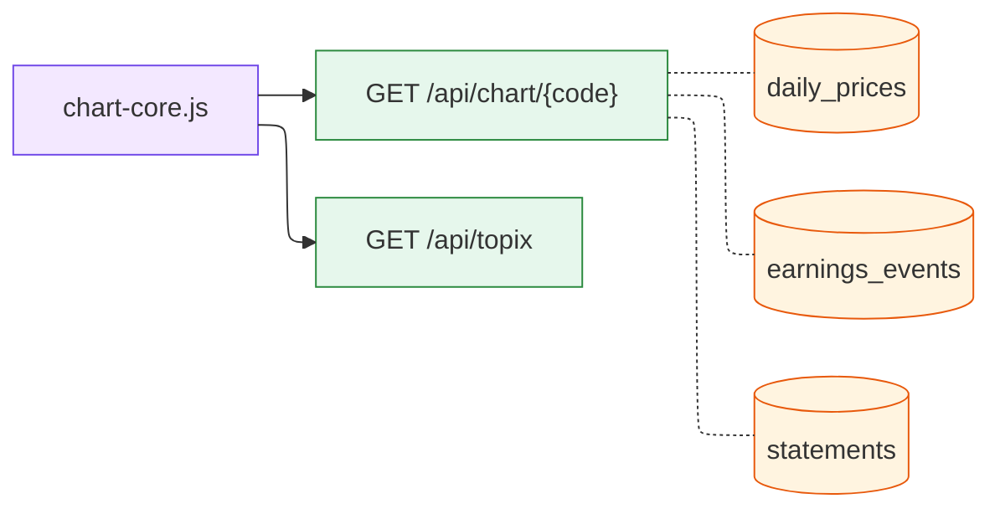

# 画面設計: 共通

**自動生成。手で直さない。** 読み方と作り方は [SCREENS.md](../../SCREENS.md)。

## 呼ぶ API と表

左から JS のファイル、API、表。API から表への実線は書く、点線は読むだけ。`stocks` を読むだけの線は省く。

| API | 呼ぶ JS | 書く | 読むだけ |
|---|---|---|---|
| `GET /api/chart/{code}` | `chart-core.js` |  | `daily_prices`, `earnings_events`, `statements`, `stocks` |
| `GET /api/topix` | `chart-core.js` |  |  |

## API の引数

### GET /api/chart/{code}

| 引数 | 場所 | 型 | 必須 | 既定 |
|---|---|---|---|---|
| `code` | path | string | ○ |  |

### GET /api/topix

引数: なし
