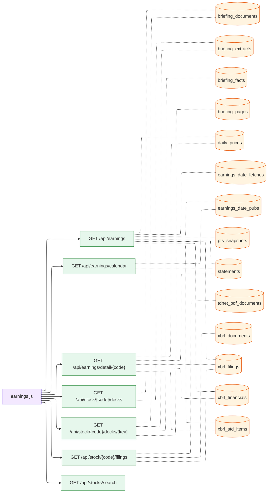

# 画面設計: 決算速報

読み方と作り方は [SCREENS.md](../../SCREENS.md)。

## 画面

| 画面 | id | ハッシュ |
|---|---|---|
| 決算速報 | `earnings` | `#earnings` |

## 呼ぶ API と表

左から JS のファイル、API、表。API から表への実線は書き込み、点線は読み取りだけ。`stocks` を読み取るだけの線は省く。

| API | 呼ぶ JS | 書き込み | 読み取りだけ |
|---|---|---|---|
| `GET /api/earnings` | `earnings.js` |  | `daily_prices`, `earnings_date_fetches`, `earnings_date_pubs`, `pts_snapshots`, `statements`, `stocks`, `xbrl_filings`, `xbrl_financials`, `xbrl_std_items` |
| `GET /api/earnings/calendar` | `earnings.js` |  | `earnings_date_pubs`, `statements`, `stocks` |
| `GET /api/earnings/detail/{code}` | `earnings.js` |  | `daily_prices`, `statements`, `stocks`, `xbrl_filings`, `xbrl_financials`, `xbrl_std_items` |
| `GET /api/stock/{code}/decks` | `earnings.js` |  | `briefing_documents`, `briefing_extracts`, `stocks` |
| `GET /api/stock/{code}/decks/{key}` | `earnings.js` |  | `briefing_documents`, `briefing_extracts`, `briefing_facts`, `briefing_pages` |
| `GET /api/stock/{code}/filings` | `earnings.js` |  | `stocks`, `tdnet_pdf_documents`, `xbrl_documents`, `xbrl_filings` |
| `GET /api/stocks/search` | `earnings.js` |  | `stocks` |

## API の引数

### GET /api/earnings

| 引数 | 場所 | 型 | 必須 | 既定 |
|---|---|---|---|---|
| `date` | query | string | ○ |  |
| `today` | query | string（`^\d{4}-\d{2}-\d{2}$`） |  |  |

### GET /api/earnings/calendar

| 引数 | 場所 | 型 | 必須 | 既定 |
|---|---|---|---|---|
| `month` | query | string（`^\d{4}-\d{2}$`） | ○ |  |
| `today` | query | string（`^\d{4}-\d{2}-\d{2}$`） |  |  |

### GET /api/earnings/detail/{code}

| 引数 | 場所 | 型 | 必須 | 既定 |
|---|---|---|---|---|
| `code` | path | string | ○ |  |
| `date` | query | string |  |  |
| `disclosure_no` | query | string |  |  |
| `rev_source` | query | string（`^(jquants\|xbrl)$`） |  |  |

### GET /api/stock/{code}/decks

| 引数 | 場所 | 型 | 必須 | 既定 |
|---|---|---|---|---|
| `code` | path | string | ○ |  |

### GET /api/stock/{code}/decks/{key}

| 引数 | 場所 | 型 | 必須 | 既定 |
|---|---|---|---|---|
| `code` | path | string | ○ |  |
| `key` | path | string | ○ |  |

### GET /api/stock/{code}/filings

| 引数 | 場所 | 型 | 必須 | 既定 |
|---|---|---|---|---|
| `code` | path | string | ○ |  |

### GET /api/stocks/search

| 引数 | 場所 | 型 | 必須 | 既定 |
|---|---|---|---|---|
| `q` | query | string | ○ |  |
