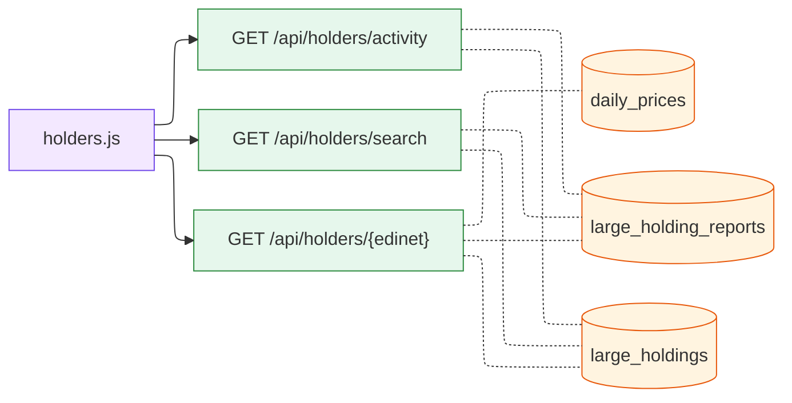

# 画面設計: 大量保有報告書

読み方と作り方は [SCREENS.md](../../SCREENS.md)。

## 画面

| 画面 | id | ハッシュ |
|---|---|---|
| 大量保有報告書 | `holders` | `#holders` |
| 保有者 | `holders-detail` | `#holders/:edinet` |

## 呼ぶ API と表

左から JS のファイル、API、表。API から表への実線は書き込み、点線は読み取りだけ。`stocks` を読み取るだけの線は省く。

| API | 呼ぶ JS | 書き込み | 読み取りだけ |
|---|---|---|---|
| `GET /api/holders/activity` | `holders.js` |  | `large_holding_reports`, `large_holdings`, `stocks` |
| `GET /api/holders/search` | `holders.js` |  | `large_holding_reports`, `large_holdings`, `stocks` |
| `GET /api/holders/{edinet}` | `holders.js` |  | `daily_prices`, `large_holding_reports`, `large_holdings`, `stocks` |

## API の引数

### GET /api/holders/activity

| 引数 | 場所 | 型 | 必須 | 既定 |
|---|---|---|---|---|
| `limit` | query | integer |  | `80` |
| `offset` | query | integer |  | `0` |
| `file_date` | query | string（`^\d{4}-\d{2}-\d{2}$`） |  |  |
| `q` | query | string |  | `` |

### GET /api/holders/search

| 引数 | 場所 | 型 | 必須 | 既定 |
|---|---|---|---|---|
| `q` | query | string |  | `` |

### GET /api/holders/{edinet}

| 引数 | 場所 | 型 | 必須 | 既定 |
|---|---|---|---|---|
| `edinet` | path | string | ○ |  |
| `today` | query | string（`^\d{4}-\d{2}-\d{2}$`） |  |  |
