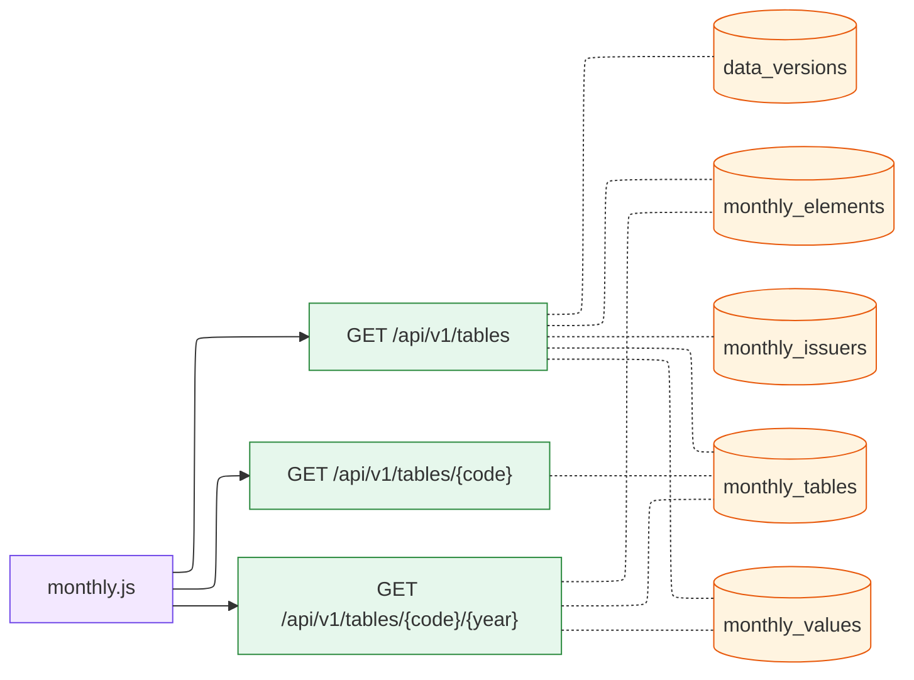

# 画面設計: 月次

**自動生成。手で直さない。** 読み方と作り方は [SCREENS.md](../../SCREENS.md)。

## 画面

| 画面 | id | ハッシュ |
|---|---|---|
| 月次 | `monthly` | `#monthly` |
| 月次詳細 | `monthly-detail` | `#monthly/:code` |

## 呼ぶ API と表

左から JS のファイル、API、表。API から表への実線は書く、点線は読むだけ。`stocks` を読むだけの線は省く。

| API | 呼ぶ JS | 書く | 読むだけ |
|---|---|---|---|
| `GET /api/v1/tables` | `monthly.js` |  | `data_versions`, `monthly_elements`, `monthly_issuers`, `monthly_tables`, `monthly_values`, `stocks` |
| `GET /api/v1/tables/{code}` | `monthly.js` |  | `monthly_tables` |
| `GET /api/v1/tables/{code}/{year}` | `monthly.js` |  | `monthly_elements`, `monthly_tables`, `monthly_values` |

## API の引数

### GET /api/v1/tables

引数: なし

### GET /api/v1/tables/{code}

| 引数 | 場所 | 型 | 必須 | 既定 |
|---|---|---|---|---|
| `code` | path | string | ○ |  |

### GET /api/v1/tables/{code}/{year}

| 引数 | 場所 | 型 | 必須 | 既定 |
|---|---|---|---|---|
| `code` | path | string | ○ |  |
| `year` | path | string | ○ |  |
