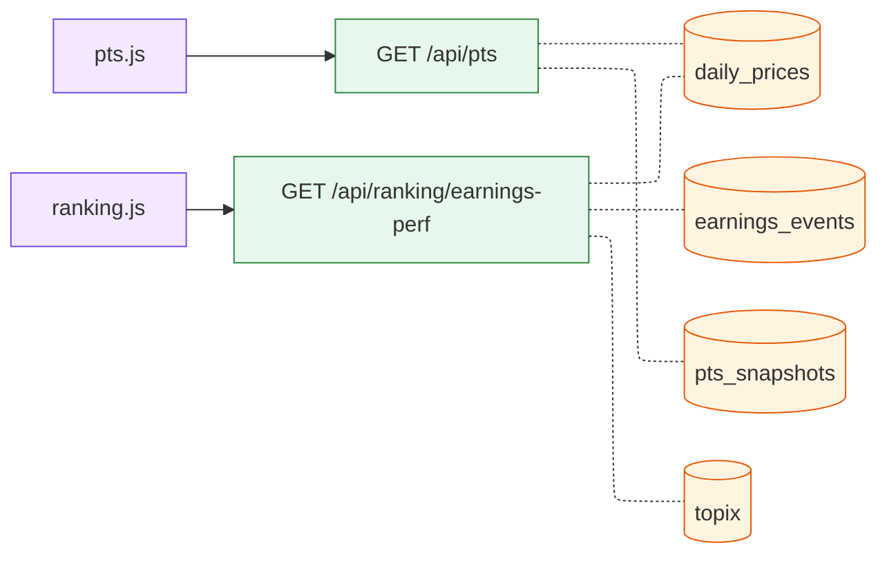

# 画面設計: ランキング

**自動生成。手で直さない。** 読み方と作り方は [SCREENS.md](../../SCREENS.md)。

## 画面

| 画面 | id | ハッシュ |
|---|---|---|
| ランキング | `ranking` | `#ranking` |
| PTS | `ranking-pts` | `#ranking/pts` |

## 呼ぶ API と表

左から JS のファイル、API、表。API から表への実線は書く、点線は読むだけ。`stocks` を読むだけの線は省く。

| API | 呼ぶ JS | 書く | 読むだけ |
|---|---|---|---|
| `GET /api/pts` | `pts.js` |  | `daily_prices`, `pts_snapshots` |
| `GET /api/ranking/earnings-perf` | `ranking.js` |  | `daily_prices`, `earnings_events`, `stocks`, `topix` |

## API の引数

### GET /api/pts

| 引数 | 場所 | 型 | 必須 | 既定 |
|---|---|---|---|---|
| `date` | query | string（date） |  |  |
| `ranking` | query | string |  | `night_up` |
| `at` | query | string（date-time） |  |  |

### GET /api/ranking/earnings-perf

| 引数 | 場所 | 型 | 必須 | 既定 |
|---|---|---|---|---|
| `month` | query | string |  |  |
