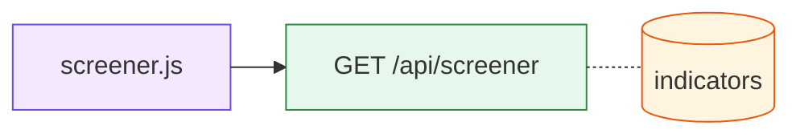

# 画面設計: スクリーナー

読み方と作り方は [SCREENS.md](../../SCREENS.md)。

## 画面

| 画面 | id | ハッシュ |
|---|---|---|
| スクリーナー | `screener` | `#screener` |

## 呼ぶ API と表

左から JS のファイル、API、表。API から表への実線は書く、点線は読むだけ。`stocks` を読むだけの線は省く。

| API | 呼ぶ JS | 書く | 読むだけ |
|---|---|---|---|
| `GET /api/screener` | `screener.js` |  | `indicators`, `stocks` |

## API の引数

### GET /api/screener

| 引数 | 場所 | 型 | 必須 | 既定 |
|---|---|---|---|---|
| `stage` | query | integer |  |  |
| `rs_min` | query | integer |  | `0` |
| `sort` | query | string |  | `rs` |
| `limit` | query | integer |  | `100` |
