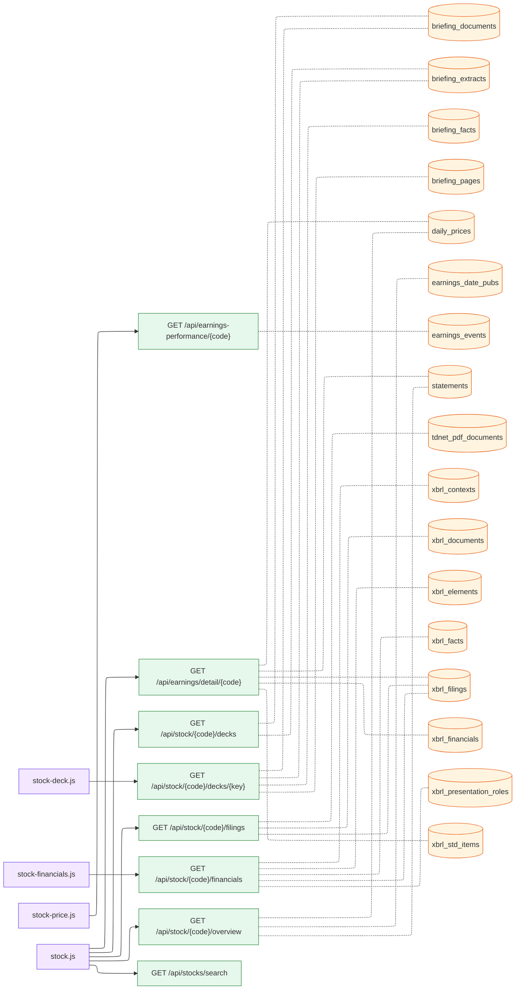

# 画面設計: 銘柄

**自動生成。手で直さない。** 読み方と作り方は [SCREENS.md](../../SCREENS.md)。

## 画面

| 画面 | id | ハッシュ |
|---|---|---|
| 銘柄 | `stock` | `#stock` |
| 概要 | `stock-summary` | `#stock/:code` `#stock/:code/summary` |
| 株価 | `stock-price` | `#stock/:code/price` |
| 業績詳細 | `stock-financials` | `#stock/:code/financials` |
| ニュース | `stock-news` | `#stock/:code/news` |
| ニュース詳細 | `stock-news-detail` | `#stock/:code/news/:newsId` |
| 株主 | `stock-holders` | `#stock/:code/holders` |
| 説明資料の中身 | `stock-deck-detail` | `#stock/:code/decks/:deckKey` |

## 呼ぶ API と表

左から JS のファイル、API、表。API から表への実線は書く、点線は読むだけ。`stocks` を読むだけの線は省く。

| API | 呼ぶ JS | 書く | 読むだけ |
|---|---|---|---|
| `GET /api/earnings-performance/{code}` | `stock-price.js` |  | `earnings_events` |
| `GET /api/earnings/detail/{code}` | `stock.js` |  | `daily_prices`, `statements`, `stocks`, `xbrl_filings`, `xbrl_financials`, `xbrl_std_items` |
| `GET /api/stock/{code}/decks` | `stock.js` |  | `briefing_documents`, `briefing_extracts`, `stocks` |
| `GET /api/stock/{code}/decks/{key}` | `stock-deck.js` |  | `briefing_documents`, `briefing_extracts`, `briefing_facts`, `briefing_pages` |
| `GET /api/stock/{code}/filings` | `stock.js` |  | `stocks`, `tdnet_pdf_documents`, `xbrl_documents`, `xbrl_filings` |
| `GET /api/stock/{code}/financials` | `stock-financials.js` |  | `stocks`, `xbrl_contexts`, `xbrl_elements`, `xbrl_facts`, `xbrl_filings`, `xbrl_presentation_roles` |
| `GET /api/stock/{code}/overview` | `stock.js` |  | `daily_prices`, `earnings_date_pubs`, `statements`, `stocks` |
| `GET /api/stocks/search` | `stock.js` |  | `stocks` |

## API の引数

### GET /api/earnings-performance/{code}

| 引数 | 場所 | 型 | 必須 | 既定 |
|---|---|---|---|---|
| `code` | path | string | ○ |  |

### GET /api/earnings/detail/{code}

| 引数 | 場所 | 型 | 必須 | 既定 |
|---|---|---|---|---|
| `code` | path | string | ○ |  |
| `date` | query | string |  |  |
| `disclosure_no` | query | string |  |  |
| `rev_source` | query | string（`^(jquants\|xbrl)$`） |  |  |

### GET /api/stock/{code}/decks

| 引数 | 場所 | 型 | 必須 | 既定 |
|---|---|---|---|---|
| `code` | path | string | ○ |  |

### GET /api/stock/{code}/decks/{key}

| 引数 | 場所 | 型 | 必須 | 既定 |
|---|---|---|---|---|
| `code` | path | string | ○ |  |
| `key` | path | string | ○ |  |

### GET /api/stock/{code}/filings

| 引数 | 場所 | 型 | 必須 | 既定 |
|---|---|---|---|---|
| `code` | path | string | ○ |  |

### GET /api/stock/{code}/financials

| 引数 | 場所 | 型 | 必須 | 既定 |
|---|---|---|---|---|
| `code` | path | string | ○ |  |
| `statement` | query | string（`^(BS\|PL\|CF)$`） |  | `BS` |
| `periods` | query | integer |  | `8` |
| `consolidated` | query | string（`^(auto\|true\|false)$`） |  | `auto` |

### GET /api/stock/{code}/overview

| 引数 | 場所 | 型 | 必須 | 既定 |
|---|---|---|---|---|
| `code` | path | string | ○ |  |
| `today` | query | string（`^\d{4}-\d{2}-\d{2}$`） |  |  |

### GET /api/stocks/search

| 引数 | 場所 | 型 | 必須 | 既定 |
|---|---|---|---|---|
| `q` | query | string | ○ |  |
