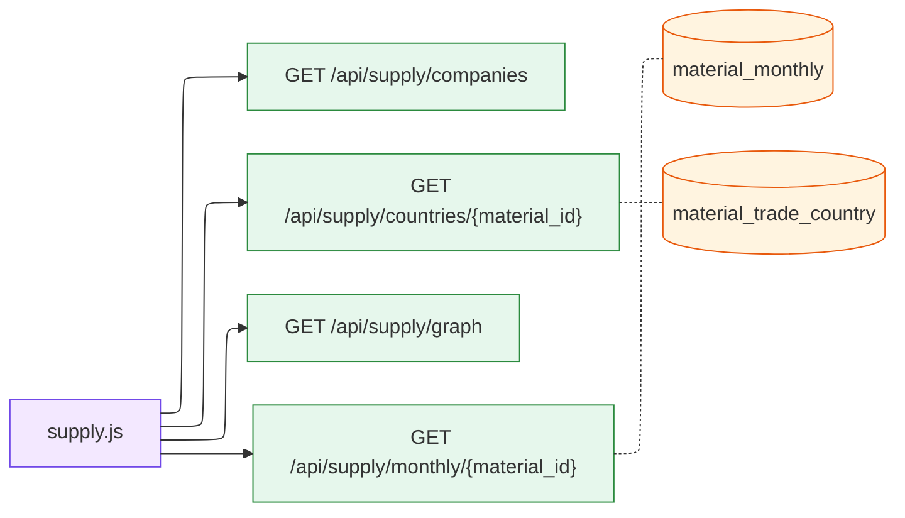

# 画面設計: サプライ

読み方と作り方は [SCREENS.md](../../SCREENS.md)。

## 画面

| 画面 | id | ハッシュ |
|---|---|---|
| サプライ | `supply` | `#supply` `#supply/:id?` |

## 呼ぶ API と表

左から JS のファイル、API、表。API から表への実線は書く、点線は読むだけ。`stocks` を読むだけの線は省く。

| API | 呼ぶ JS | 書く | 読むだけ |
|---|---|---|---|
| `GET /api/supply/companies` | `supply.js` |  |  |
| `GET /api/supply/countries/{material_id}` | `supply.js` |  | `material_trade_country` |
| `GET /api/supply/graph` | `supply.js` |  |  |
| `GET /api/supply/monthly/{material_id}` | `supply.js` |  | `material_monthly` |

## API の引数

### GET /api/supply/companies

引数: なし

### GET /api/supply/countries/{material_id}

| 引数 | 場所 | 型 | 必須 | 既定 |
|---|---|---|---|---|
| `material_id` | path | string | ○ |  |
| `flow` | query | string |  | `import` |

### GET /api/supply/graph

引数: なし

### GET /api/supply/monthly/{material_id}

| 引数 | 場所 | 型 | 必須 | 既定 |
|---|---|---|---|---|
| `material_id` | path | string | ○ |  |
